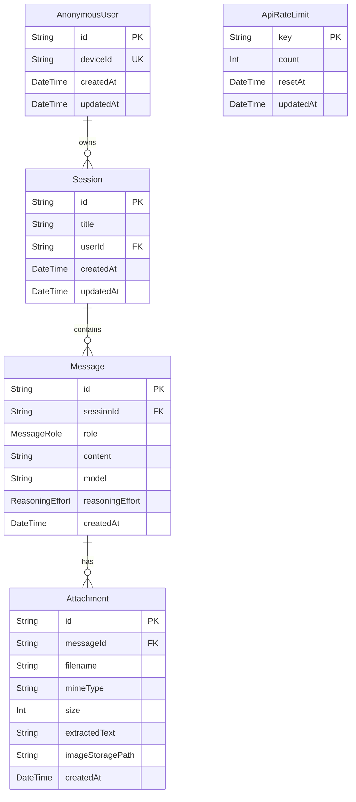

# StudyMate ER Diagram



## Notes

- `AnonymousUser.deviceId` is unique and comes from the signed anonymous auth cookie.
- `Session.userId` references `AnonymousUser.id`; deleting a user cascades to sessions.
- `Message.sessionId` references `Session.id`; deleting a session cascades to messages.
- `Attachment.messageId` references `Message.id`; deleting a message cascades to attachments.
- `Attachment.imageStoragePath` stores only the server-side image path; image binaries stay outside PostgreSQL.
- `ApiRateLimit` is standalone and keyed by a rate-limit identity.

## Enums

```text
MessageRole:
- USER
- ASSISTANT
- SYSTEM

ReasoningEffort:
- NONE
- LOW
- MEDIUM
- HIGH
- XHIGH
```

## Indexes

```text
AnonymousUser:
- unique(deviceId)

Session:
- index(userId, updatedAt)

Message:
- index(sessionId, createdAt)

Attachment:
- index(messageId)
```
