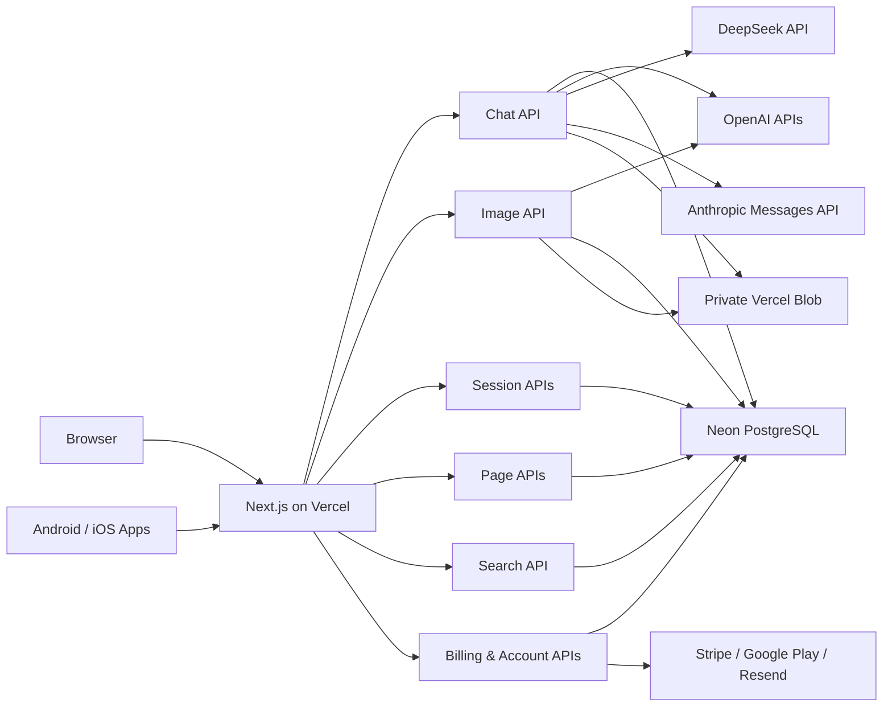

# NoteFable Architecture

这个目录的目的不是写“漂亮的设计文档”，而是让未来的自己在几个月没有维护之后，能快速恢复对系统的理解。

先读入门版：[项目全景图](../project-map.md)，用大白话讲整体结构、签名、发布和收费。

文档原则：

1. **先记录真实实现，再写建议目标。**
2. **数据怎么流比用了什么技术更重要。**
3. 架构图使用 Mermaid，跟代码一起版本管理。
4. 数据库结构以实际 Neon + Prisma schema 为准。
5. 部署状态以 Vercel / Neon 实际资源和当前部署记录为准。

## 5 分钟恢复上下文

按这个顺序看：

1. 本文件 — 系统有哪些组件
2. [chat-flow.md](chat-flow.md) — 用户发一句话之后到底发生什么；也包含项目的共通指示与参考笔记、跨 Chats / Notes 搜索、回答的复制 / 保存到 Notes / Markdown 导出与会话链接、桌面端聊天与笔记分屏
3. [image-flow.md](image-flow.md) — 图片上传、AI 生成图片、图片保存
4. [provider-requests.md](provider-requests.md) — 三家模型的上游请求结构、工具循环与压缩续传
5. [database.md](database.md) — Neon 里有哪些表、关系是什么
6. [deployment.md](deployment.md) — GitHub、Vercel、Neon 如何组合；Google / 邮箱登录配置
7. [notes-flow.md](notes-flow.md) — 站内页面、区块编辑、自动保存与冲突恢复、Trash 与编辑历史、Markdown 导出 / 导入、笔记里的 AI 助手（选中文字提问与对话恢复）
8. [android.md](android.md) — Android 开发环境、APK 交付、App 内登录、手机网页排版
9. [android-native.md](android-native.md) — Kotlin / Compose 客户端、模型列表与网页界面对齐
10. [ios.md](ios.md) — iOS PR 检查、App Store Connect / TestFlight 自动打包上传与云端签名
    - [ios-native.md](ios-native.md) — Swift / SwiftUI 客户端的结构、与 Android 的对应、现状与上线前还缺的部分
11. [i18n.md](i18n.md) — 17 种界面语言（含阿拉伯语 RTL）、自动检测、语言 Cookie、账号同步与原生多语言生成
12. [billing.md](billing.md) — 月额 Pro（Stripe 与 Google Play 订阅、30 天免费试用）、各档位用量上限和定价依据

## 一张图先记住整个项目



## 最重要的源文件

| 文件 | 作用 |
| --- | --- |
| `src/app/[locale]/page.tsx`、`src/components/thread-landing.tsx`、`src/app/[locale]/landing.css` | `/` 产品介绍主页（"一根线"滚动叙事）；旧的根路径会话与笔记链接保留查询参数转到 `/app` |
| `src/app/[locale]/app/page.tsx` | `/app` 聊天与 Notes 工作区、输入框、附件、发送、图片生成模式 |
| `src/app/[locale]/note-embed/page.tsx`、`src/components/note-embed.tsx`、`src/lib/native-bridge.ts` | Android / iOS 内嵌笔记编辑器页面与 JS 桥接约定 |
| `src/lib/hosts.ts`、`src/proxy.ts`、`src/lib/i18n/routing.ts` | 介绍页（`notefable.com`）与工作区（`app.notefable.com`）分域：按主机分流、旧链接转发、共享提示 Cookie（[deployment.md](deployment.md)） |
| `src/lib/i18n/locale.ts`、`src/app/api/i18n/route.ts` | 17 种语言注册表、RTL 方向、回退规则与按需词典接口（[i18n.md](i18n.md)） |
| `src/app/api/chat/route.ts` | 普通聊天主流程与共享 `buildInstructions()` |
| `src/lib/chat-branches.ts`、`src/lib/chat-branch-store.ts` | 消息树（`parentId` / `active` / `selectedAt`）、编辑、重新生成、切换版本与分支 |
| `src/app/api/images/route.ts` | 图片生成 / 图片编辑主流程 |
| `src/app/privacy/page.tsx`、`src/app/terms/page.tsx`、`src/app/legal-notice/page.tsx`、`src/app/delete-account/page.tsx` | 公开的隐私权政策、服务条款、特定商取引法に基づく表記（日文）与账号删除说明页 |
| `src/app/api/sessions/*` | 会话列表、历史消息、会话图标、拖动重排、停止生成（`stop`）、版本切换（`versions`）、分支（`branch`）、导出（`export`）与整理成笔记（`page`） |
| `src/app/api/pages/*` | 站内页面 CRUD、版本检查、分组（`groups`）、拖动重排、子页面/收藏/页面设置/复制/图标、封面与附件、原生回答保存（`from-answer`）、回收站（`trash`）、编辑历史（`revisions`）、Markdown 导出（`export`）与导入（`import`）、笔记助手的对话恢复（`assistant`） |
| `src/lib/note-io.ts` | 笔记的 Markdown 导出格式、导入的个数 / 大小 / 扩展名上限与标题提取（[notes-flow.md](notes-flow.md#markdown-导出与导入)） |
| `src/lib/session-messages.ts` | 读取一个会话当前显示的消息（附件、附加笔记、提案）的函数，`GET /api/sessions/:id/messages` 使用 |
| `src/components/split-note-pane.tsx`、`src/lib/split-view.ts` | 桌面端聊天右侧的笔记面板，以及分屏开关、所开笔记和比例的本机保存（[chat-flow.md](chat-flow.md#聊天与笔记分屏)） |
| `src/lib/theme.ts`、`src/lib/theme-init.ts`、`src/components/theme-settings.tsx`、`src/app/globals.css` 的 `:root[data-theme="dark"]` | 外观（跟随系统 / 浅色 / 深色）：本机偏好、首次绘制前写 `data-theme` 的内联脚本、设置里的“外观”一行和深色色板（访客的入口在 `help-menu.tsx`） |
| `src/lib/page-tools.ts`、`src/lib/note-proposals.ts`、`src/app/api/proposals/*` | AI 的 Notes 读写/提案工具定义与提案应用/放弃接口 |
| `src/lib/note-tree.ts`、`src/lib/note-tree-server.ts`、`src/lib/note-trash.ts`、`src/lib/note-revisions.ts` | 子页面树与元数据、Trash 保留期与惰性清理、编辑历史快照与裁剪 |
| `src/components/note-trash-dialog.tsx`、`src/components/note-history-dialog.tsx`、`src/components/note-assistant.tsx` | Trash 对话框、编辑历史/恢复对话框与笔记内 AI 助手面板 |
| `src/components/note-editor.tsx` | 客户端区块编辑器及允许的区块类型 |
| `src/lib/note-save-queue.ts` | 自动保存队列、重试和冲突状态 |
| `src/lib/custom-instructions.ts`、`src/app/api/custom-instructions/route.ts`、`src/components/settings-dialog.tsx`、`src/lib/settings-navigation.ts` | 已登录用户的自定义指令与设置界面（通用/个性化/方案/账号，手机两级导航），整合个人资料（`profile-settings.tsx`）、语言、外观（`theme-settings.tsx`）、AI 角色图标（`app-icon-settings.tsx`）、方案（`plan-settings.tsx`）与退出/删号 |
| `src/lib/characters.ts`、`src/lib/app-icon.ts` | 7 个预设 AI 角色与本机图标配置 |
| `src/lib/chat-project-context.ts`、`src/app/api/chat-projects/*`、`src/components/chat-project-settings.tsx` | 聊天项目的共通指示与参考笔记：读取、截断、写入系统指令，及设置界面 |
| `src/app/api/search/route.ts`、`src/lib/search.ts`、`src/lib/search-fold.ts`、`src/components/search-dialog.tsx`、`src/lib/search-reveal.ts` | 跨 Chats / Notes 关键词搜索（表记折叠、附件文本、项目过滤）、搜索面板、跳到命中的消息或块 |
| `src/components/answer-actions.tsx`、`src/lib/answer-export.ts`、`src/lib/answer-export-server.ts`、`src/lib/clipboard.ts`、`src/app/api/reports/route.ts`、`src/lib/answer-report.ts` | 回答操作行与菜单（Regenerate / Branch / Copy / Save to page / Download conversation / Report answer）及 `/c/<会话>?message=` 会话链接 |
| `src/app/api/attachments/[attachmentId]/image/route.ts` | 保存图片的受控读取入口 |
| `src/lib/auth.ts`、`src/app/api/account/*`、`src/lib/account-deletion.ts`、`src/lib/deleted-accounts.ts` | 匿名设备 Cookie 与账号识别、个人资料与头像接口、账号删除与旧登录 Cookie 作废 |
| `src/lib/google-auth.ts`、`src/app/api/auth/[...nextauth]/route.ts` | Auth.js（JWT 会话）的 Google 登录；未配置环境变量时停用 |
| `src/lib/email-login.ts`、`src/app/api/auth/email/*`、`src/components/sign-in-dialog.tsx` | 邮箱验证码登录（发码、校验、签发同样的会话 Cookie）和登录弹窗（Google / 邮箱）；配置见 [deployment.md](deployment.md) |
| `src/lib/native-google-login.ts`、`src/app/api/native-auth/*` | Android / iOS 原生 App 内的 Google 登录：校验端侧 ID 令牌后签发同样的会话 Cookie（见 [android.md](android.md)、[ios-native.md](ios-native.md)） |
| `src/lib/usage-plans.ts`、`src/lib/usage-limits.ts`、`src/lib/billing.ts`、`src/lib/google-play-billing.ts`、`src/lib/subscription-state.ts`、`src/app/api/billing/*` | 各档位用量上限计数、Stripe 网页订阅、Google Play 订阅与 RTDN 同步（[billing.md](billing.md)） |
| `src/lib/models.ts`、`src/lib/model-registry.ts`、`src/app/api/models/route.ts` | 内置模型能力、推理档位与 `NOTEFABLE_MODELS` 服务端模型注册表 |
| `src/lib/claude-image.ts` | Claude 模型图片副本压缩与尺寸控制，原图保留 |
| `src/lib/files.ts` | 文件校验、PDF/文本抽取、图片预处理 |
| `src/lib/chat-upload-ticket.ts`、`src/lib/chat-uploads.ts`、`src/app/api/uploads/*` | 聊天附件私有 Blob 直传凭证、归属验证、大小检查、临时文件读取与清理 |
| `src/lib/storage.ts` | Vercel Blob 图片存储（本地开发可回退到文件系统） |
| `src/lib/stored-files.ts` | 文件仓库的登记（`StoredFile`）：按套餐的存储上限、引用的认领、未引用文件的清理与盘点（[database.md](database.md#storedfile)） |
| `src/lib/prisma.ts` | Prisma + PostgreSQL adapter、schema 选择 |
| `src/lib/anthropic-messages.ts`、`src/lib/deepseek-responses.ts` | Anthropic Messages API 与 DeepSeek Responses 兼容处理 |
| `prisma/schema.prisma` | 数据模型 |
| `prisma/migrations/` | 数据库变更历史 |

## 图片存储

当前生产实现：

```text
Vercel Function
  -> Private Vercel Blob
  -> PostgreSQL 保存 blob pathname / storage key
```

本地开发在未配置 `BLOB_READ_WRITE_TOKEN` 时回退到 `NOTEFABLE_STORAGE_DIR`，但 Vercel 环境缺少 Blob token 会直接报错，不会把临时文件系统当成持久存储。

## 文档更新时间

本轮文档与主分支代码核对：**2026-11-22**，覆盖产品定位、分域、17 语言、计费与用量、登录与删号、Notes、Android / iOS 客户端、上游请求示例和图片读取。生产数据库连接方式与本地数据库的运行核验仍为 **2026-09-16**，Neon 项目资源核验为 **2026-09-05**；文档同步不代表重新验证了所有线上功能或已交付安装包。
