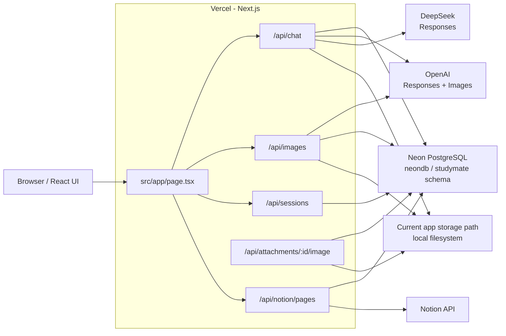

# StudyMate Architecture

这个目录的目的不是写“漂亮的设计文档”，而是让未来的自己在几个月没有维护之后，能快速恢复对系统的理解。

文档原则：

1. **先记录真实实现，再写建议目标。**
2. **数据怎么流比用了什么技术更重要。**
3. 架构图使用 Mermaid，跟代码一起版本管理。
4. 数据库结构以实际 Neon + Prisma schema 为准。
5. 部署状态以 Vercel / Neon 实际资源为准，不沿用历史 Render 假设。

## 5 分钟恢复上下文

按这个顺序看：

1. [system-overview.md](system-overview.md) — 系统有哪些组件
2. [chat-flow.md](chat-flow.md) — 用户发一句话之后到底发生什么
3. [image-flow.md](image-flow.md) — 图片上传、AI 生成图片、图片保存
4. [database.md](database.md) — Neon 里有哪些表、关系是什么
5. [deployment.md](deployment.md) — GitHub、Vercel、Neon 如何组合

## 一张图先记住整个项目



## 最重要的源文件

| 文件 | 作用 |
| --- | --- |
| `src/app/page.tsx` | 前端主页面、输入框、附件、发送、图片生成模式 |
| `src/app/api/chat/route.ts` | 普通聊天主流程 |
| `src/app/api/images/route.ts` | 图片生成 / 图片编辑主流程 |
| `src/app/api/sessions/*` | 会话与历史消息读取 |
| `src/app/api/attachments/[attachmentId]/image/route.ts` | 保存图片的受控读取入口 |
| `src/app/api/notion/pages/route.ts` | 导出到 Notion |
| `src/lib/auth.ts` | 匿名设备 Cookie / 用户识别 |
| `src/lib/models.ts` | 模型能力、推理档位 |
| `src/lib/files.ts` | 文件校验、PDF/文本抽取、图片预处理 |
| `src/lib/storage.ts` | 当前图片本地文件存储 |
| `src/lib/prisma.ts` | Prisma + PostgreSQL adapter、schema 选择 |
| `src/lib/deepseek-responses.ts` | DeepSeek Responses 兼容处理 |
| `src/lib/notion.ts` | Notion API 写入 |
| `prisma/schema.prisma` | 数据模型 |
| `prisma/migrations/` | 数据库变更历史 |

## 当前明确的架构债务

### 图片存储

当前实现：

```text
Vercel Function
  -> fs.writeFile()
  -> STUDYMATE_STORAGE_DIR
```

这个实现来自常驻服务器思路，但当前生产已经是 Vercel。它不应该作为长期持久文件方案。

建议目标：

```text
Vercel Function
  -> Private Vercel Blob
  -> PostgreSQL 保存 blob pathname / storage key
```

这只是**建议目标，尚未实现**。

## 文档更新时间

最后核对实际 GitHub / Vercel / Neon 状态：**2026-09-05**。
