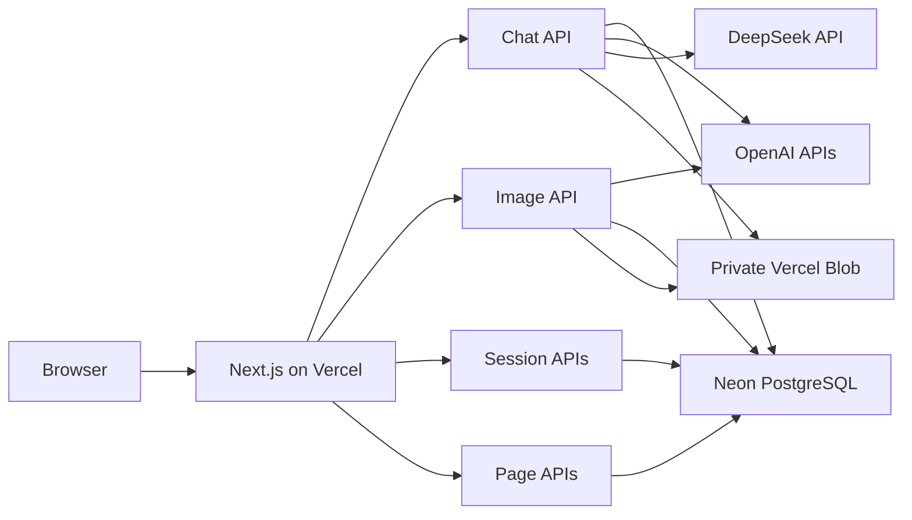

# StudyMate Architecture

这个目录的目的不是写“漂亮的设计文档”，而是让未来的自己在几个月没有维护之后，能快速恢复对系统的理解。

文档原则：

1. **先记录真实实现，再写建议目标。**
2. **数据怎么流比用了什么技术更重要。**
3. 架构图使用 Mermaid，跟代码一起版本管理。
4. 数据库结构以实际 Neon + Prisma schema 为准。
5. 部署状态以 Vercel / Neon 实际资源和当前部署记录为准。

## 5 分钟恢复上下文

按这个顺序看：

1. 本文件 — 系统有哪些组件
2. [chat-flow.md](chat-flow.md) — 用户发一句话之后到底发生什么
3. [image-flow.md](image-flow.md) — 图片上传、AI 生成图片、图片保存
5. [database.md](database.md) — Neon 里有哪些表、关系是什么
6. [deployment.md](deployment.md) — GitHub、Vercel、Neon 如何组合
7. [notes-flow.md](notes-flow.md) — 站内页面、区块编辑、自动保存与冲突恢复

## 一张图先记住整个项目



## 最重要的源文件

| 文件 | 作用 |
| --- | --- |
| `src/app/page.tsx` | 前端主页面、输入框、附件、发送、图片生成模式 |
| `src/app/api/chat/route.ts` | 普通聊天主流程 |
| `src/app/api/images/route.ts` | 图片生成 / 图片编辑主流程 |
| `src/app/api/sessions/*` | 会话与历史消息读取 |
| `src/app/api/pages/*` | 站内页面 CRUD、匿名归属和版本检查 |
| `src/components/note-editor.tsx` | 客户端区块编辑器及允许的区块类型 |
| `src/lib/note-save-queue.ts` | 自动保存队列、重试和冲突状态 |
| `src/app/api/attachments/[attachmentId]/image/route.ts` | 保存图片的受控读取入口 |
| `src/lib/auth.ts` | 匿名设备 Cookie / 用户识别；已 Google 登录时返回对应账号的用户 |
| `src/lib/google-auth.ts`、`src/app/api/auth/[...nextauth]/route.ts` | Auth.js（JWT 会话）的 Google 登录；未配置环境变量时停用 |
| `src/lib/models.ts` | 模型能力、推理档位 |
| `src/lib/files.ts` | 文件校验、PDF/文本抽取、图片预处理 |
| `src/lib/storage.ts` | Vercel Blob 图片存储（本地开发可回退到文件系统） |
| `src/lib/prisma.ts` | Prisma + PostgreSQL adapter、schema 选择 |
| `src/lib/deepseek-responses.ts` | DeepSeek Responses 兼容处理 |
| `prisma/schema.prisma` | 数据模型 |
| `prisma/migrations/` | 数据库变更历史 |

## 图片存储

当前生产实现：

```text
Vercel Function
  -> Private Vercel Blob
  -> PostgreSQL 保存 blob pathname / storage key
```

本地开发在未配置 `BLOB_READ_WRITE_TOKEN` 时回退到 `STUDYMATE_STORAGE_DIR`，但 Vercel 环境缺少 Blob token 会直接报错，不会把临时文件系统当成持久存储。

## 文档更新时间

GitHub / Vercel 部署、生产数据库连接方式与本地数据库：**2026-09-16**。Neon 项目资源信息：**2026-09-05**。
