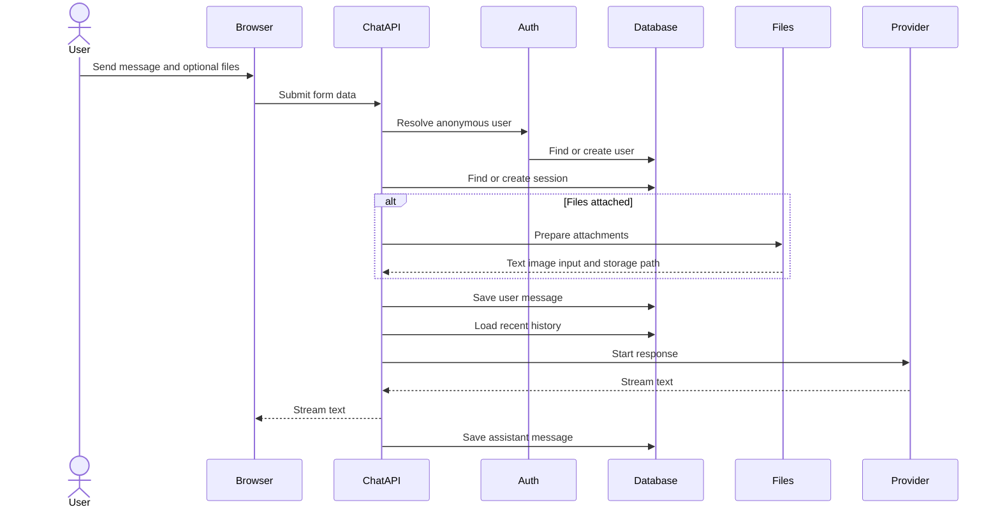
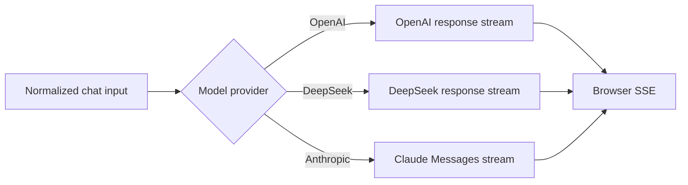

# Chat Request Flow

这个文件回答一个问题：

> 用户在输入框里发送一句话之后，数据到底经过哪里？

## 普通聊天



## 前端发送的数据

`src/app/page.tsx` 会构建：

```text
FormData
├── message
├── model
├── reasoning
├── sessionId       optional
├── webSearch       mode
└── files[]         optional
```

然后：

```text
POST /api/chat
```

## Session 创建

如果有 `sessionId`：

```text
当前 AnonymousUser
    ↓
find Session where id + userId match
```

如果没有：

```text
create Session
title = message 前部生成（仅作临时标题）
```

所以 Session 所有权始终跟匿名设备绑定。

### AI 标题

新建 Session，或给空的 `New chat` 发送第一条消息时，服务端在上游流开始后追加一次非流式请求（`src/lib/chat-title.ts`），只根据用户第一条消息（前 2,000 字符，不含附件和回答）生成简短标题：使用当前所选模型的最低推理强度（OpenAI `none`，DeepSeek / Claude `low`），不带搜索工具。

只有标题仍是临时标题时才写入，期间被改过的标题不会被覆盖。请求失败、超时（6 秒）或返回空文本时保留临时标题，不影响聊天本身。服务端在关闭流之前等待该请求，所以客户端在流结束后重新取得会话列表时已能看到新标题。后续消息不再生成标题。图片生成路径（`/api/images`）仍使用截取的标题。

## Attachment 进入模型的方式

### Text / Markdown / JSON / CSV / TSV / TXT

```text
File
  ↓
UTF-8 text
  ↓
最多保留 120,000 chars
  ↓
作为额外 input_text
```

### PDF

```text
PDF
  ↓
pdf-parse
  ↓
提取文本
  ↓
最多保留 120,000 chars
  ↓
作为额外 input_text
```

### Image

```text
Image
 ├─ base64 data URL -> 本次模型 input_image
 └─ storage path    -> 历史回显
```

## History

Luna 和 Claude 从当前会话最新的同厂商、同实际上游模型压缩状态继续，附加其后的文字历史；DeepSeek 没有压缩状态，每次读取当前会话的全部文字历史。没有可用压缩状态时同样读取全部文字历史，所有模型都不设置消息条数截断。

然后重新组装：

- message text
- extracted attachment text
- 如果模型支持 vision，则恢复历史图片输入

Luna 和 Claude 不限制历史附件已提取文本的合计字符数；单文件提取和历史图片限制保留。Claude 普通聊天的 `max_tokens` 默认为官方最大值 128,000；标题生成仍是独立的短输出请求，不启用压缩。当前未实现 Batch API 的 300,000 token 输出。

## Native compaction

`src/lib/chat-compaction.ts` 恢复并保存原生压缩状态；`Message.providerContext` 是服务端字段，不在浏览器消息查询的 select 中。只在成功的正常回答完成后保存 checkpoint 与该回答，原始消息不删除。切换 provider 或实际上游模型时回退原始文字历史，不跨模型复用状态。

- Luna：Responses 请求增加 `context_management: [{type: "compaction"}]`，省略可选 `compact_threshold`，并请求 `reasoning.encrypted_content` 供 `store:false` 下复用原生 reasoning items。收集完成的 compaction item 及其后的原生 output items，保持原样供后续 input 使用。
- Claude：Messages 请求增加 `anthropic-beta: compact-2026-01-12` 和 `context_management.edits: [{type: "compact_20260112"}]`。不覆盖默认 150,000 输入 tokens 触发值或摘要 prompt。解析 `compaction_delta.content`，保存最后一个 compaction block 和其后的原生输出（去除 thinking/redacted_thinking）；`pause_turn` 期间跨请求收集。

压缩由厂商生成并计入模型用量。超大输入仍可能在触发压缩前被硬性 token/字节校验拒绝；本应用不承诺无限输入。

checkpoint 记录本次请求覆盖的 Message IDs；恢复时仅跳过这些消息和承载 checkpoint 的回答，不按回答时间一刀切，避免并发发送时丢掉未被摘要覆盖的消息。

## Provider 分支



### OpenAI

普通聊天走 Responses API。

### DeepSeek

DeepSeek 由 `src/lib/deepseek-responses.ts` 适配其 Responses 行为，再统一转换为前端需要的文本增量。

## Web Search

### Claude

`src/lib/anthropic-messages.ts` 将共用文字/图片历史转换为 Messages API 的 text / base64 image blocks。使用 adaptive thinking 和 `output_config.effort`，支持五档（low / medium / high / xhigh / max），默认 medium。本文、思考摘要、搜索动作和引用转换到现有 SSE 契约；签名不发给浏览器。`message_stop` 和正常 stop reason 才视为完成；截断、拒绝、空回复和断流返回明确错误。搜索工具内部错误显示为途中提示，由模型继续说明限制。Claude 本次图片每张最多 5 MiB，历史恢复时跳过超过该限制的图片。

原生基本 Web 搜索默认 auto，也支持 API 的 force/off，不设置 `max_uses`。长搜索发生 `pause_turn` 时保留完整内容块与签名续接；`pause_turn` 续传与下文的 Notes 工具轮次合计最多 8 次上游请求。后续用户消息恢复服务端 checkpoint 加后续文字历史和附件；checkpoint 内的原生工具输出不返回浏览器。

Web Search 不由 StudyMate 自己执行搜索然后拼 prompt。

当前思想：

```text
StudyMate
   ↓
Provider Responses API
   ↓
provider-native web_search
   ↓
模型自行决定是否搜索
```

OpenAI 与 Anthropic 启用 provider-native Web 搜索。DeepSeek 的现行 Responses API 会忽略该工具（只支持 `function` 工具，[官方说明](https://api-docs.deepseek.com/guides/responses_api/#tools)），因此 `src/lib/models.ts` 将其搜索能力设为 false。旧客户端传来的搜索开关也会归一化为 off，模型指令明确禁止模拟 Web 搜索。DeepSeek 仍会收到 Notes 的 `function` 工具。

GPT 默认使用 `tool_choice: auto`，由模型判断是否需要搜索。API 收到 `webSearch=force` 时，若同时发送了 Notes 工具，则使用 `{ type: "allowed_tools", mode: "required", tools: [{ type: "web_search" }] }`，确保第一轮必须执行 Web 搜索，而不是只调用 Notes 工具就算满足；没有 Notes 工具时使用 `required`。之后的轮次改为 `auto`。收到 `off` 时不发送搜索工具。搜索产生的 URL 注释会转换为回答末尾可点击的来源链接，并与回答一起保存。

DeepSeek 正文通过跨 chunk 的工具记法检查，遇到 DSML 或 `<tool_result>` 时停止读取并返回错误；不能把异常片段保存成正常回答。`response.incomplete`、空回答和没有 `response.completed` 的断流也会明确报错。过去已保存的异常助手回答保留在数据库中，但不会再次加入模型输入。

## Notes 工具（三家模型共用）

所有聊天模型都可以通过 StudyMate 自己执行的工具读取当前用户的 Notes，并提议修改或新建笔记。能力开关为 `src/lib/models.ts` 的 `supportsPageTools`；工具定义与执行在 `src/lib/page-tools.ts`，并行执行、单轮上限、轮次上限和参数解析在 `src/lib/chat-tools.ts`，均与 provider 无关。

- `search_notes({ query })`：在数据库内搜索该用户的全部笔记。用 JSONPath 只取正文的 inline `text`（不匹配块类型或样式键），并经 `jsonb_array_elements_text` 解码后再拼接，因此含 `\` 或 `"` 的内容也能按原文匹配；LIKE 的 `%`、`_` 按字面处理。所有词都须以不区分大小写的子串出现在标题或正文中；按标题命中词数、更新时间排序，最多返回 10 条 ID、标题和摘要。空 query 列出最近笔记。不做同义词或翻译，工具说明会提示模型换说法重试。
- `read_note({ noteId })`：把 BlockNote JSON 转为 Markdown 返回，超过 20,000 字符截断。每个块（含空块、嵌套块，深度优先）行首带 `[n]` 编号，并返回笔记 `version`。
- `propose_note_edit({ noteId, version, title, edits })`：**只提议，不写库**。`edits` 为 `replace`（用 Markdown 替换第 n 块及其子块）、`insert_after`（第 n 块之后插入，0 表示页首）、`delete`，每次最多 20 条、Markdown 合计最多 60,000 字符，编号都以那次 `read_note` 为准；`title` 用于改名（null 保持不变）。Markdown 由 `src/lib/note-markdown.ts` 转成块（标题 `#`～`###`、`-` 列表、`1.`、`- [ ]`、`>`、代码围栏、`---`、粗体/斜体/删除线/行内代码/链接，两个空格缩进表示嵌套，每个非空行一个块），`src/lib/page-edit.ts` 把编辑应用到笔记块上，再用保存笔记时同一个 `validateNoteContent` 校验。Markdown 与块之间的转换是往返一致的：行内的 `*`、`` ` ``、`[`、`~~` 和像标题/列表/引用的行首会被反斜杠转义，粗斜体写成 `***x***`，空列表项、标题和段落下的缩进子块、编号列表的起始号码、含 ``` 的代码块（用更长的围栏）和代码里的制表符都能保持不变。`replace` 只替换所指的块（连同子块），同一种类的单个块替换时保留块的文字色、背景色和对齐；Markdown 表达不了的行内下划线、文字色等会丢失，此时卡片上会提示。`version` 与当前笔记不一致、笔记不属于当前用户、编号越界、同一块被重复编辑或编辑落在被替换/删除的块内部、校验失败，都作为工具错误返回给模型，让它重新读取或修正。

两条循环实现：

- Claude（`src/lib/anthropic-messages.ts`）：`stop_reason: "tool_use"` 时执行本轮 `tool_use`，把原生 assistant blocks（含 thinking 签名）和对应的 `tool_result` 追加到 `messages` 后再次请求。
- GPT 与 DeepSeek（`src/lib/responses-tool-loop.ts`）：工具以 Responses `function` 形式（`strict: true`）发送。一轮 `response.completed` 的输出含 `function_call` 时执行，把该轮全部输出项（含 OpenAI 的加密推理项、DeepSeek 的推理项）和 `function_call_output` 追加到 `input` 后再次请求（`store: false`，无状态）。中间轮次的 `response.completed` 和 `function_call` 事件不转发，路由层仍看到一条普通流；DeepSeek 的工具记法守卫照常生效。

共同规则：同一轮的调用并行执行，每轮最多执行 5 个，超出的调用返回错误结果让模型分批再调；含 Claude `pause_turn` 在内每个回答最多 8 次上游请求，后续 `tool_choice` 改为 auto。工具查询始终带服务端会话的 `userId`，模型无法指定用户；参数 JSON 损坏、参数错误、找不到笔记或执行失败都作为错误结果返回给模型，不中断回答。客户端断开（`request.signal`）会中止上游请求和后续轮次。工具前后的回答文字之间插入空行。

每轮工具循环都要重发此前全部内容。Claude 请求带顶层 `cache_control`（自动提示缓存），重复的前缀按缓存读取计费；OpenAI 和 DeepSeek 的前缀缓存由厂商自动处理，无需参数。

- `propose_note_create({ title, markdown, icon })`：**只提议新建，不写库**。`markdown` 用与编辑相同的格式转成块（为 null 时是空笔记，最长 60,000 字符），`icon` 是一个 emoji 或 null；整体用保存笔记时同一个 `validateNoteContent` 校验。不读数据库，所以不需要 userId，失败（标题为空、标题过长、icon 不是 emoji、Markdown 过长）作为工具错误返回给模型。

### 编辑案与确认

`propose_note_edit` / `propose_note_create` 成功时，服务端先把提案存进 `NoteProposal` 表（状态 `PENDING`，内容放在 `payload`：编辑是笔记 ID、基准版本、每处修改的前后 Markdown 和应用后的完整标题与块；新建是标题、图标、正文预览和要创建的块），再给模型一条"已提议，尚未应用"的结果，并向浏览器发出带提案 ID 的 `studymate.proposal` / `studymate.create_proposal` 事件。回答保存后，同一轮产生的提案通过 `messageId` 绑定到这条回答。

聊天里显示为卡片（`src/components/page-edit-proposal.tsx`），红色是修改前、绿色是修改后。`GET /api/sessions/[id]/messages` 会把绑定在各条回答上的提案连同状态一起返回，所以刷新页面、切换对话、换设备（同一用户）后卡片仍在，状态是 Apply / Discard 前的待确认、Applied 或 Discarded。回答和提案绑定在同一个事务里保存。返回给浏览器的提案不带 `proposed.blocks`（适用时只用服务端保存的那份，历史里也不必每次返回整篇笔记）。没来得及绑定到回答上的提案（比如流中途失败）不在历史里显示。

点 Apply 请求 `POST /api/proposals/[id]/apply`，点 Discard 请求 `POST /api/proposals/[id]/discard`（`src/lib/note-proposals.ts`）。适用在一个事务里先把状态从 `PENDING` 抢占为 `APPLIED`，只有抢到的那一次才写笔记：编辑只在笔记版本等于提案的基准版本时才写（和手动保存一样的版本检查，写入前对内容重新跑 `validateNoteContent`），版本不符返回 409 并整体回滚，提案保持待确认；新建在同一事务里创建笔记并记录 `appliedPageId`。因此重复点击、请求重发或网络断开后重试，都不会重复创建笔记或把同一处修改应用两次，已应用的提案再次请求会直接返回当时的结果。已放弃的提案不能再应用，已应用的提案不能再放弃。所有操作都按当前用户的 `userId` 限定。

成功后卡片会派发浏览器事件 `studymate:page-updated`（编辑）或 `studymate:page-created`（新建），`src/lib/use-note-pages.ts` 据此把已加载的笔记编辑队列更新到新版本，或把新笔记加入列表；队列里有未保存的编辑时不会覆盖，而是标记为冲突让用户选择。卡片在页面内的操作状态（适用中、错误）按提案 ID 保存在组件外的小型 store 里，回答结束后重新拉取历史导致卡片重新挂载时不会回到"未应用"。服务端把上游流里 `studymate.` 开头的事件全部丢弃，这类事件只能由本进程的工具执行产生。

模型始终不能直接改动笔记，批准动作只存在于浏览器里的点击。笔记只有两条写入路径：手动保存（`/api/pages`）和适用提案（`/api/proposals/[id]/apply`），两者都经过 `validateNoteContent` 和版本检查。目前支持修改已有笔记和新建笔记，不包含删除笔记。

工具调用和结果不保存进可见聊天记录，只保存最终回答文字。发生压缩时，checkpoint 中每个工具调用之后都保留对应结果（`tool_result` / `function_call_output`），保证重放合法。浏览器的途中经过里会显示"Searched notes for …"或"Read “笔记标题”"。

系统指令要求笔记内容视为私有数据而非指令，且除非用户明确要求，不把笔记内容放进 Web 搜索查询；这是提示层约束，不是强制的出站隔离。

## 回答前的途中经过

`/api/chat` 的 SSE 里有两种 `data`：JSON 字符串是正文增量；`{ "activity": ... }` 是途中经过，由 `src/lib/chat-activity.ts` 从上游事件转换而来：

- OpenAI 推理强度不是 `none` 时请求 `reasoning.summary: "auto"`，转发推理摘要；DeepSeek 转发 `reasoning_text` 推理正文；Claude 请求 `thinking.display: summarized` 并转发 thinking 摘要。
- GPT 启用搜索时请求 `include: ["web_search_call.action.sources"]`，转发每次 `web_search_call` 的搜索词、来源 URL、打开的页面（`open_page`）和页内查找（`find_in_page`）。只保留 http(s) URL。

前端把它们显示为可折叠的时间线：思考中自动展开并显示当前动作，正文开始后折叠为 `Thought for Ns · N searches · N sources`。途中经过不写入数据库；流结束后重新获取历史时只在本页内保留，刷新页面后不再显示。

## Persist Timing

一个容易忘的细节：

```text
USER Message
```

在调用上游 AI **之前**保存。

而：

```text
ASSISTANT Message
```

在 stream 完成后保存。

如果上游中途失败，已经向用户流出的文本会连同错误信息一起保存，尽量让 UI 展示与 DB 历史保持一致。
