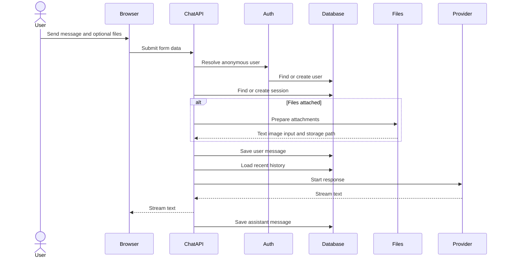
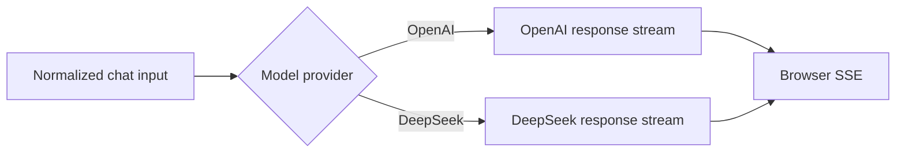
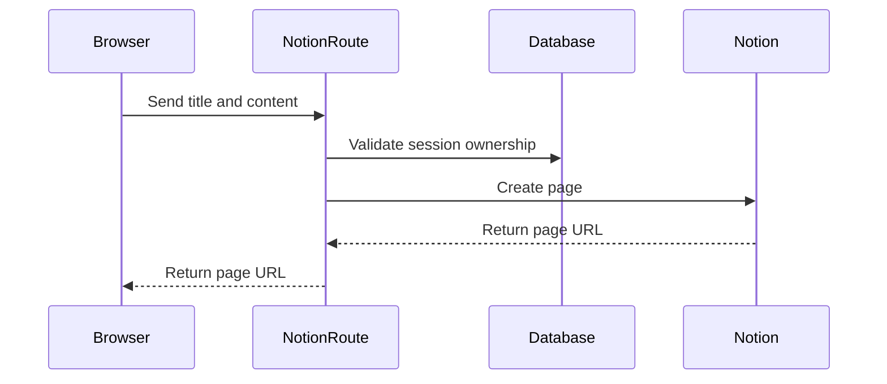

# Chat Request Flow

这个文件回答一个问题：

> 用户在输入框里发送一句话之后，数据到底经过哪里？

## 普通聊天



## 前端发送的数据

`src/app/page.tsx` 会构建：

```text
FormData
├── message
├── model
├── reasoning
├── sessionId       optional
├── webSearch       mode
└── files[]         optional
```

然后：

```text
POST /api/chat
```

## Session 创建

如果有 `sessionId`：

```text
当前 AnonymousUser
    ↓
find Session where id + userId match
```

如果没有：

```text
create Session
title = message 前部生成
```

所以 Session 所有权始终跟匿名设备绑定。

## Attachment 进入模型的方式

### Text / Markdown / JSON / CSV / TSV / TXT

```text
File
  ↓
UTF-8 text
  ↓
最多保留 120,000 chars
  ↓
作为额外 input_text
```

### PDF

```text
PDF
  ↓
pdf-parse
  ↓
提取文本
  ↓
最多保留 120,000 chars
  ↓
作为额外 input_text
```

### Image

```text
Image
 ├─ base64 data URL -> 本次模型 input_image
 └─ storage path    -> 历史回显
```

## History

每次请求不会把整个数据库历史全部发给模型。

当前读取：

```text
最近 30 条 Message
```

然后重新组装：

- message text
- extracted attachment text
- 如果模型支持 vision，则恢复历史图片输入

这样可以控制 token 和数据库读取量。

## Provider 分支



### OpenAI

普通聊天走 Responses API。

### DeepSeek

DeepSeek 由 `src/lib/deepseek-responses.ts` 适配其 Responses 行为，再统一转换为前端需要的文本增量。

## Web Search

Web Search 不由 StudyMate 自己执行搜索然后拼 prompt。

当前思想：

```text
StudyMate
   ↓
Provider Responses API
   ↓
provider-native web_search
   ↓
模型自行决定是否搜索
```

OpenAI 和 DeepSeek 都在 provider 侧处理搜索能力。

## Persist Timing

一个容易忘的细节：

```text
USER Message
```

在调用上游 AI **之前**保存。

而：

```text
ASSISTANT Message
```

在 stream 完成后保存。

如果上游中途失败，已经向用户流出的文本会连同错误信息一起保存，尽量让 UI 展示与 DB 历史保持一致。

## Notion 导出是另一条链路

Notion 导出不经过 `/api/chat`：


