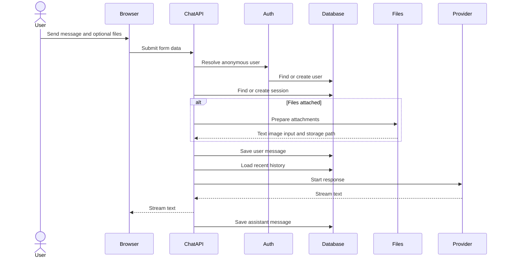
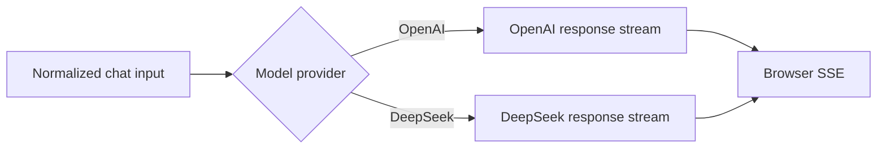
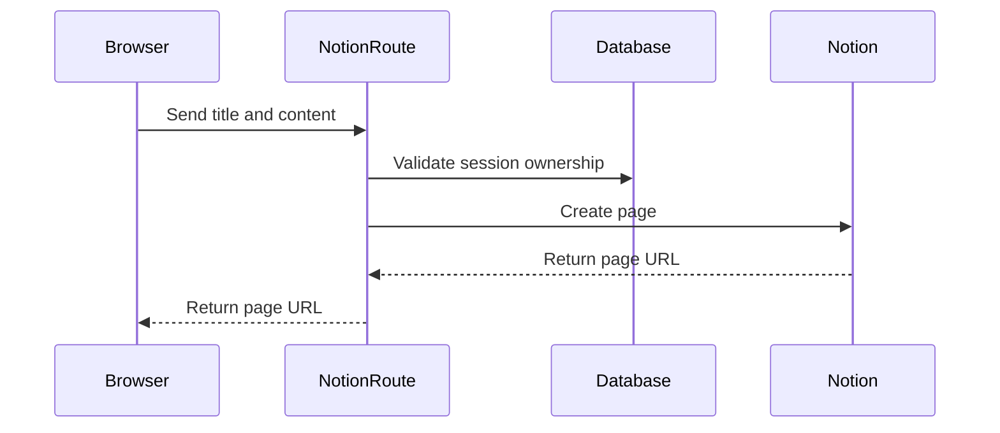

# Chat Request Flow

这个文件回答一个问题：

> 用户在输入框里发送一句话之后，数据到底经过哪里？

## 普通聊天



## 前端发送的数据

`src/app/page.tsx` 会构建：

```text
FormData
├── message
├── model
├── reasoning
├── sessionId       optional
├── webSearch       mode
└── files[]         optional
```

然后：

```text
POST /api/chat
```

## Session 创建

如果有 `sessionId`：

```text
当前 AnonymousUser
    ↓
find Session where id + userId match
```

如果没有：

```text
create Session
title = message 前部生成（仅作临时标题）
```

所以 Session 所有权始终跟匿名设备绑定。

### AI 标题

新建 Session，或给空的 `New chat` 发送第一条消息时，服务端在上游流开始后追加一次非流式请求（`src/lib/chat-title.ts`），只根据用户第一条消息（前 2,000 字符，不含附件和回答）生成简短标题：使用当前所选模型的最低推理强度（OpenAI `none`，DeepSeek `low`），不带搜索工具。

只有标题仍是临时标题时才写入，期间被改过的标题不会被覆盖。请求失败、超时（6 秒）或返回空文本时保留临时标题，不影响聊天本身。服务端在关闭流之前等待该请求，所以客户端在流结束后重新取得会话列表时已能看到新标题。后续消息不再生成标题。图片生成路径（`/api/images`）仍使用截取的标题。

## Attachment 进入模型的方式

### Text / Markdown / JSON / CSV / TSV / TXT

```text
File
  ↓
UTF-8 text
  ↓
最多保留 120,000 chars
  ↓
作为额外 input_text
```

### PDF

```text
PDF
  ↓
pdf-parse
  ↓
提取文本
  ↓
最多保留 120,000 chars
  ↓
作为额外 input_text
```

### Image

```text
Image
 ├─ base64 data URL -> 本次模型 input_image
 └─ storage path    -> 历史回显
```

## History

每次请求不会把整个数据库历史全部发给模型。

当前读取：

```text
最近 30 条 Message
```

然后重新组装：

- message text
- extracted attachment text
- 如果模型支持 vision，则恢复历史图片输入

这样可以控制 token 和数据库读取量。

## Provider 分支



### OpenAI

普通聊天走 Responses API。

### DeepSeek

DeepSeek 由 `src/lib/deepseek-responses.ts` 适配其 Responses 行为，再统一转换为前端需要的文本增量。

## Web Search

Web Search 不由 StudyMate 自己执行搜索然后拼 prompt。

当前思想：

```text
StudyMate
   ↓
Provider Responses API
   ↓
provider-native web_search
   ↓
模型自行决定是否搜索
```

只有 OpenAI 启用 provider-native `web_search`。DeepSeek 的现行 Responses API 会忽略该工具（[官方说明](https://api-docs.deepseek.com/guides/responses_api/#tools)），因此 `src/lib/models.ts` 将其搜索能力设为 false。旧客户端传来的搜索开关也会归一化为 off，模型指令明确禁止模拟搜索。

GPT 默认使用 `tool_choice: auto`，由模型判断是否需要搜索。API 收到 `webSearch=force` 时使用 `required`；收到 `off` 时不发送搜索工具。搜索产生的 URL 注释会转换为回答末尾可点击的来源链接，并与回答一起保存。

DeepSeek 正文通过跨 chunk 的工具记法检查，遇到 DSML 或 `<tool_result>` 时停止读取并返回错误；不能把异常片段保存成正常回答。`response.incomplete`、空回答和没有 `response.completed` 的断流也会明确报错。过去已保存的异常助手回答保留在数据库中，但不会再次加入模型输入。

## 回答前的途中经过

`/api/chat` 的 SSE 里有两种 `data`：JSON 字符串是正文增量；`{ "activity": ... }` 是途中经过，由 `src/lib/chat-activity.ts` 从上游事件转换而来：

- OpenAI 推理强度不是 `none` 时请求 `reasoning.summary: "auto"`，转发推理摘要；DeepSeek 转发 `reasoning_text` 推理正文。
- GPT 启用搜索时请求 `include: ["web_search_call.action.sources"]`，转发每次 `web_search_call` 的搜索词、来源 URL、打开的页面（`open_page`）和页内查找（`find_in_page`）。只保留 http(s) URL。

前端把它们显示为可折叠的时间线：思考中自动展开并显示当前动作，正文开始后折叠为 `Thought for Ns · N searches · N sources`。途中经过不写入数据库；流结束后重新获取历史时只在本页内保留，刷新页面后不再显示。

## Persist Timing

一个容易忘的细节：

```text
USER Message
```

在调用上游 AI **之前**保存。

而：

```text
ASSISTANT Message
```

在 stream 完成后保存。

如果上游中途失败，已经向用户流出的文本会连同错误信息一起保存，尽量让 UI 展示与 DB 历史保持一致。

## Notion 导出是另一条链路

Notion 导出不经过 `/api/chat`：


