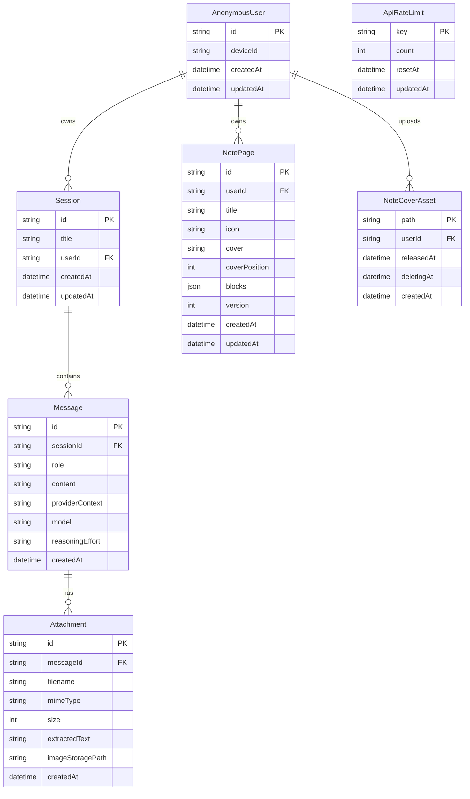

# Database Architecture

`Message.providerContext` 为可空 TEXT，保存成功回答对应的原生压缩 checkpoint（版本、provider、实际上游 model、原生 items 和已覆盖消息 ID 的 JSON）。按已覆盖 ID 恢复，避免遗漏并发新增消息。仅服务端聊天请求读取，浏览器消息接口不返回；原始 `Message.content` 与附件不被压缩或删除。新增字段通过 `20261011120000_message_provider_context` migration 部署。

## 实际生产数据库

截至 2026-09-05 已通过 Neon 实际资源确认：

| 项目 | 当前值 |
| --- | --- |
| Neon project | `neon_db` |
| Region | `aws-us-east-1` |
| PostgreSQL | 18 |
| Branch | `production` |
| Database | `neondb` |
| StudyMate schema | `studymate` |

### 非常重要

同一个 `neondb` 中还存在另一个 schema：

```text
kaku_log
```

它不是 StudyMate 的表。

数据库排查或手工 SQL 时，优先明确写 `studymate.<Table>`，不要因为都在同一个 Neon project 里就把两个应用混在一起。

## Runtime Connection

`src/lib/prisma.ts` 使用：

```text
DATABASE_URL
    ↓
读取 ?schema=...
    ↓
PrismaPg(databaseUrl, { schema })
    ↓
PrismaClient
```

默认 schema 回退值是 `studymate`。

2026-09-16 的生产构建日志确认 `DATABASE_URL` 使用 Neon pooled endpoint。连接方式以部署实际使用的地址为准，不能从旧的 compute 状态推断。

Node 运行时在创建 adapter 前，通过 `src/lib/database-url.ts` 把 `sslmode=prefer/require/verify-ca` 明确为 `verify-full`，保持当前 pg 8 的证书与主机名验证语义，避免将来升级改变行为。显式的 `uselibpqcompat=true` 设置不改写；没有 TLS 参数的本地连接也不改写。Prisma CLI 继续使用原始 `DATABASE_URL`。

## Local Database

本地开发使用独立的 Docker PostgreSQL 18.4 容器 `studymate-pg18-dev`，主机端口 5432，数据库 `studymate`，schema `public`。它与生产 Neon 的 `neondb/studymate` 分离；不要为了统一名称移动已有表或重置数据。

启动与连接排查见 [README 的本地启动](../../README.md#本地启动)。Docker Desktop 和容器必须运行；数据库不可用时，静态页面仍可能显示，但会话 API 会返回 503。

## ER Diagram



## Table Responsibilities

### AnonymousUser

匿名浏览器设备。

核心字段：

- `id`：内部主键
- `deviceId`：签名 Cookie 对应的唯一设备 ID

关系：

```text
AnonymousUser 1 -> N Session
```

删除用户会级联删除 Session。

### NotePage

站内笔记页面，与聊天 `Session` 独立。`userId` 关联 `AnonymousUser`，删除匿名用户时级联删除。`blocks` 保存 BlockNote 原生 JSON 的区块顺序、稳定 ID、文字装饰和嵌套关系；页面标题另存 `title`。`icon` 是单个emoji，`cover` 是 `src/lib/note-document.ts` 中 `NOTE_COVERS` 的预设键，或 `upload:page-covers/<userId>/<uuid>.<ext>` 形式的上传图片键（不接受任意 URL）；`coverPosition` 是上传封面的纵向位置（0–100）。未设置时均为 null。上传封面路径包含所属匿名用户 ID，服务端只允许引用自己目录下的键；上传封面登记在 `NoteCoverAsset`（`path` 主键、`userId`、`releasedAt`、`deletingAt`）：上传时先建行（`releasedAt` 为当前时间）再写入存储；保存页面引用上传封面时在同一事务内把该行设为使用中（`releasedAt = null`），行已不存在则拒绝保存。日次 cron（`/api/cron/cleanup`）先给不再被引用的行记录 `releasedAt`，记录后再次确认引用，避免与保存同时发生时误记。连续未使用 7 天后用条件更新设置 `deletingAt`（此后不能再被引用），删除存储中的图片成功后才删除该行，失败的在下次运行重试；与保存竞争时以同一行的锁决定结果，不会留下指向已删除图片的页面。只处理本数据库登记的封面，因此与本地开发共享 Blob 存储也不会误删。PATCH 省略 `icon`/`cover`/`coverPosition` 时保留已保存的值，兼容旧客户端与旧草稿。

`version` 从 0 开始，每次保存原子递增。更新条件同时包含页面 ID、匿名用户 ID 和预期版本；版本冲突返回 409，防止另一标签页的内容被覆盖。`(userId, updatedAt)` 索引用于侧栏列表。所有页面读写限制在当前匿名用户。具体保存和草稿恢复流程见 [notes-flow.md](notes-flow.md)。

### Session

一段对话。

核心字段：

- `title`
- `userId`
- `createdAt`
- `updatedAt`

索引：

```text
(userId, updatedAt)
```

用于按用户读取并排序最近会话。

### Message

一条用户或 AI 消息。

核心字段：

- `sessionId`
- `role`
- `content`
- `providerContext`（可空，仅服务端原生压缩状态）
- `model`
- `reasoningEffort`

关系：

```text
Session 1 -> N Message
```

索引：

```text
(sessionId, createdAt)
```

### Attachment

属于某一条 Message 的附件。

核心字段：

- `filename`
- `mimeType`
- `size`
- `extractedText`
- `imageStoragePath`

其中：

- 文本/PDF：主要使用 `extractedText`
- 图片：主要使用 `imageStoragePath`
- 图片二进制不存 PostgreSQL

关系：

```text
Message 1 -> N Attachment
```

### ApiRateLimit

独立限流表，不属于 Session 层级。

目前：

- chat：30 / hour
- images：10 / hour

## Enums

```text
MessageRole
- USER
- ASSISTANT
- SYSTEM

ReasoningEffort
- NONE
- LOW
- MEDIUM
- HIGH
- XHIGH
- MAX
```

## 为什么 Attachment 不直接存图片

早期 migration 曾经存在 `imageDataUrl` 字段，随后被删除，改为：

```text
Attachment.imageStoragePath
        ↓
实际图片存储
```

这是正确的“数据库保存引用、对象存储保存文件本体”的方向。生产环境中 `imageStoragePath` 保存私有 Vercel Blob 的 pathname；本地开发未配置 Blob token 时才回退到文件系统路径。

## Migration Rule

生产只使用可追踪 migration：

```bash
npm run prisma:migrate
```

不要对生产执行：

```text
prisma db push
prisma migrate reset
```

Schema 变更应同时更新：

1. `prisma/schema.prisma`
2. `prisma/migrations/`
3. 本文档 ERD
