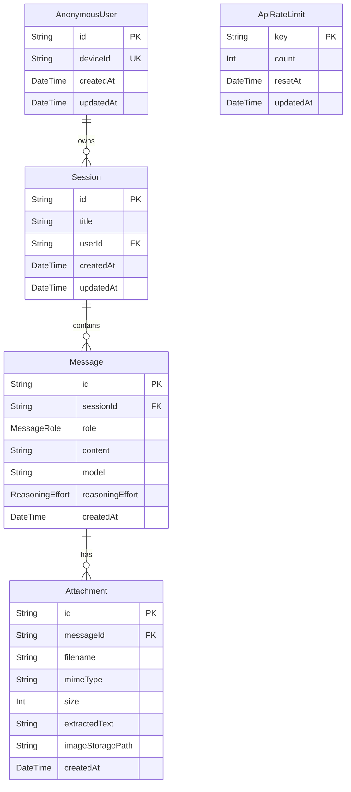

# Database Architecture

## 实际生产数据库

截至 2026-09-05 已通过 Neon 实际资源确认：

| 项目 | 当前值 |
| --- | --- |
| Neon project | `neon_db` |
| Region | `aws-us-east-1` |
| PostgreSQL | 18 |
| Branch | `production` |
| Database | `neondb` |
| StudyMate schema | `studymate` |

### 非常重要

同一个 `neondb` 中还存在另一个 schema：

```text
kaku_log
```

它不是 StudyMate 的表。

数据库排查或手工 SQL 时，优先明确写 `studymate.<Table>`，不要因为都在同一个 Neon project 里就把两个应用混在一起。

## Runtime Connection

`src/lib/prisma.ts` 使用：

```text
DATABASE_URL
    ↓
读取 ?schema=...
    ↓
PrismaPg(databaseUrl, { schema })
    ↓
PrismaClient
```

默认 schema 回退值是 `studymate`。

当前 Neon compute 的 pooler 状态经实际检查为未启用，因此不要在文档或代码里默认“当前已经在使用 pooled connection”。

## ER Diagram



## Table Responsibilities

### AnonymousUser

匿名浏览器设备。

核心字段：

- `id`：内部主键
- `deviceId`：签名 Cookie 对应的唯一设备 ID

关系：

```text
AnonymousUser 1 -> N Session
```

删除用户会级联删除 Session。

### Session

一段对话。

核心字段：

- `title`
- `userId`
- `createdAt`
- `updatedAt`

索引：

```text
(userId, updatedAt)
```

用于按用户读取并排序最近会话。

### Message

一条用户或 AI 消息。

核心字段：

- `sessionId`
- `role`
- `content`
- `model`
- `reasoningEffort`

关系：

```text
Session 1 -> N Message
```

索引：

```text
(sessionId, createdAt)
```

### Attachment

属于某一条 Message 的附件。

核心字段：

- `filename`
- `mimeType`
- `size`
- `extractedText`
- `imageStoragePath`

其中：

- 文本/PDF：主要使用 `extractedText`
- 图片：主要使用 `imageStoragePath`
- 图片二进制不存 PostgreSQL

关系：

```text
Message 1 -> N Attachment
```

### ApiRateLimit

独立限流表，不属于 Session 层级。

目前：

- chat：30 / hour
- images：10 / hour

## Enums

```text
MessageRole
- USER
- ASSISTANT
- SYSTEM

ReasoningEffort
- NONE
- LOW
- MEDIUM
- HIGH
- XHIGH
- MAX
```

## 为什么 Attachment 不直接存图片

早期 migration 曾经存在 `imageDataUrl` 字段，随后被删除，改为：

```text
Attachment.imageStoragePath
        ↓
实际图片存储
```

这是正确的“数据库保存引用、对象存储保存文件本体”的方向。生产环境中 `imageStoragePath` 保存私有 Vercel Blob 的 pathname；本地开发未配置 Blob token 时才回退到文件系统路径。

## Migration Rule

生产只使用可追踪 migration：

```bash
npm run prisma:migrate
```

不要对生产执行：

```text
prisma db push
prisma migrate reset
```

Schema 变更应同时更新：

1. `prisma/schema.prisma`
2. `prisma/migrations/`
3. 本文档 ERD
