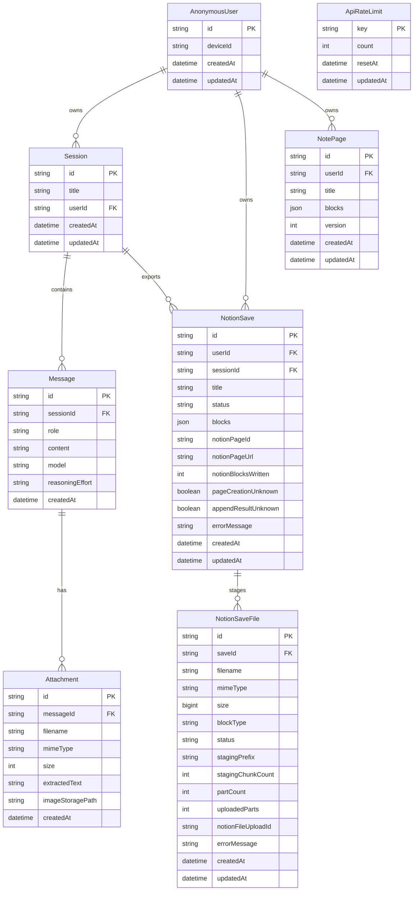

# Database Architecture

## 实际生产数据库

截至 2026-09-05 已通过 Neon 实际资源确认：

| 项目 | 当前值 |
| --- | --- |
| Neon project | `neon_db` |
| Region | `aws-us-east-1` |
| PostgreSQL | 18 |
| Branch | `production` |
| Database | `neondb` |
| StudyMate schema | `studymate` |

### 非常重要

同一个 `neondb` 中还存在另一个 schema：

```text
kaku_log
```

它不是 StudyMate 的表。

数据库排查或手工 SQL 时，优先明确写 `studymate.<Table>`，不要因为都在同一个 Neon project 里就把两个应用混在一起。

## Runtime Connection

`src/lib/prisma.ts` 使用：

```text
DATABASE_URL
    ↓
读取 ?schema=...
    ↓
PrismaPg(databaseUrl, { schema })
    ↓
PrismaClient
```

默认 schema 回退值是 `studymate`。

2026-09-16 的生产构建日志确认 `DATABASE_URL` 使用 Neon pooled endpoint。连接方式以部署实际使用的地址为准，不能从旧的 compute 状态推断。

Node 运行时在创建 adapter 前，通过 `src/lib/database-url.ts` 把 `sslmode=prefer/require/verify-ca` 明确为 `verify-full`，保持当前 pg 8 的证书与主机名验证语义，避免将来升级改变行为。显式的 `uselibpqcompat=true` 设置不改写；没有 TLS 参数的本地连接也不改写。Prisma CLI 继续使用原始 `DATABASE_URL`。

## Local Database

本地开发使用独立的 Docker PostgreSQL 18.4 容器 `studymate-pg18-dev`，主机端口 5432，数据库 `studymate`，schema `public`。它与生产 Neon 的 `neondb/studymate` 分离；不要为了统一名称移动已有表或重置数据。

启动与连接排查见 [README 的本地启动](../../README.md#本地启动)。Docker Desktop 和容器必须运行；数据库不可用时，静态页面仍可能显示，但会话 API 会返回 503。

## ER Diagram



## Table Responsibilities

### AnonymousUser

匿名浏览器设备。

核心字段：

- `id`：内部主键
- `deviceId`：签名 Cookie 对应的唯一设备 ID

关系：

```text
AnonymousUser 1 -> N Session
```

删除用户会级联删除 Session。

### NotePage

站内笔记页面，与聊天 `Session` 和外部导出 `NotionSave` 独立。`userId` 关联 `AnonymousUser`，删除匿名用户时级联删除。`blocks` 保存 BlockNote 原生 JSON 的区块顺序、稳定 ID、文字装饰和嵌套关系；页面标题另存 `title`。

`version` 从 0 开始，每次保存原子递增。更新条件同时包含页面 ID、匿名用户 ID 和预期版本；版本冲突返回 409，防止另一标签页的内容被覆盖。`(userId, updatedAt)` 索引用于侧栏列表。所有页面读写限制在当前匿名用户。具体保存和草稿恢复流程见 [notes-flow.md](notes-flow.md)。

### Session

一段对话。

核心字段：

- `title`
- `userId`
- `createdAt`
- `updatedAt`

索引：

```text
(userId, updatedAt)
```

用于按用户读取并排序最近会话。

### Message

一条用户或 AI 消息。

核心字段：

- `sessionId`
- `role`
- `content`
- `model`
- `reasoningEffort`

关系：

```text
Session 1 -> N Message
```

索引：

```text
(sessionId, createdAt)
```

### Attachment

属于某一条 Message 的附件。

核心字段：

- `filename`
- `mimeType`
- `size`
- `extractedText`
- `imageStoragePath`

其中：

- 文本/PDF：主要使用 `extractedText`
- 图片：主要使用 `imageStoragePath`
- 图片二进制不存 PostgreSQL

关系：

```text
Message 1 -> N Attachment
```

### ApiRateLimit

独立限流表，不属于 Session 层级。

目前：

- chat：30 / hour
- images：10 / hour

### NotionSave

一次 Notion 导出的处理记录。

核心字段：

- `blocks`：正文的「文字 / 文件」有序数组。文字块直接存字符串，文件块存 `NotionSaveFile.id`。
- `status`：`STAGING → TRANSFERRING → COMPLETED`，另有 `CANCELLED` / `EXPIRED`。
- `notionPageId` / `notionPageUrl`：页面创建后立即写入，追加正文失败时可以继续同一个页面。
- `notionBlocksWritten`：已经写进 Notion 的块数量，续写时从这里开始。
- `pageCreationUnknown`：页面创建没有拿到响应时为 `true`。此时不会自动重建，必须由用户确认后再建。
- `appendResultUnknown`：正文追加没有拿到响应时为 `true`。重试可能重复写入，先检查现有页面，再由用户确认是否继续追加。

关系：

```text
AnonymousUser 1 -> N NotionSave
Session?      1 -> N NotionSave
```

删除 Session 时 `sessionId` 置空，导出记录本身保留。

### NotionSaveFile

一次导出里的一个待传文件。与会话附件（`Attachment`）完全分开管理。

核心字段：

- `size`：`BigInt`。5 GiB 超过 `Int` 的范围。
- `blockType`：`image` 或 `file`，决定在 Notion 里用哪种块。
- `stagingPrefix`：临时文件在 Private Blob 的路径前缀。删除后置空，也就退出了超时回収范围。
- `stagingChunkCount` / `partCount` / `uploadedParts`：传输进度。
- `notionFileUploadId`：Notion `file_uploads` 的 ID。

关系：

```text
NotionSave 1 -> N NotionSaveFile
```

详细流程见 [notion-flow.md](notion-flow.md)。

## Enums

```text
MessageRole
- USER
- ASSISTANT
- SYSTEM

ReasoningEffort
- NONE
- LOW
- MEDIUM
- HIGH
- XHIGH
- MAX

NotionSaveStatus
- STAGING
- TRANSFERRING
- COMPLETED
- CANCELLED
- EXPIRED

NotionFileStatus
- PENDING
- STAGED
- UPLOADING
- COMPLETE
```

## 为什么 Attachment 不直接存图片

早期 migration 曾经存在 `imageDataUrl` 字段，随后被删除，改为：

```text
Attachment.imageStoragePath
        ↓
实际图片存储
```

这是正确的“数据库保存引用、对象存储保存文件本体”的方向。生产环境中 `imageStoragePath` 保存私有 Vercel Blob 的 pathname；本地开发未配置 Blob token 时才回退到文件系统路径。

## Migration Rule

生产只使用可追踪 migration：

```bash
npm run prisma:migrate
```

不要对生产执行：

```text
prisma db push
prisma migrate reset
```

Schema 变更应同时更新：

1. `prisma/schema.prisma`
2. `prisma/migrations/`
3. 本文档 ERD
