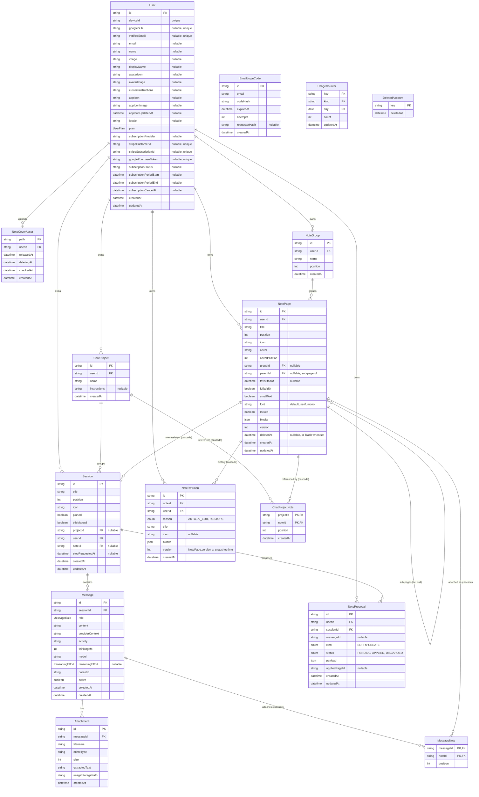

# Database Architecture

`Message.providerContext` 为可空 TEXT，保存成功回答对应的原生压缩 checkpoint（版本、provider、实际上游 model、原生 items 和已覆盖消息 ID 的 JSON）。按已覆盖 ID 恢复，避免遗漏并发新增消息。仅服务端聊天请求读取，浏览器消息接口不返回；原始 `Message.content` 与附件不被压缩或删除。新增字段通过 `20261011120000_message_provider_context` migration 部署。

`Message.activity` 为可空 TEXT，保存回答前的途中经过（推理摘要、Web 搜索、Pages 工具步骤的 `ActivityStep[]` JSON，不含已另存于 `NoteProposal` 的提案）；`Message.thinkingMs` 为可空 INTEGER，保存从请求开始到首个正文增量的毫秒数。两者仅用于显示，浏览器消息接口返回（经 `parseStoredActivity` 校验），聊天历史查询不 select、不回传给模型。新增字段通过 `20261014180000_message_activity` migration 部署。

## 实际生产数据库

截至 2026-09-05 已通过 Neon 实际资源确认：

| 项目 | 当前值 |
| --- | --- |
| Neon project | `neon_db` |
| Region | `aws-us-east-1` |
| PostgreSQL | 18 |
| Branch | `production` |
| Database | `neondb` |
| NoteFable schema | `notefable` |

### 非常重要

同一个 `neondb` 中还存在另一个 schema：

```text
kaku_log
```

它不是 NoteFable 的表。

数据库排查或手工 SQL 时，优先明确写 `notefable.<Table>`，不要因为都在同一个 Neon project 里就把两个应用混在一起。

## Runtime Connection

`src/lib/prisma.ts` 使用：

```text
DATABASE_URL
    ↓
schema 固定为 notefable（覆盖 URL 里的 ?schema=）
    ↓
PrismaPg(databaseUrl, { schema })
    ↓
PrismaClient
```

schema 固定为 `notefable`（`src/lib/database-url.ts` 的 `DATABASE_SCHEMA`）：`src/lib/prisma.ts` 和 `prisma.config.ts` 都会把 `DATABASE_URL` 里的 `schema` 参数换成它。

2026-09-16 的生产构建日志确认 `DATABASE_URL` 使用 Neon pooled endpoint。连接方式以部署实际使用的地址为准，不能从旧的 compute 状态推断。

Node 运行时在创建 adapter 前，通过 `src/lib/database-url.ts` 把 `sslmode=prefer/require/verify-ca` 明确为 `verify-full`，保持当前 pg 8 的证书与主机名验证语义，避免将来升级改变行为。显式的 `uselibpqcompat=true` 设置不改写；没有 TLS 参数的本地连接也不改写。Prisma CLI 使用 `DATABASE_URL`，只把 schema 换成 `notefable`。

## Local Database

本地开发使用独立的 Docker PostgreSQL 18.4 容器 `notefable-pg18-dev`，主机端口 5432，数据库 `notefable`，schema `notefable`。它与生产 Neon 的 `neondb/notefable` 分离。

启动与连接排查见 [README 的本地启动](../../README.md#本地启动)。Docker Desktop 和容器必须运行；数据库不可用时，静态页面仍可能显示，但会话 API 会返回 503。

## ER Diagram



## Table Responsibilities

### User

用户记录：未登录时是匿名浏览器设备（签名 Cookie），Google / 邮箱登录后也是这一行。表原名 `AnonymousUser`，由 `20261115000000_rename_user_table` migration 改名为 `User`（只改名字，主键和唯一索引一并改名，外键约束名不变）。为了让改名时还在运行的旧版本不报错，那个 migration 临时留了一个同名的可更新视图 `"AnonymousUser"`（`SELECT * FROM "User"`），新版本上线后已由 `20261115010000_drop_anonymous_user_view` 删除。因此不能再把生产回滚到改名之前的部署（旧代码查的是 `"AnonymousUser"`）。

手写 SQL 时表名必须带双引号：`SELECT * FROM "User"`。`user` 是 PostgreSQL 的保留字，不带引号的 `SELECT * FROM user` 返回的是当前数据库角色，不是这张表。

核心字段：

- `id`：内部主键
- `deviceId`：签名 Cookie 对应的唯一设备 ID
- `googleSub`：可空且唯一，Google 账号 ID；首次 Google 登录时绑定到当前设备的用户，之后在任何设备登录同一账号都会得到这一行
- `verifiedEmail`：可空且唯一，确认过的邮箱（小写）。用邮箱验证码登录的邮箱，或 Google 登录时 Gmail / Google Workspace（ID 令牌带 `hd`）的已验证邮箱（`isAuthoritativeGoogleEmail`，`src/lib/email-address.ts`），都写在这里；同一个邮箱就是同一个用户，所以先用 Google 再用邮箱（或反过来）登录会进同一个账号（`src/lib/auth.ts`）。其他 Google 账号上登记的外部邮箱即使 `email_verified` 也不写、不合并：那种邮箱可能已经换了主人，合并会让旧主人看到新主人的数据。已有 Google 用户：Gmail 由 `20261114120100_email_login_gmail_backfill` 迁移补上，Workspace 用户在下次重新 Google 登录后补上；补的时候如果这个邮箱已经被一个只用邮箱登录的用户占了（Workspace 老用户在补上之前先在别的设备用邮箱登录过），两个用户保持分开、不合并数据：笔记文件和封面的存储路径里带着用户 ID，搬数据要连文件一起改，风险大，而这种情况只会出现在邮箱登录上线初期的 Workspace 老用户身上。通过 `20261114120000_email_login` migration 部署
- `email` / `name` / `image`：可空，登录时从 Google 同步的资料（邮箱登录的用户只有 `email`）
- `displayName` / `avatarIcon` / `avatarImage`：可空，用户在“设置”的个人资料部分自己设的显示名（1–40 个字符）、emoji 图标、上传的头像照片（存储路径）。为空就用 Google 的名字和头像。头像照片和 emoji 图标二选一：上传照片会清掉图标，选图标或“恢复 Google”会清掉照片并删除旧文件。它们和上一行是两组字段：每次登录会用 Google 的资料覆盖 `name` / `image`，但不会动这三个字段。照片在浏览器里先裁成 512×512 再上传，存到 `avatars/<用户 ID>/<UUID>.<扩展名>`（私有 Blob；本地开发在配置了 Blob token 时也写同一个 Blob，不是本地磁盘），`GET /api/account/avatar?v=<UUID>` 只返回当前登录用户自己的照片（版本对上才长缓存），`POST` 上传（只收 JPEG/PNG/WebP/GIF，按内容识别，≤ 2 MB；选照片时上限 10 MB、短边至少 200px，数值参照 Slack / LinkedIn / X 等主流产品）。`GET/PATCH /api/account` 读写名字和图标，只有已登录（Google 或邮箱）的本人能改；新增字段通过 `20261014200100_user_profile`、`20261014200200_user_avatar_image` migration 部署
- `customInstructions`：可空，用户在“设置”里写的自定义指令（最多 4,000 字符，校验与项目的共通指示相同，空白存为 null）。只有已登录的用户能通过 `GET/PUT /api/custom-instructions` 读写，聊天时也只对已登录用户带入，见 [chat-flow.md](chat-flow.md) 的“自定义指令”。字段通过 `20261114130000_custom_instructions` migration 部署
- `appIcon` / `appIconImage` / `appIconUpdatedAt`：可空，设置里的“图标”（AI 角色或上传的图片，`src/lib/app-icon.ts`）的账号副本，只有已登录（Google 或邮箱）的本人通过 `GET/PUT /api/app-icon` 读写（`src/app/api/app-icon/route.ts`，校验在 `src/lib/account-app-icon.ts`；未登录 401），匿名的行不用。`appIcon` 是 `null`（默认角色 Quill）、`character:<id>` 或 `image`；`image` 时 `appIconImage` 是存储路径 `app-icons/<用户 ID>/<UUID>.<扩展名>`（私有 Blob；图片本体不进 Postgres）。`PUT { icon }` 接受 `null` / `""`、角色（`character:<id>` 或裸 id，`quill` 存为 `null`）或 base64 的 `data:image/...` URL：按内容识别，只收 PNG / JPEG / WebP、解码后 ≤ 64 KB（端末生成的是 96×96 的 PNG），旧表情和未知值返回 400。换图片时先写新文件，再按读到的 `appIconImage` 条件更新（同时被别处换掉时删掉新文件、返回 409），成功后尽力删除旧文件（失败不影响保存，账号删除时整个目录会删）。`GET` 返回 `{ icon, updatedAt, account }`：图片读出来直接放成 data URL（很小，不另开图片地址）；`updatedAt` 为 `null` 表示还没有任何端末保存过；`account` 是由用户 ID 算出的不透明键（`appIconAccountKey`，`PUT` 也返回），端末用它记住本机图标属于哪个账号。图片在存储里不见了时按默认角色（`icon: null`）回答并记日志，一时读不到才 503。客户端规则见 [image-flow.md](image-flow.md) 的“设置里的图标”。字段通过 `20261122000000_user_app_icon` migration 部署
- `locale`：可空，已登录用户在“设置”里选的界面语言（`src/lib/i18n/locale.ts` 的全部 17 种已启用内部代码之一）。`null` 表示明确的自动检测（按浏览器语言和地区显示）。`PATCH /api/account` 的 `locale` 接受这 17 个代码或 `null`（显式恢复自动）；读出时不认识的值当作 `null`。浏览器端把它同步到语言 Cookie，见 [i18n.md](i18n.md)。字段通过 `20261116200000_user_locale` migration 部署

- `plan`：`FREE`（默认）或 `PRO`。决定用量上限的档位（见下方 `UsageCounter`）。`PRO` 由 Stripe 或 Google Play 订阅经 `src/lib/subscription-state.ts` 同步写入（有效订阅期间），也可以手动改库设置；见 [billing.md](billing.md)。字段通过 `20261113000000_usage_limits` migration 部署
- `subscriptionProvider`：可空，当前订阅在哪里买的（`stripe` = 网页、`google` = Android 的 Google Play）；下面的状态和账期都属于这份订阅。`googlePurchaseToken`：可空且唯一，Google Play 订阅的购买令牌。
- `stripeCustomerId` / `stripeSubscriptionId`：可空且唯一，Stripe 的客户和当前（或最近一次）订阅。`subscriptionStatus` 保存订阅状态（Stripe 的状态原文，或 Google Play 经 `playStatus` 映射后的等价状态，如 `active`、`past_due`、`canceled` 等；`null` 表示没订阅过），`subscriptionPeriodStart` / `subscriptionPeriodEnd` 是当前账期（Pro 的月上限按它计），`subscriptionCancelAt` 是预约解约的日期（`null` 为没有预约）。都由 `src/lib/billing.ts`（Stripe）或 `src/lib/google-play-billing.ts`（Google Play）从外部取回后经 `src/lib/subscription-state.ts` 写入，不由用户直接修改。字段通过 `20261118000000_subscription` migration 部署

关系：

```text
User 1 -> N Session / ChatProject / NotePage / NoteCoverAsset / NoteProposal / NoteGroup / NoteRevision
```

删除用户会级联删除上述全部关联记录。

**删除账号**（Google Play 的账号删除要求）：已登录用户在网页或 App 的“设置 → 删除账号”确认后调用 `DELETE /api/account`（同源或不带 `Origin` 的原生请求；未登录 401）。`src/app/api/account/route.ts` 在按用户的账务锁（`withUserBillingLock`）内先停止计费：有 Stripe 客户时立即取消订阅、过期未完成结账并删掉 Stripe 客户（`cancelCustomerBilling`），有 Google Play 购买令牌时停止自动续费（`cancelPlayRenewal`），任一步失败就返回 502、不删除（见 [billing.md](billing.md)）；随后调用 `deleteAccount`（`src/lib/account-deletion.ts`）在同一事务里收集聊天附件图片路径，删掉这个邮箱的 `EmailLoginCode`、`UsageCounter` 里 `user:<id>` 的行，写入 `DeletedAccount`（见下），并删掉 `User` 行本身——会话、消息、附件、笔记、历史版本、分组、项目、提案、封面记录都靠外键 `onDelete: Cascade` 一起删除。行删掉以后再删文件：聊天附件图片逐个删，`note-files/<id>/`、`page-covers/<id>/`、`avatars/<id>/`、`chat-uploads/<id>/`、`app-icons/<id>/` 整个目录删（`deleteStoredPrefix` 只接受以 `/` 结尾、至少两层的目录，避免误删别人的前缀）；文件在响应之后（`after()`）删，失败只把路径记进日志，不回滚（行已不在，没人能再读到）。响应用过期 Cookie 清掉 Auth.js 会话；`notefable_device` 保留（它可能指向这个设备另一条匿名的行，清掉就回不到那些数据；指向被删的行时，下一次请求会建新的匿名行）。网页和 App 都先等资料保存队列清空再发删除。公开说明页是 `/delete-account`。

### DeletedAccount

删除账号的印记，`key`（主键）是登录 ID 的 HMAC（`google:<sub>` 或 `email:<地址>`，用 Cookie 签名密钥），不存 ID 本身；`deletedAt` 有索引（`20261116300000_deleted_account`）。登录 Cookie 是 JWT、服务端没有记录，删除后其他设备或还在路上的请求仍带着有效 Cookie；`getOrCreateUser` 每次用登录 Cookie 找用户时都和查用户行并行地查这张表（包括删除后用同一身份重新建的账号），Cookie 的 `signedInAt`（登录时写入，Auth.js 更新 Cookie 时保留；旧 Cookie 没有，按 0 处理）早于 `deletedAt` 就当作未登录，不重建账号（`src/lib/deleted-accounts.ts`）。删除后重新登录得到的新 Cookie 照常建新账号。`GET /api/account` 遇到这种 Cookie 返回 `user: null`。超过 400 天的行在下一次删除账号时顺带删掉。

### UsageCounter

用量计数，`(key, kind, day)` 为主键。`key` 是 `user:<User.id>`，或未登录用户所在网络的 `ip:<HMAC>`（用 Cookie 签名密钥对 IP 做 HMAC，不存原始 IP；IPv6 取前 64 位）；`kind` 是 `chat`（每次发送，包括笔记内 AI 助手和每次“整理成笔记”）或 `image`（每次生成；图片的每日上限用这一行），按月计的免费额度用 `image:month`（未登录的网络上限也用这个名字，`key` 不同），Pro 用 `chat:pro` / `image:pro`；`day` 是日本时间的日期，按月计时是这个周期的第一天（免费是自然月 1 日，Pro 是账期开始日）。没有外键，删除用户不会级联。上限和档位写在 `src/lib/usage-plans.ts`，计数逻辑在 `src/lib/usage-limits.ts`，定价依据见 [billing.md](billing.md)：

| 档位 | 条件 | 聊天 | 图片 |
| --- | --- | --- | --- |
| guest | 未登录 | 20 / 天 | 10 / 月，且 3 / 天 |
| member | 已登录（Google 或邮箱） | 40 / 天 | 20 / 月，且 5 / 天 |
| pro | `plan = PRO` | 2000 / 账期 | 60 / 账期，且 10 / 天 |

上限为 0 时直接拒绝，不写行（`INSERT` 本身不受 `WHERE` 限制）。图片一次生成同时计月（账期）和当天两行（`USAGE_DAILY_LIMITS`）。未登录用户清 Cookie 就会变成新用户，所以同一 IP 的未登录用户还共享一个更大的上限（聊天 100 / 天、图片 30 / 月）；登录后不受这个限制。计数用带条件的 `INSERT … ON CONFLICT DO UPDATE … WHERE count < limit`，并发请求也不会超额；多个计数在同一事务里，任一满额就整体回滚。`/api/chat`、`/api/images` 和 `/api/sessions/:id/page` 满额时返回 429（`code: "usage_limit"`）。没能交付任何内容的失败（聊天在正文和提案出现前失败或取消、图片生成或保存失败、会话不存在、附件处理失败）会退还这一次。按天计的行超过 7 天、按月计的行超过 62 天，在计数时以 1% 的概率顺带删除（没有定时任务）。设置里的“方案”经 `GET /api/billing` 读本期用量（`usageSummary`）。`kind = report` 的行是“报告回答”的每日次数（`REPORT_LIMITS`：每个用户 10 次，未登录时同一网络 20 次，`consumeReportQuota`），不属于用量档位。

### EmailLoginCode

邮箱登录的验证码（`src/lib/email-login.ts`）。只存 `codeHash`（`AUTH_SECRET` 为密钥的 HMAC），不存验证码本身；`expiresAt` 为发出后 10 分钟，`attempts` 记错误次数（满 5 次作废），`requesterHash` 是对 `clientNetworkKey`（IPv4 或 IPv6 前 64 位的 HMAC）再用 `AUTH_SECRET` 做的 HMAC，只用来限流（同一邮箱每分钟 1 次、每小时 5 次；同一 IP 每小时 20 次）。验证成功后把这个邮箱所有还能用的验证码标成已使用（`attempts` 设为 1000 并过期；不删除，否则限流的计数会被清零；用 `attempts` 而不是时间来判断，所以同一个码同时提交两次只有一次成功）；任何一个未过期、还有剩余次数的验证码都能用，所以别人替你再要一个新码不会让你手上的码失效；输错时这些码的次数一起加 1；过期 1 小时以上的行在发新码时以 5% 的概率顺带删除（没有定时任务）。没有外键。

### NotePage

站内笔记页面，与聊天 `Session` 独立。`userId` 关联 `User`，删除用户时级联删除。`blocks` 保存 BlockNote 原生 JSON 的区块顺序、稳定 ID、文字装饰和嵌套关系；页面标题另存 `title`。`icon` 是单个emoji，`cover` 是 `src/lib/note-document.ts` 中 `NOTE_COVERS` 的预设键，或 `upload:page-covers/<userId>/<uuid>.<ext>` 形式的上传图片键（不接受任意 URL）；`coverPosition` 是上传封面的纵向位置（0–100）。未设置时均为 null。上传封面路径包含所属用户 ID，服务端只允许引用自己目录下的键；上传封面登记在 `NoteCoverAsset`（`path` 主键、`userId`、`releasedAt`、`deletingAt`、`checkedAt`（有索引））：上传时先建行（`releasedAt` 为当前时间）再写入存储；保存页面引用上传封面时在同一事务内把该行设为使用中（`releasedAt = null`），行已不存在则拒绝保存。`collectUnusedCovers()`（`src/lib/note-covers.ts`）按 `checkedAt` 从旧到新巡查，先给不再被引用的行记录 `releasedAt`，记录后再次确认引用，避免与保存同时发生时误记。连续未使用 7 天后用条件更新设置 `deletingAt`（此后不能再被引用），删除存储中的图片成功后才删除该行，失败的在下次运行重试；目前没有定时任务调用它（Vercel Cron 已移除），未引用的封面图片会留在存储中，需要时再接入；与保存竞争时以同一行的锁决定结果，不会留下指向已删除图片的页面。只处理本数据库登记的封面，因此与本地开发共享 Blob 存储也不会误删。PATCH 省略 `icon`/`cover`/`coverPosition` 时保留已保存的值，兼容旧客户端与旧草稿。

`version` 从 0 开始，每次保存原子递增。更新条件同时包含页面 ID、当前用户 ID 和预期版本；版本冲突返回 409，防止另一标签页的内容被覆盖。`(userId, updatedAt)` 索引仍保留；页面列表现按 `position` 升序、`createdAt` 降序和 `id` 降序返回。所有页面读写限制在当前用户（匿名设备或已登录账号）。具体保存和草稿恢复流程见 [notes-flow.md](notes-flow.md)。

`deletedAt` 可空（`20261015100000_note_trash_and_revisions` 追加，索引 `(userId, deletedAt)`）。`null` 是正常笔记；有值表示笔记在 Trash（回收站）里，是软删除：`DELETE /api/pages/:id` 只写 `deletedAt`，不删行，`version`、`position`、`groupId`、正文和封面都原样保留，所以此前“`DELETE` 删除页面行”的说法已不成立。保留期 30 天（常量 `TRASH_RETENTION_DAYS`，定义在 `src/types/notes.ts`，客户端文案与服务端共用）：期限内可由 `POST /api/pages/trash/:id` 把 `deletedAt` 置回 `null` 复原，期限之后复原被拒绝，行由惰性清理永久删除（没有定时任务，规则见下文“保留与级联”和 [notes-flow.md](notes-flow.md)）。复原和放入 Trash 都经 `updateMany`，会刷新 `@updatedAt`，但不增加 `version`。

**读写规则：** 所有“活着的笔记”的读取和写入都必须带 `deletedAt: null`（列表、单页读写、移动分组、重排、搜索、AI 工具、提案适用、笔记助手的 `noteId` 校验、项目参考笔记的读取，原生 SQL 里是 `p."deletedAt" IS NULL`）；只有 Trash 相关的接口读取 `deletedAt` 非空的行。新增查询笔记的代码时不要漏掉这个条件，否则回收站里的笔记会重新出现在列表、搜索或 AI 回答里。上传封面的引用统计（`referencedPaths()`）则有意不看 `deletedAt`：Trash 里的笔记仍引用它的封面，保留期内封面图片不会被回收；笔记被永久删除、行消失之后，才按原有的 7 天宽限期释放封面。

`parentId`、`favoritedAt`、`fullWidth`、`smallText`、`font`、`locked`（`20261116000000_note_page_tree_settings` 追加，索引 `(parentId)`）。`parentId` 是自引用外键，指向父页面（子页面），父页面行被永久删除时置空（`SetNull`）；子页面的 `groupId` 与最上位的祖先一致。`favoritedAt` 非空即为收藏。其余四列是页面的显示设置和锁定。这些都是元数据：由专用接口用原生 SQL 写入，不增加 `version`、不刷新 `updatedAt`（与重排相同），子树的查询用 `WITH RECURSIVE`（`src/lib/note-tree-server.ts`）。规则见 [notes-flow.md](notes-flow.md#子页面收藏与页面设置)。

### NoteGroup

Notes 的单层分组（文件夹）。`userId` 关联 `User`，删除用户时级联删除；`position` 决定排列顺序（新分组排在最后），索引 `(userId, position)`。每个用户最多 50 个分组，名称最长 60 字符。`NotePage.groupId` 可空，指向所属分组；删除分组时页面保留并把 `groupId` 置空（`SetNull`），索引 `(userId, groupId)`。移动页面到分组（`PUT /api/pages/:id/group`）会把页面脱离父页面（`parentId = null`）并同步更新整棵子树的 `groupId`，不增加 `version`。

### NoteRevision

笔记的编辑历史（`20261015100000_note_trash_and_revisions` 新增），是“恢复到过去某个版本”的来源。每一行是**被覆盖之前**的一份快照：`title`、`icon`、`blocks` 和当时的 `NotePage.version`；不保存封面、封面位置、分组和位置，恢复时这些保持现状。`noteId` 指向 `NotePage`，`userId` 指向 `User`，两者都 `ON DELETE CASCADE`；索引 `(noteId, createdAt)` 用于按笔记读取历史，`(userId)` 用于级联删除。

`reason`（枚举 `NoteRevisionReason`）说明为什么留下这一份：

| reason | 何时写入 |
| --- | --- |
| `AUTO` | 手动编辑的自动保存（`PATCH /api/pages/:id`）。**每个笔记最多每 10 分钟一份**（`AUTO_REVISION_INTERVAL_MS`），而不是每次保存一份；保存前由一条 `INSERT ... SELECT ... FOR UPDATE` 从已保存的行直接复制，正文不进应用内存。已保存的版本与请求的 `version` 不一致（冲突、响应丢失后的重发）、笔记在 Trash、正文为空数组时不写 |
| `AI_EDIT` | 适用 AI 编辑提案（`POST /api/proposals/:id/apply`）、覆盖笔记之前，写在适用提案的同一个事务里；写入失败整体回滚时这份历史一起消失，重试不会重复 |
| `RESTORE` | 从历史恢复（`POST /api/pages/:id/revisions/:revisionId/restore`）、覆盖笔记之前，写“恢复前”的当前状态，所以恢复本身也可以再恢复回去；与恢复写入在同一事务，版本被抢先修改（409）时一起回滚 |

**保留：** 每个笔记最多 50 份（`MAX_REVISIONS_PER_NOTE`），按类别分开计数：`AUTO` 最新 30 份（`MAX_AUTO_REVISIONS_PER_NOTE`，超过 90 天的也删除），`AI_EDIT` / `RESTORE` 合计最新 20 份（`MAX_MARKED_REVISIONS_PER_NOTE`），写入后按 `createdAt` 从旧到新裁剪，所以连续的自动保存不会把“AI 编辑前”的快照挤出去。自动快照在 `PATCH /api/pages/:id` 的事务里用 SAVEPOINT 包裹，失败时回滚到保存点并只记录日志，保存本身照常成功。历史随笔记走：笔记放进 Trash 时历史保留，复原后继续可用；笔记被永久删除时历史级联删除。历史读取接口只给“活着的”笔记（Trash 里的笔记返回 404）。快照 SQL 使用 `gen_random_uuid()`（PostgreSQL 13+，Neon 与本地 18 均满足），并明确限定 schema（`notefable`）。

### NoteProposal

AI 提出的笔记修改或新建提案。`kind` 为 `EDIT`（修改已有笔记）或 `CREATE`（新建），`status` 为 `PENDING`（待确认）、`APPLIED`、`DISCARDED`。`payload` 保存画面要显示的内容和适用时要写入的标题与块（编辑还包含目标笔记 ID 和提案时的基准版本）；`messageId` 在回答保存后填入，用来在历史里把提案挂回那条回答（为 null 的不显示）；`appliedPageId` 是新建提案适用后创建的笔记 ID，重复适用时据此返回同一笔记。`userId` 和 `sessionId` 删除时级联删除。适用在一个事务里先把 `PENDING` 改为 `APPLIED`，再确认目标笔记仍是活着的（`deletedAt` 为空）且版本等于提案的基准版本，把覆盖前的状态写成一份 `AI_EDIT` 的 `NoteRevision`，最后才写笔记，所以并发或重发都只会生效一次；版本不一致或笔记已进 Trash 时事务回滚（含刚写的历史），提案保持待确认，响应是 409（笔记已变）或 404（笔记不存在或在 Trash）。索引 `(sessionId, createdAt)` 用于读取会话历史，`messageId` 索引用于按回答查找。流程见 [chat-flow.md](chat-flow.md)。

### ChatProject

聊天的独立项目，与 Notes 分组互不影响。字段为 `id`、`userId`、`name`、`instructions`、`createdAt`，所有 API 按当前用户限定所有者。项目最多 50 个，名字最多 60 字符；删除项目时会话外键设为 null，聊天和消息保留，参考笔记的关联行（`ChatProjectNote`）级联删除但笔记本身保留。

`instructions`（可空 TEXT，`20261015110000_chat_project_context` 追加）是项目的共通指示，作用于项目内所有会话。服务端保存前去掉首尾空白、统一为 `\n` 换行，最多 4,000 字符（`MAX_PROJECT_INSTRUCTIONS`，定义在 `src/types/chat.ts`），除换行、回车、制表符外的控制字符被拒绝；空字符串和 `null` 都存成 `NULL`，所以“有没有指示”只看是不是 `NULL`（`hasInstructions`）。内容是用户自己的指示，原样进入聊天的系统指令（见 [chat-flow.md](chat-flow.md)），列表接口不返回正文，只有设置对话框用的详情接口返回。

### ChatProjectNote

项目选定的参考笔记（`20261015110000_chat_project_context` 新增）。主键 `(projectId, noteId)`，`position` 是选择顺序（保存时等于数组下标，也是传给模型的顺序），索引 `(noteId)`。两个外键都是 `ON DELETE CASCADE`：项目被删除，关联行消失；笔记被**永久**删除，关联行消失；笔记放进 Trash 时关联行保留，但所有读取（设置对话框、侧栏的 `noteCount`、聊天时的上下文加载、保存时的校验）都带 `note.deletedAt: null`，所以 Trash 里的笔记不计数、不发给模型，复原后自动回到项目里。

每个项目最多 5 篇（`MAX_PROJECT_NOTES`），`PATCH /api/chat-projects/:id` 的 `noteIds` 是**整体替换**：同一事务里先持有 `pg_advisory_xact_lock(hashtext(projectId))`，校验每个 ID 都是自己的活笔记，再删除全部旧行并按数组顺序重建；任何一个 ID 无效则什么都不写。笔记正文**不复制**到这张表，聊天时每次都从 `NotePage` 重新读取。

### Session

一段对话。

核心字段：

- `title`
- `position`（手动列表顺序）
- `icon`（可空，单个 emoji，`null` 为默认聊天图标）
- `pinned`（置顶）、`projectId`（可空，独立聊天项目）、`titleManual`（手动标题不再被自动标题覆盖）
- `userId`
- `noteId`（可空；有值表示这是“笔记里的 AI 助手”的对话，关联 `NotePage`。笔记放进 Trash 时对话原样保留，复原后仍在；笔记被永久删除（手动、清空 Trash 或过期清理）时一起级联删除）
- `stopRequestedAt`（可空；用户点击“停止”时的时间戳，生成中的 `/api/chat` 每秒轮询该值以停止上游请求并保存已生成正文）
- `createdAt`
- `updatedAt`

索引：

```text
(userId, updatedAt)
(userId, projectId)
(noteId)
```

用于按用户读取会话。`GET /api/sessions` 按 `pinned` 降序、`position` 升序、`updatedAt` 降序和 `id` 降序返回，只包含 `noteId` 为空的会话，所以笔记助手的对话不会出现在侧栏的 Chats 里。`noteId` 通过 `20261014210000_session_note` migration 部署（只追加可空列、索引和外键）；手动顺序见文末的列表排序说明。

`icon` 可在 `POST /api/sessions` 创建会话时一并给出（新聊天在第一条消息前选的图标；不带请求体的旧调用仍然可用），之后由 `PATCH /api/sessions/[sessionId]` 修改：校验与 Notes 图标相同（`src/lib/emoji-icon.ts`，单个 emoji 或 `null`），按会话 ID 和当前用户 ID 限定所有者；修改图标时把 `updatedAt` 原样写回，保留置顶与手动顺序以及同序时的时间排序：写入条件包含读到的 `updatedAt`，若同时有回答保存使其前进则重新读取并重试（最多 3 次），仍有竞争时以保存图标为优先、不再保持排序。另外，第一条消息生成标题时 `/api/chat` 会让模型顺带选一个 emoji（见 [chat-flow.md](chat-flow.md)），只在 `icon` 仍为 `null` 时写入，同样把 `updatedAt` 原样写回（竞争时重读，最多 3 次，仍失败就不写）。新增字段通过 `20261014200000_session_icon` migration 部署。

### Message

一条用户或 AI 消息。

核心字段：

- `sessionId`
- `role`
- `content`
- `providerContext`（可空，仅服务端原生压缩状态）
- `activity`（可空，回答前的途中经过 JSON，仅用于显示）
- `thinkingMs`（可空，本文开始前的毫秒数）
- `model`
- `reasoningEffort`
- `parentId`（可空 TEXT，没有外键）：上一条消息的 ID，会话的第一条是 `"root"`。`null` 是这一列之前的行，按创建顺序的前一条当父节点
- `active`（BOOLEAN，默认 true）：在不在当前显示的这一枝上。编辑发言、重新生成回答时，被替换的版本和它后面的消息设为 false 留在表里，切换版本时再设回 true
- `selectedAt`（可空）：切换版本时选中这个版本的时间。再切换它上面的版本时，下面回到最后选过的版本

读取对话内容的查询（发给模型的历史、消息接口、搜索、导出、Create page、附加的笔记、AI 工具的附件列表、图片生成的上下文）都必须带 `active: true`；只有计算版本的 `loadBranchTree` 读全部行。规则与流程见 [chat-flow.md](chat-flow.md#停止编辑重新生成与分支)。

关系：

```text
Session 1 -> N Message
```

索引：

```text
(sessionId, createdAt)
```

用户在发言时附加的笔记存在 `MessageNote`（见下），`Message` 本身不存笔记正文。

`Message.content`、`Session.title` 和下面的 `Attachment.extractedText` 是跨 Chats 搜索的对象：搜索对它们做顺序扫描，没有专用索引，已存文本也不做折叠（见 [chat-flow.md](chat-flow.md#跨-chats--notes-搜索)）。

### MessageNote

聊天发言附加的笔记（`20261116100000_message_notes` 新增），只存引用不存正文。主键 `(messageId, noteId)`，`position` 是附加顺序，索引 `(noteId)`。每条发言最多 5 篇（`MAX_MESSAGE_NOTES`），发送时 `/api/chat` 只保留属于当前用户且不在 Trash（`deletedAt: null`）的笔记，与用户消息在同一个 `create` 里写入。两个外键都是 `ON DELETE CASCADE`：消息（会话）被删除或笔记被**永久**删除时关联行消失；笔记放进 Trash 时关联行保留，但聊天的上下文加载和 `GET /api/sessions/:id/messages` 都带 `note.userId` 与 `note.deletedAt: null`，Trash 里的笔记既不发给模型也不显示，复原后自动回来。用法见 [chat-flow.md](chat-flow.md#发言附加的笔记)。

### Attachment

属于某一条 Message 的附件。

核心字段：

- `filename`
- `mimeType`
- `size`
- `extractedText`
- `imageStoragePath`

其中：

- 文本/PDF：主要使用 `extractedText`（入库时最多 120,000 字符，也参与跨 Chats 搜索）
- 图片：主要使用 `imageStoragePath`
- 图片二进制不存 PostgreSQL

关系：

```text
Message 1 -> N Attachment
```

## Enums

```text
MessageRole
- USER
- ASSISTANT
- SYSTEM

ReasoningEffort
- NONE
- LOW
- MEDIUM
- HIGH
- XHIGH
- MAX

NoteProposalKind
- EDIT
- CREATE

NoteProposalStatus
- PENDING
- APPLIED
- DISCARDED

NoteRevisionReason
- AUTO
- AI_EDIT
- RESTORE

UserPlan
- FREE
- PRO
```

## 保留与级联

| 数据 | 保留规则 | 删除时的级联 |
| --- | --- | --- |
| Trash 里的笔记（`NotePage.deletedAt`） | 30 天。期内可复原；超期的笔记不再列出，复原被拒绝（404），并在下一次惰性清理时永久删除 | 永久删除一篇笔记会级联删除它的 `NoteRevision`、`ChatProjectNote`、`MessageNote` 和笔记助手的 `Session`（及其消息、附件行、提案） |
| 编辑历史（`NoteRevision`） | 每篇笔记最多 50 份（`AUTO` 30 份且不超过 90 天，`AI_EDIT` / `RESTORE` 合计 20 份）；自动快照最短间隔 10 分钟；超出时删最旧的 | 随笔记或用户级联删除 |
| 项目参考笔记（`ChatProjectNote`） | 每个项目最多 5 篇；Trash 里的笔记保留关联但不使用 | 随项目、随笔记的永久删除级联删除 |
| 发言附加的笔记（`MessageNote`） | 每条发言最多 5 篇；Trash 里的笔记保留关联但不使用、不显示 | 随消息（会话）、随笔记的永久删除级联删除 |

**没有定时任务清理 Trash。** 超期笔记在三个时机被永久删除：用户打开 Trash 列表（`GET /api/pages/trash`，先清理再列出，清理失败也不会把超期笔记列出来）、把某篇笔记放进 Trash（`DELETE /api/pages/:id`，尽力清理，失败只记日志）、清空 Trash（`DELETE /api/pages/trash`，删除 Trash 笔记，不论是否超期；界面带 `before` 只删到用户确认时看到的最新一条）。长期不操作的用户，其超期笔记会一直留在库里直到下一次这样的操作，但任何接口都看不到它们。若将来要定时清理，复用 `purgeExpiredNotes()`（`src/lib/note-trash.ts`）即可；注意笔记图片和文件目前没有垃圾回收，如果将来新增，必须同时扫描 Trash 里的笔记和 `NoteRevision.blocks` 的引用，否则历史恢复后会出现指向已删除文件的块。

## 为什么 Attachment 不直接存图片

早期 migration 曾经存在 `imageDataUrl` 字段，随后被删除，改为：

```text
Attachment.imageStoragePath
        ↓
实际图片存储
```

这是正确的“数据库保存引用、对象存储保存文件本体”的方向。生产环境中 `imageStoragePath` 保存私有 Vercel Blob 的 pathname；本地开发未配置 Blob token 时才回退到文件系统路径。

## Migration Rule

生产只使用可追踪 migration：

```bash
npm run prisma:migrate
```

不要对生产执行：

```text
prisma db push
prisma migrate reset
```

Schema 变更应同时更新：

1. `prisma/schema.prisma`
2. `prisma/migrations/`
3. 本文档 ERD

`20261015100000_note_trash_and_revisions`（枚举 `NoteRevisionReason`、可空列 `NotePage.deletedAt` 及索引、`NoteRevision` 表）和 `20261015110000_chat_project_context`（可空列 `ChatProject.instructions`、`ChatProjectNote` 表）都只追加，不改写或删除已有数据；现有笔记的 `deletedAt` 为 `NULL`，即“正常笔记”。两者随 Vercel 构建里的 `prisma migrate deploy` 部署到 Neon。`20261116100000_message_notes`（`MessageNote` 表）同样只新增表，不动已有数据。`20261117000000_message_branches` 给 `Message` 追加可空的 `parentId` 和默认 true 的 `active`，不回填：已有消息全部是显示状态，父节点按创建顺序推出。`20261117010000_chat_stop_and_selected_version` 追加可空的 `Session.stopRequestedAt`（停止生成的请求时间，生成中的回答每秒读一次）和 `Message.selectedAt`。

聊天行右侧显示三点按钮，置顶/取消置顶、重命名、移动项目和删除确认均在三点菜单内。列表先显示置顶聊天，再显示项目和未分组聊天；同区内按手动 `position` 顺序排列，未手动排序的新聊天先显示；修改内容不会挪动已排好的顺序。`PATCH /api/sessions/[sessionId]` 接受 `title`（1–120 字符）、`pinned`、`projectId`，项目归属同时验证所有者；元数据更新沿用图标的并发时间戳保护。`/api/chat-projects` 与 `/api/chat-projects/[projectId]` 提供项目列表、新建、改名与删除。新增表和字段通过 `20261015000000_chat_projects` 非破坏迁移部署。

`Session.position` 和 `NotePage.position` 由 `20261015001000_manual_list_order` 追加并按此前显示顺序回填。新项目/分组不影响正文结构。`POST /api/sessions/reorder`、`POST /api/pages/reorder` 在用户级事务锁中读取最新完整列表，以目标行确定插入位置，保存全部 `position` 并将移动项放进目标行所属项目/分组（聊天拖入置顶区只改变置顶状态，保留原项目；置顶区内部排序也保留项目归属；笔记重排同时把 `parentId` 设为目标行的 `parentId`、同步整棵子树的 `groupId`，并拒绝移到自身子孙旁）。排序 SQL 明确限定 schema 和 userId，参数化行 ID；不触发 Prisma 的 `@updatedAt` 或笔记版本更新。
