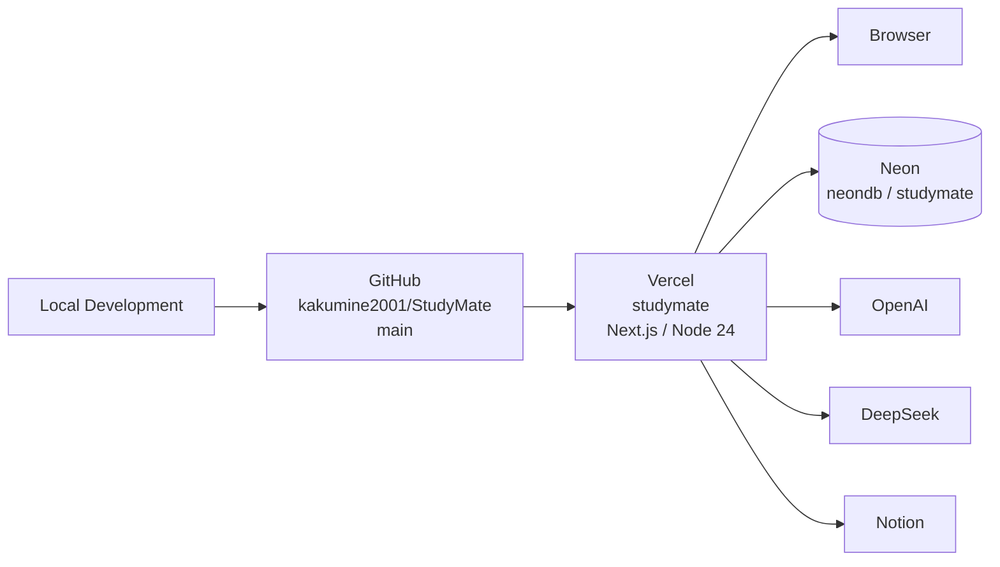

# Deployment Architecture

## 已验证生产状态

截至 2026-09-05：

### GitHub

```text
Repository: kakumine2001/StudyMate
Branch: main
```

### Vercel

```text
Project: studymate
Framework: Next.js
Node.js: 24.x
Deployment type: Lambdas
Production region: iad1
```

Production aliases：

```text
studymate-lab-ai.vercel.app
studymate-kaku10.vercel.app
```

首次编写本文档时核对的 production deployment 使用 Git commit：

```text
8f0bc2b53f56e143f29d4d1256e09aa5186f77b3
```

Vercel 项目已经连接：

```text
kakumine2001 / StudyMate
```

当时最新部署记录显示 source 为 CLI，但部署元数据对应 GitHub `main` commit。因此以后排查“为什么线上不是这个代码”时，要同时看：

1. GitHub main HEAD
2. Vercel deployment commit SHA
3. deployment source

不要只看域名。

### Neon

```text
Project: neon_db
Region: aws-us-east-1
PostgreSQL: 18
Branch: production
Database: neondb
Schema: studymate
```

当前 Vercel `iad1` 与 Neon `aws-us-east-1` 都位于美国东部。

## Deployment Diagram



## Build

`package.json` 当前：

```json
{
  "build": "prisma generate && next build",
  "start": "next start",
  "prisma:migrate": "node scripts/prisma-migrate-retry.mjs"
}
```

所以：

```text
npm run build
!=
npm run prisma:migrate
```

这是一个需要长期记住的区别。

### Migration

代码库有 migration retry wrapper，用来处理 Neon 短暂连接问题。

但从代码本身不能推断 Vercel 每次 build 一定会执行 migration。

因此部署数据库结构变更时，应明确确认：

```text
migration 是否已经执行
        ↓
再部署依赖新 schema 的代码
```

不要默认“push 到 main = migration 自动完成”。

## Database Schema Boundary

连接字符串必须把 StudyMate 指向：

```text
?schema=studymate
```

并且运行时 `src/lib/prisma.ts` 会再次显式把这个 schema 传给 Prisma adapter。

这是必要的，因为同一个 Neon database 里还有：

```text
kaku_log
```

## Environment Variable Categories

### Core

```text
DATABASE_URL
COOKIE_SECRET
```

### OpenAI

```text
OPENAI_API_KEY
OPENAI_BASE_URL
OPENAI_TEXT_MODEL
OPENAI_IMAGE_MODEL
```

### DeepSeek

```text
DEEPSEEK_API_KEY
DEEPSEEK_BASE_URL
DEEPSEEK_FLASH_MODEL
DEEPSEEK_PRO_MODEL
```

### Notion

```text
NOTION_API_KEY
NOTION_DATABASE_ID
```

### Current Local Storage

```text
STUDYMATE_STORAGE_DIR
```

这个变量属于当前旧 Storage Layer。迁移到 Vercel Blob 后应重新整理相关配置。

## Production Debug Checklist

线上出问题时按这个顺序，不要随机排查：

### 1. 确认部署代码

```text
GitHub main HEAD
vs
Vercel deployment commit SHA
```

### 2. 看 Vercel deployment state

确认：

```text
READY / ERROR
```

### 3. 看 Vercel build/runtime logs

区分：

- build error
- route runtime error
- upstream provider error

### 4. 确认 Neon

检查：

- production branch 是否 ready
- `neondb` 是否存在
- `studymate` schema 是否存在
- migration 是否完成

### 5. 再查外部 API

- OpenAI
- DeepSeek
- Notion

## Legacy Render Files

仓库目前仍有：

```text
render.yaml
```

它属于历史部署配置。

当前真实生产是 Vercel，所以架构判断不要以 `render.yaml` 为准。

如果以后确认完全不再需要 Render 回退方案，可以单独做一次 cleanup 删除它；本次架构文档提交不修改运行代码或历史部署文件。
