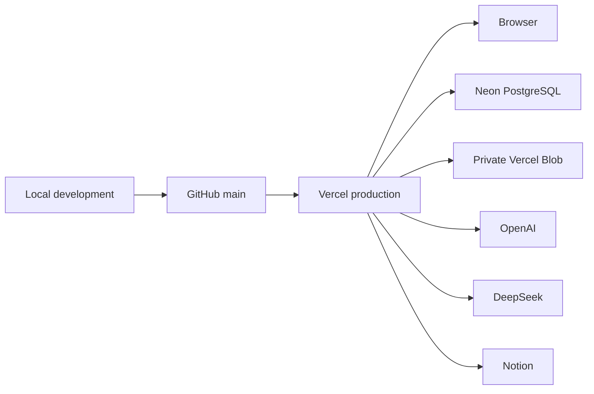

# Deployment Architecture

## 已验证生产状态

截至 2026-09-05：

### GitHub

```text
Repository: kakumine2001/StudyMate
Branch: main
```

### Vercel

```text
Project: studymate
Framework: Next.js
Node.js: 24.x
Deployment type: Lambdas
Production region: iad1
```

Production aliases：

```text
studymate-lab-ai.vercel.app
studymate-kaku10.vercel.app
```

生产部署应始终核对 Vercel deployment 的 `gitSource.sha` 是否等于 GitHub `main` 当前提交；不要仅凭域名判断线上代码版本。

Vercel 项目已经连接：

```text
kakumine2001 / StudyMate
```

当时最新部署记录显示 source 为 CLI，但部署元数据对应 GitHub `main` commit。因此以后排查“为什么线上不是这个代码”时，要同时看：

1. GitHub main HEAD
2. Vercel deployment commit SHA
3. deployment source

不要只看域名。

### Neon

```text
Project: neon_db
Region: aws-us-east-1
PostgreSQL: 18
Branch: production
Database: neondb
Schema: studymate
```

当前 Vercel `iad1` 与 Neon `aws-us-east-1` 都位于美国东部。

## Deployment Diagram



## Build

`package.json` 与 `vercel.json` 当前：

```json
{
  "build": "prisma generate && next build",
  "start": "next start",
  "prisma:migrate": "node scripts/prisma-migrate-retry.mjs"
}
```

所以：

```text
npm run build
# prisma generate && next build
```

Vercel 的 `vercel.json` build command 会先运行 `npm run prisma:migrate`，再运行 `npm run build`；本地单独执行 `npm run build` 不会自动迁移数据库。

### Migration

代码库有 migration retry wrapper，用来处理 Neon 短暂连接问题。

当前 `vercel.json` 的 Build Command 会先执行 `npm run prisma:migrate`，再执行 `npm run build`。因此从 Vercel 正常构建的 production deployment 会走 migration deploy。

仍需注意：Preview 环境如果复用生产 `DATABASE_URL`，也可能触发 migration，所以环境变量必须明确区分。

## Database Schema Boundary

连接字符串必须把 StudyMate 指向：

```text
?schema=studymate
```

并且运行时 `src/lib/prisma.ts` 会再次显式把这个 schema 传给 Prisma adapter。

这是必要的，因为同一个 Neon database 里还有：

```text
kaku_log
```

## Environment Variable Categories

### Core

```text
DATABASE_URL
COOKIE_SECRET
```

### OpenAI

```text
OPENAI_API_KEY
OPENAI_BASE_URL
OPENAI_TEXT_MODEL
OPENAI_IMAGE_MODEL
```

### DeepSeek

```text
DEEPSEEK_API_KEY
DEEPSEEK_BASE_URL
DEEPSEEK_FLASH_MODEL
DEEPSEEK_PRO_MODEL
```

### Notion

```text
NOTION_API_KEY
NOTION_DATABASE_ID
```

### Image Storage

生产环境使用私有 Vercel Blob：

```text
Vercel Function
  -> @vercel/blob.put / get
  -> Private Vercel Blob (studymate-images)
  -> PostgreSQL 保存 imageStoragePath
```

Vercel 项目在 Production、Preview、Development 环境配置 `BLOB_READ_WRITE_TOKEN`。本地开发未配置该 token 时，Storage Layer 回退到 `STUDYMATE_STORAGE_DIR`；Vercel 环境缺少 token 会直接报错。

## Production Debug Checklist

线上出问题时按这个顺序，不要随机排查：

### 1. 确认部署代码

```text
GitHub main HEAD
vs
Vercel deployment commit SHA
```

### 2. 看 Vercel deployment state

确认：

```text
READY / ERROR
```

### 3. 看 Vercel build/runtime logs

区分：

- build error
- route runtime error
- upstream provider error

### 4. 确认 Neon

检查：

- production branch 是否 ready
- `neondb` 是否存在
- `studymate` schema 是否存在
- migration 是否完成

### 5. 再查外部 API

- OpenAI
- DeepSeek
- Notion
