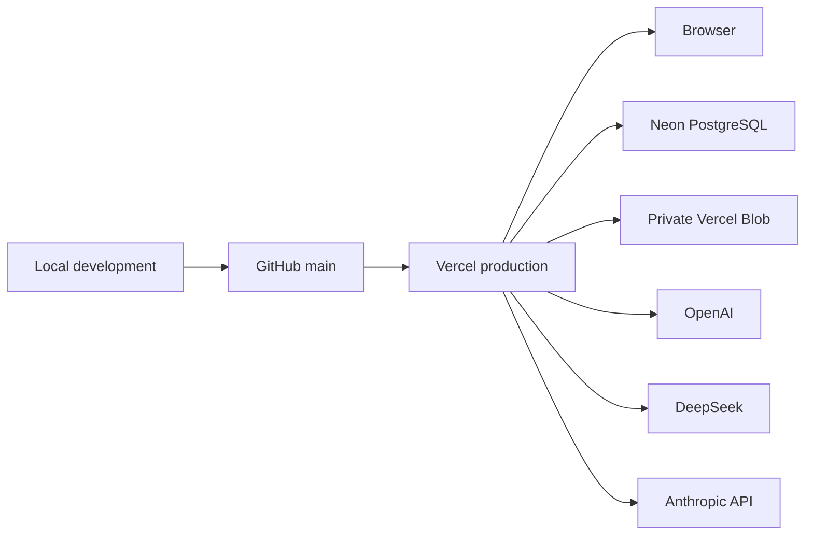

# Deployment Architecture

## 已验证生产状态

GitHub 仓库、Vercel 项目名与绑定域名于 2026-11-15 重新核对。生产数据库连接的运行核验仍为 2026-09-16，Neon 项目资源核验为 2026-09-05；以下配置说明不代表所有线上功能已通过最新端到端验证。

### GitHub

```text
Repository: kakumine2001/NoteFable
Branch: main
```

### Vercel

```text
Project: notefable
Framework: Next.js
Node.js: 24.x
Deployment type: Lambdas
Production region: iad1
```

Production aliases：

```text
notefable.com                 # 正式域名（2026-11-15 购入，Vercel 管理 DNS）
www.notefable.com             # 308 跳转到 notefable.com
studymate-lab-ai.vercel.app   # 旧网址，继续可用（匿名用户的数据跟着各自域名的 Cookie）
notefable-kaku10.vercel.app   # Vercel 项目 2026-11-15 由 studymate 改名为 notefable
```

生产部署应始终核对 Vercel deployment 的 `gitSource.sha` 是否等于 GitHub `main` 当前提交；不要仅凭域名判断线上代码版本。

Vercel 项目已经连接：

```text
kakumine2001 / NoteFable
```

当前生产由 GitHub `main` push 触发，部署记录的 source 为 `git`。排查线上版本时，要同时看：

1. GitHub main HEAD
2. Vercel deployment commit SHA
3. deployment source

不要只看域名。

### Neon

```text
Project: neon_db
Region: aws-us-east-1
PostgreSQL: 18
Branch: production
Database: neondb
Schema: studymate
```

当前 Vercel `iad1` 与 Neon `aws-us-east-1` 都位于美国东部。

## Deployment Diagram



## Build

`package.json` 的 `engines.node` 固定为 `24.x`，与本地和 Vercel 运行环境一致，避免自动跨到下一个 Node.js 主版本。

`package.json` 与 `vercel.json` 当前：

```json
{
  "build": "prisma generate && next build",
  "start": "next start",
  "prisma:migrate": "node scripts/prisma-migrate-retry.mjs"
}
```

所以：

```text
npm run build
# prisma generate && next build
```

Vercel 的 `vercel.json` build command 会先运行 `npm run prisma:migrate`，再运行 `npm run build`；本地单独执行 `npm run build` 不会自动迁移数据库。

### Migration

代码库有 migration retry wrapper，用来处理 Neon 短暂连接问题。

当前 `vercel.json` 的 Build Command 会先执行 `npm run prisma:migrate`，再执行 `npm run build`。因此从 Vercel 正常构建的 production deployment 会走 migration deploy。

仍需注意：Preview 环境如果复用生产 `DATABASE_URL`，也可能触发 migration，所以环境变量必须明确区分。

## Database Schema Boundary

生产连接字符串必须把 NoteFable 指向：

```text
?schema=studymate
```

并且运行时 `src/lib/prisma.ts` 会再次显式把这个 schema 传给 Prisma adapter。

这是必要的，因为同一个 Neon database 里还有：

```text
kaku_log
```

本地使用独立数据库 `studymate` 的 `public` schema，不共享生产库。启动与迁移步骤见 [README](../../README.md#本地启动)。

生产 `DATABASE_URL` 当前使用 Neon pooled endpoint。Node 运行时会将旧的 SSL 别名明确为 `verify-full`，保持证书与主机名验证；详见 [数据库连接说明](database.md#runtime-connection)。

## Environment Variable Categories

### Core

```text
DATABASE_URL
COOKIE_SECRET
```

### Google 登录（可选）

```text
AUTH_SECRET
AUTH_GOOGLE_ID
AUTH_GOOGLE_SECRET
```

三项都配置才启用；在 Google Cloud 的 OAuth 客户端中登记重定向 URI `https://<域名>/api/auth/callback/google`（本地为 `http://localhost:3000/api/auth/callback/google`）。

**Google 同意屏幕（品牌塑造页）**：公开页面是 `/privacy`（隐私权政策）和 `/terms`（服务条款），页面内容在 `src/app/privacy/page.tsx`、`src/app/terms/page.tsx`，联系邮箱和更新日期在 `src/components/legal-page.tsx`；两个链接也放在聊天 / 笔记侧栏底部。Google Cloud → Google Auth Platform → 品牌塑造里填：应用主页 `https://notefable.com`，隐私权政策 `https://notefable.com/privacy`，服务条款 `https://notefable.com/terms`；已授权网域登记了 `notefable.com` 和旧的 `studymate-lab-ai.vercel.app`，OAuth 客户端的重定向 URI 也两个都登记了（加上本地 `http://localhost:3000`），所以从这两个域名都能 Google 登录（其他域名会报 `redirect_uri_mismatch`）。应用名是 NoteFable。当前只用 `openid` / `email` / `profile` 基础权限，不需要 Google 的敏感权限审核；OAuth 同意屏幕已于 2026-10-14 发布为“正式版”（Google Auth Platform → 对象 页可随时“改回测试”）；网站所有权已在 Search Console 用 `public/googlebbfeef8de1d165ef.html` 验证（**这个文件不能删**）；“品牌验证”（让同意屏幕显示应用名和链接）是可选步骤，尚未提交；改了数据处理方式（比如新增第三方服务）时要同步更新这两个页面。

### 邮箱验证码登录（可选）

```text
AUTH_SECRET
RESEND_API_KEY
EMAIL_FROM
```

用户输入邮箱，收到 6 位验证码后登录（`/api/auth/email/start`、`/api/auth/email/verify`），不设密码。发信用 [Resend](https://resend.com)；`EMAIL_FROM` 是发件人，生产为 `NoteFable <login@notefable.com>`。`notefable.com` 已在 Resend（东京区域）添加，验证用的 DKIM（`resend._domainkey` TXT）、发信（`send`、`rsend` CNAME）和 DMARC（`_dmarc` TXT）记录加在 Vercel 的 DNS 里。没验证域名时 Resend 只能用 `onboarding@resend.dev` 发给注册账号本人，`*.vercel.app` 也不能验证，所以正式开放需要自己的域名。本地开发（非 production）没配 `RESEND_API_KEY` 时也能用：验证码不发信，打印在开发服务器日志里（`[email-login] code for …`）。production 没配齐时不显示邮箱登录。登录成功后签发和 Google 登录同一种 Auth.js 会话 Cookie（`loginEmail`），账号合并规则见 [database.md](database.md) 的 `verifiedEmail`。

Android App 内的登录复用同一个 Web 客户端 ID（`AUTH_GOOGLE_ID`）校验令牌，不需要新增环境变量；另需在同一个 Google Cloud 项目里建一个 Android 类型客户端（包名 + 签名 SHA-1），详见 [android.md](android.md)。

### OpenAI

```text
OPENAI_API_KEY
OPENAI_BASE_URL
OPENAI_TEXT_MODEL
OPENAI_IMAGE_MODEL
```

代码默认聊天模型为 `gpt-6-luna`，图片生成与编辑为 `gpt-image-2.6-sunburst`。Production 使用官方接入点 `https://api.openai.com/v1`，两条流程共用服务端 `OPENAI_API_KEY`。本地代码不代表已发布的线上版本；更换密钥或模型环境变量后，需要重新部署才能应用到运行中的函数。

### DeepSeek

```text
DEEPSEEK_API_KEY
DEEPSEEK_BASE_URL
DEEPSEEK_FLASH_MODEL
```

### Anthropic

```text
ANTHROPIC_API_KEY
ANTHROPIC_BASE_URL
ANTHROPIC_HAIKU_MODEL
```

启用 Claude 必须配置服务端密钥。默认接入点 `https://api.anthropic.com/v1`，模型 `claude-haiku-5-5`，调用 Messages API；后两项可省略。API 独立计费。修改 Vercel 环境变量后重新部署生效，密钥不得进入客户端或 Git。

### 可用模型（`STUDYMATE_MODELS`，可选）

`src/lib/models.ts` 定义内置模型和每个模型的能力；服务器用 `STUDYMATE_MODELS` 决定现在开放哪些，网页和 Android 都从服务器拿这份结果（`src/lib/model-registry.ts`、`GET /api/models`）。不设置时使用全部内置模型。

值是一个 JSON 数组。只有写在里面的模型可用，顺序就是选择器里的顺序，第一个是默认模型：

```text
STUDYMATE_MODELS=[{"id":"gpt-6-luna"},{"id":"claude-haiku-5-5","label":"Claude","upstreamModel":"claude-haiku-5-5"}]
```

- 内置 id：以内置设置为底，只覆盖写出的字段（`label`、`upstreamModel`、能力开关、推理档位、`tokenLimits`）。
- 推理档位只能用同一 provider 的内置模型已有的档位；`tokenLimits` 是 `{"contextWindow":正整数,"maxOutputTokens":正整数}`，Anthropic 请求的 `max_tokens` 取其中的 `maxOutputTokens`（不写则用 Haiku 的上限）。`"enabled": false` 可以临时下架。
- 新 id：必须写全 `label`、`provider`（`openai` / `anthropic` / `deepseek`）、`supportsImageInput`、`supportsWebSearch`、`supportsCompaction`、`supportsPageTools`、`reasoningEfforts`、`defaultReasoning`。每个 provider 的接入代码是固定的，新 id 只能复用已有的三种。
- 上游模型名的优先级：`upstreamModel` > 旧的单模型变量（`OPENAI_TEXT_MODEL` 等）> id 本身。
- 内容无法解析或不合法时，服务器记一条日志并退回内置列表，不会让模型选择器失效。
- `/` 和 `/app` 是静态页面，模型列表在构建时确定；修改这个变量后必须重新部署。

### Image Storage

生产环境使用私有 Vercel Blob：

```text
Vercel Function
  -> @vercel/blob.put / get
  -> Private Vercel Blob (studymate-images)
  -> PostgreSQL 保存 imageStoragePath
```

Vercel 项目在 Production、Preview、Development 环境配置 `BLOB_READ_WRITE_TOKEN`。本地开发未配置该 token 时，Storage Layer 回退到 `STUDYMATE_STORAGE_DIR`；Vercel 环境缺少 token 会直接报错。

## Production Debug Checklist

线上出问题时按这个顺序，不要随机排查：

### 1. 确认部署代码

```text
GitHub main HEAD
vs
Vercel deployment commit SHA
```

### 2. 看 Vercel deployment state

确认：

```text
READY / ERROR
```

### 3. 看 Vercel build/runtime logs

区分：

- build error
- route runtime error
- upstream provider error

### 4. 确认 Neon

检查：

- production branch 是否 ready
- `neondb` 是否存在
- `studymate` schema 是否存在
- migration 是否完成

### 5. 再查外部 API

- OpenAI
- DeepSeek
- Anthropic
