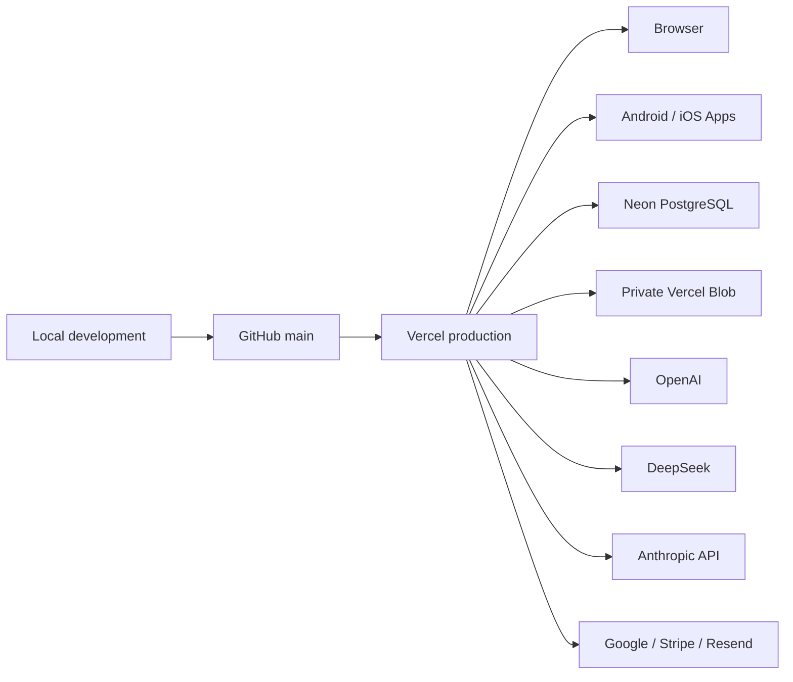

# Deployment Architecture

## 已验证生产状态

GitHub 仓库、Vercel 项目名与绑定域名于 2026-11-15 重新核对。生产数据库连接的运行核验仍为 2026-09-16，Neon 项目资源核验为 2026-09-05；以下配置说明不代表所有线上功能已通过最新端到端验证。

### GitHub

```text
Repository: kakumine2001/NoteFable
Branch: main
```

### Vercel

```text
Project: notefable
Framework: Next.js
Node.js: 24.x
Deployment type: Lambdas
Production region: iad1
```

Production aliases：

```text
notefable.com                 # 正式域名（2026-11-15 购入，Vercel 管理 DNS）：介绍页、法律页面
app.notefable.com             # 工作区（聊天与 Notes）
www.notefable.com             # 308 跳转到 notefable.com
notefable-kaku10.vercel.app
```

### 官网与工作区分域（`src/lib/hosts.ts`）

参照 Notion：介绍页在 `notefable.com`，工作区在 `app.notefable.com`，同一个 Vercel 项目、同一份代码，由 `src/proxy.ts` 按主机分流。Production 设置两个变量时才分域：

```text
NEXT_PUBLIC_SITE_ORIGIN=https://notefable.com
NEXT_PUBLIC_APP_ORIGIN=https://app.notefable.com
```

`NEXT_PUBLIC_*` 在构建时写进页面，修改后要重新部署。Preview 和本地不设这两个变量，保持单主机（`/` 介绍页、`/app` 工作区）；设了变量后，不是这两个主机的请求（Preview 的 `*.vercel.app`、`notefable-kaku10.vercel.app`）也按单主机处理。

| 请求 | 结果 |
| --- | --- |
| `notefable.com/` | 介绍页；用过工作区的设备（共享提示 Cookie `notefable_app`，或旧的设备 / 登录 Cookie）转到 `app.notefable.com/`，`/?intro` 始终显示介绍页 |
| `notefable.com/app`、`notefable.com/?chat=…` 等旧链接 | 307 转到 `app.notefable.com/`，保留全部查询参数 |
| `notefable.com/note-embed`、`notefable.com/<语言>/note-embed` | 307 转到 `app.notefable.com` 的同一路径，保留查询参数（编辑器用的接口只在工作区主机） |
| `app.notefable.com/` | 工作区（rewrite 到 `/{locale}/app`），`X-Robots-Tag: noindex`，写入 `Domain=notefable.com` 的提示 Cookie `notefable_app=1`（只是“用过工作区”的标记，不是登录凭证） |
| 两个主机的 `/c/<会话>?message=…` | 会话的分享链接（保存到笔记、导出的 Markdown 里写的），转到工作区 `app.notefable.com/?chat=…&message=…`；其中 `app.notefable.com/c/…` 在装了 Android App 时由 App Links 直接在 App 里打开（`public/.well-known/assetlinks.json`，`AndroidManifest.xml` 仅匹配工作区主机） |
| `notefable.com/{locale}/app` | 转到 `app.notefable.com/`，保留查询参数 |
| `app.notefable.com/app` | 转到 `app.notefable.com/`（Stripe 付款后的返回地址 `/app?billing=…` 走这里） |
| `app.notefable.com/api/*` | 接口只在工作区主机提供。Android App 的 `BASE_URL`、iOS App 的 `NOTEFABLE_BASE_URL`、Stripe Webhook、Google Play RTDN（Pub/Sub push 和 `GOOGLE_PLAY_PUSH_AUDIENCE`）都登记这个主机（[billing.md](billing.md)） |
| `notefable.com/api/*` | 421（JSON，`code: "wrong_host"`；不跳转：Webhook 和 App 不跟随跳转，登记错了要马上看得出来；不用 404，因为界面把 404 当成“笔记或会话已删除”）。例外只有 `/api/i18n`（介绍页的语言菜单取词典）；介绍页的语言菜单在这个主机上不向账号保存（没有登录，选择靠共用的语言 Cookie 带到工作区）。规则是 `next.config.ts` 的 rewrite（`siteApiBlockRewrites`，`src/lib/hosts.ts`），按主机名匹配，转到 `/api/unavailable`；没分域的环境、两个主机名相同只差端口的配置和 `*.vercel.app` 别名不受影响 |

Cookie 和浏览器存储按主机分开：匿名设备 Cookie、登录会话 Cookie 和 `localStorage`（草稿、模型选择等）不会从 `notefable.com` 带到 `app.notefable.com`。分域时的决定（2026-11-19）是不迁移：旧的匿名数据留在数据库里，在新主机上从新的匿名身份开始；登录用户在新主机重新登录后数据照常可见。界面语言 Cookie（`notefable-locale`）在分域后写到 `Domain=notefable.com`，两个主机共用。

上线 / 回退步骤：

1. Vercel 项目添加 `app.notefable.com`（Vercel 管理 DNS，自动签发证书）。
2. Google OAuth 客户端登记 `https://app.notefable.com/api/auth/callback/google`（`notefable.com` 的回调不登记）。
3. Stripe Webhook 端点、Pub/Sub push 订阅（地址和 audience）和 `GOOGLE_PLAY_PUSH_AUDIENCE` 都改成 `app.notefable.com` 的地址。
4. Production 设置上面两个变量并重新部署。
5. 回退：删除两个变量并重新部署，即回到单主机，`notefable.com/api/*` 恢复可用；`app.notefable.com` 可以保留，第 3 步登记的地址不用改回。

生产部署应始终核对 Vercel deployment 的 `gitSource.sha` 是否等于 GitHub `main` 当前提交；不要仅凭域名判断线上代码版本。

Vercel 项目已经连接：

```text
kakumine2001 / NoteFable
```

当前生产由 GitHub `main` push 触发，部署记录的 source 为 `git`。排查线上版本时，要同时看：

1. GitHub main HEAD
2. Vercel deployment commit SHA
3. deployment source

不要只看域名。

### Neon

```text
Project: neon_db
Region: aws-us-east-1
PostgreSQL: 18
Branch: production
Database: neondb
Schema: notefable
```

当前 Vercel `iad1` 与 Neon `aws-us-east-1` 都位于美国东部。

## Deployment Diagram



## Build

`package.json` 的 `engines.node` 固定为 `24.x`，与本地和 Vercel 运行环境一致，避免自动跨到下一个 Node.js 主版本。

`package.json` 与 `vercel.json` 当前：

```json
{
  "build": "prisma generate && next build",
  "start": "next start",
  "prisma:migrate": "node scripts/prisma-migrate-retry.mjs"
}
```

所以：

```text
npm run build
# prisma generate && next build
```

Vercel 的 `vercel.json` build command 会先运行 `npm run prisma:migrate`，再运行 `npm run build`；本地单独执行 `npm run build` 不会自动迁移数据库。

`npm run build` 和 `npm run dev` 之前会先跑 `scripts/copy-whiteboard-assets.mjs`（`prebuild` / `predev`）：把白板用的 Excalidraw 字体和 pdf.js 的 worker 从 `node_modules` 写到 `public/whiteboard/`（不进仓库，随静态文件部署），白板不从 CDN 读字体（[whiteboard.md](whiteboard.md)）。没有新的环境变量。

### Migration

代码库有 migration retry wrapper，用来处理 Neon 短暂连接问题。

当前 `vercel.json` 的 Build Command 会先执行 `npm run prisma:migrate`，再执行 `npm run build`。因此从 Vercel 正常构建的 production deployment 会走 migration deploy。

Preview 的 `DATABASE_URL` 由 Neon 的 Vercel 集成按 git 分支提供（见下面「Preview 数据库与图片」），Preview 构建的 migration 只改那个分支库。

### Preview 数据库与图片（Neon 的 Vercel 集成）

Preview 永远不连生产库，也不碰生产的图片。2026-11-19 起由 Neon 的 Vercel 集成（Neon 控制台 → 项目 `neon_db` → Integrations → Vercel）自动管理：

1. 每个 git 分支第一次部署 Preview 时，集成先取消那次构建，从 `production` 复制出 Neon 分支 `preview/<git 分支名>`，把它的 `DATABASE_URL` / `DATABASE_URL_UNPOOLED` 写成只对这个 git 分支生效的 Preview 变量，再重新部署。之后同一分支的部署都连这个库。被取消的那次构建会在 GitHub PR 上显示成一个失败的 Vercel 检查，合并前等重新部署那次变成成功。
2. 构建里的 `prisma migrate deploy` 只改这个分支库，不碰 `production` 和别的 PR。
3. git 分支合并或删除后，集成删掉对应的 Neon 分支和分支变量（集成设置里的 “Automatically delete obsolete Neon branches”）。清理在下一次有 Preview 部署时才执行，所以刚合并的分支库会留到下一个 PR 部署为止，这是正常的。
4. Production 的 `DATABASE_URL` 不归集成管，仍是原来的值。集成另外加了 Production 的 `DATABASE_URL_UNPOOLED`，代码不读。Development 环境没有数据库变量，也没有 `vercel-dev` 分支（安装时的可选项，已删除）；本地开发照旧用 `.env`。

图片：Preview 的 `BLOB_READ_WRITE_TOKEN` 指向单独的私有 Blob store `notefable-preview`，Production / Development 用原来的 store。所以 Preview 里删图、删账号不会删掉正式用户的图片；从生产复制来的旧图片在 Preview 里读不到（404），这是预期的。

没有不限分支的 Preview `DATABASE_URL`，也没有共享的 Preview 库：每个 Preview 都只连集成给它建的分支库。

规则：迁移一旦部署过（包括 Preview）就不再修改，要改另写新迁移。以前的共享 Preview 库就是因为一个已执行的迁移后来又被改过，缺列，导致 Preview 全部 500。

## Database Schema Boundary

NoteFable 的表固定放在 `notefable` schema：`src/lib/database-url.ts` 的 `DATABASE_SCHEMA` 会覆盖 `DATABASE_URL` 里的 `?schema=`（运行时 `src/lib/prisma.ts` 和迁移 `prisma.config.ts` 都是），运行时再显式把它传给 Prisma adapter。连接字符串里写什么 schema 都不影响。

`scripts/prisma-migrate-retry.mjs` 在迁移前检查：数据库里别的 schema 已有 NoteFable 的表、`notefable` 却没有迁移记录时直接失败（否则 `prisma migrate deploy` 会新建一个空的 `notefable` schema，上线后看起来数据全没了）。

这是必要的，因为同一个 Neon database 里还有：

```text
kaku_log
```

本地使用独立数据库 `notefable`（schema 同样是 `notefable`），不共享生产库。启动与迁移步骤见 [README](../../README.md#本地启动)。

生产 `DATABASE_URL` 当前使用 Neon pooled endpoint。Node 运行时会将旧的 SSL 别名明确为 `verify-full`，保持证书与主机名验证；详见 [数据库连接说明](database.md#runtime-connection)。

## Environment Variable Categories

### Core

```text
DATABASE_URL
COOKIE_SECRET
```

### 官网与工作区分域（可选）

```text
NEXT_PUBLIC_SITE_ORIGIN
NEXT_PUBLIC_APP_ORIGIN
```

两者同时设置时启用分域（见上方「官网与工作区分域」）。未配置分域时，`src/lib/i18n/routing.ts` 的 `siteOrigin()` 会回退读取 Vercel 内置环境变量 `VERCEL_PROJECT_PRODUCTION_URL`（用于 `robots.ts`、`sitemap.ts` 和根布局的 `metadataBase`）。

### Stripe 订阅（可选）

```text
STRIPE_SECRET_KEY
STRIPE_PRICE_ID
STRIPE_WEBHOOK_SECRET
```

月额 Pro（¥300）的网页付款。三项都设置时才开放申请；缺任一项时没有升级入口，`/api/billing/checkout` 返回 404（Webhook 和“管理订阅”的 `/api/billing/portal` 只需要 `STRIPE_SECRET_KEY` 和 `STRIPE_WEBHOOK_SECRET`）。Customer Portal 的解约方式由代码保持为“在计费周期结束时取消”。Stripe 后台的产品、价格、Webhook 端点（`/api/billing/webhook`）和 Customer Portal 设置见 [billing.md](billing.md#配置stripe)。

### Google Play 结算（可选）

```text
GOOGLE_PLAY_SERVICE_ACCOUNT_JSON
GOOGLE_PLAY_PUSH_SERVICE_ACCOUNT
GOOGLE_PLAY_PUSH_AUDIENCE
GOOGLE_PLAY_PACKAGE_NAME   # 可选
GOOGLE_PLAY_PRODUCT_ID     # 可选
```

Android App 内购买 Pro。前两项都设置时才开放；Play Console 的订阅商品、服务账号权限和 Pub/Sub（RTDN）设置见 [billing.md](billing.md#配置google-play)。

### Google 登录（可选）

```text
AUTH_SECRET
AUTH_GOOGLE_ID
AUTH_GOOGLE_SECRET
```

三项都配置才启用；在 Google Cloud 的 OAuth 客户端中登记重定向 URI `https://<域名>/api/auth/callback/google`（分域后登录在 `app.notefable.com` 进行，登记这个主机的回调；`notefable.com` 的回调不登记；回退到单主机时要重新登记）（本地为 `http://localhost:3000/api/auth/callback/google`）。

**Google 同意屏幕（品牌塑造页）**：公开页面是 `/privacy`（隐私权政策）和 `/terms`（服务条款），页面内容在 `src/app/privacy/page.tsx`、`src/app/terms/page.tsx`，联系邮箱和更新日期（`LEGAL_UPDATED_ISO`）在 `src/components/legal-page.tsx`；这两个链接和特商法标示 `/legal-notice` 也放在聊天 / 笔记侧栏底部的帮助菜单（网页、Android 与 iOS）和介绍页页脚。Google Cloud → Google Auth Platform → 品牌塑造里填：应用主页 `https://notefable.com`，隐私权政策 `https://notefable.com/privacy`，服务条款 `https://notefable.com/terms`；已授权网域登记 `notefable.com`，OAuth 客户端的重定向 URI 登记 `https://app.notefable.com/api/auth/callback/google`（分域后的工作区主机；主域 `notefable.com/api/*` 返回 421）和本地 `http://localhost:3000/api/auth/callback/google`（其他域名会报 `redirect_uri_mismatch`）。应用名是 NoteFable。当前只用 `openid` / `email` / `profile` 基础权限，不需要 Google 的敏感权限审核；OAuth 同意屏幕已于 2026-10-14 发布为“正式版”（Google Auth Platform → 对象 页可随时“改回测试”）；网站所有权已在 Search Console 用 `public/googlebbfeef8de1d165ef.html` 验证（**这个文件不能删**）；“品牌验证”（让同意屏幕显示应用名和链接）是可选步骤，尚未提交；改了数据处理方式（比如新增第三方服务）时要同步更新这两个页面，并改 `LEGAL_UPDATED_ISO`。

### 邮箱验证码登录（可选）

```text
AUTH_SECRET
RESEND_API_KEY
EMAIL_FROM
```

用户输入邮箱，收到 6 位验证码后登录（`/api/auth/email/start`、`/api/auth/email/verify`），不设密码。发信用 [Resend](https://resend.com)；`EMAIL_FROM` 是发件人，生产为 `NoteFable <login@notefable.com>`。生产环境的回答举报（`POST /api/reports`，`src/lib/answer-report.ts`）也共用 `RESEND_API_KEY` 和 `EMAIL_FROM` 给开发者发信，未配置时返回 502。`notefable.com` 已在 Resend（东京区域）添加，验证用的 DKIM（`resend._domainkey` TXT）、发信（`send`、`rsend` CNAME）和 DMARC（`_dmarc` TXT）记录加在 Vercel 的 DNS 里。没验证域名时 Resend 只能用 `onboarding@resend.dev` 发给注册账号本人，`*.vercel.app` 也不能验证，所以正式开放需要自己的域名。本地开发（非 production）没配 `RESEND_API_KEY` 时也能用：验证码不发信，打印在开发服务器日志里（`[email-login] code for …`）。production 没配齐时不显示邮箱登录。登录成功后签发和 Google 登录同一种 Auth.js 会话 Cookie（`loginEmail`），账号合并规则见 [database.md](database.md) 的 `verifiedEmail`。

Android 和 iOS 原生 App 内的 Google 登录都复用同一个 Web 客户端 ID（`AUTH_GOOGLE_ID`）作为令牌受众，服务端不需要新增环境变量；另需在同一个 Google Cloud 项目里登记对应平台的客户端（Android 为包名 + Play 应用签名 SHA-1，见 [android.md](android.md)；iOS 为 Bundle ID 对应的 iOS 客户端并通过 `GOOGLE_IOS_CLIENT_ID` / `GOOGLE_IOS_REVERSED_CLIENT_ID` 注入构建，见 [ios.md](ios.md) 与 [ios-native.md](ios-native.md)）。

### OpenAI

```text
OPENAI_API_KEY
OPENAI_BASE_URL
OPENAI_TEXT_MODEL
OPENAI_IMAGE_MODEL
OPENAI_EMBEDDING_MODEL
NOTEFABLE_SEMANTIC_SEARCH
```

代码默认聊天模型为 `gpt-6-luna`，图片生成与编辑为 `gpt-image-2.6-sunburst`，笔记语义搜索嵌入模型为 `text-embedding-3-small`（可选 `text-embedding-3-small` / `text-embedding-3-large`，512 维，非法值会记录警告并回退默认；共用 `OPENAI_API_KEY` 与 `OPENAI_BASE_URL`）。`NOTEFABLE_SEMANTIC_SEARCH` 设为 `0` 或 `false` 时关闭语义搜索（退回纯关键词搜索）。Production 使用官方接入点 `https://api.openai.com/v1`。本地代码不代表已发布的线上版本；更换密钥或模型环境变量后，需要重新部署才能应用到运行中的函数。

### DeepSeek

```text
DEEPSEEK_API_KEY
DEEPSEEK_BASE_URL
DEEPSEEK_FLASH_MODEL
```

### Anthropic

```text
ANTHROPIC_API_KEY
ANTHROPIC_BASE_URL
ANTHROPIC_HAIKU_MODEL
```

启用 Claude 必须配置服务端密钥。默认接入点 `https://api.anthropic.com`；`ANTHROPIC_BASE_URL` 和官方 SDK 一样可以不带 `/v1`，带不带都行（末尾不是 `/v1` 时自动补上，见 `anthropicMessagesUrl`）；模型 `claude-haiku-5-5`，调用 Messages API；后两项可省略。API 独立计费。修改 Vercel 环境变量后重新部署生效，密钥不得进入客户端或 Git。

### 可用模型（`NOTEFABLE_MODELS`，可选）

`src/lib/models.ts` 定义内置模型和每个模型的能力；服务器用 `NOTEFABLE_MODELS` 决定现在开放哪些，网页、Android 和 iOS 都从服务器拿这份结果（`src/lib/model-registry.ts`、`GET /api/models`）。不设置时使用全部内置模型。

值是一个 JSON 数组。只有写在里面的模型可用，顺序就是选择器里的顺序，第一个是默认模型：

```text
NOTEFABLE_MODELS=[{"id":"gpt-6-luna"},{"id":"claude-haiku-5-5","label":"Claude","upstreamModel":"claude-haiku-5-5"}]
```

- 内置 id：以内置设置为底，只覆盖写出的字段（`label`、`upstreamModel`、能力开关、推理档位、`tokenLimits`）。
- 推理档位只能用同一 provider 的内置模型已有的档位；`tokenLimits` 是 `{"contextWindow":正整数,"maxOutputTokens":正整数}`，Anthropic 请求的 `max_tokens` 取其中的 `maxOutputTokens`（不写则用 Haiku 的上限）。`"enabled": false` 可以临时下架。
- 新 id：必须写全 `label`、`provider`（`openai` / `anthropic` / `deepseek`）、`supportsImageInput`、`supportsWebSearch`、`supportsCompaction`、`supportsPageTools`、`reasoningEfforts`、`defaultReasoning`。每个 provider 的接入代码是固定的，新 id 只能复用已有的三种。
- 上游模型名的优先级：`upstreamModel` > 旧的单模型变量（`OPENAI_TEXT_MODEL` 等）> id 本身。
- 内容无法解析或不合法时，服务器记一条日志并退回内置列表，不会让模型选择器失效。
- `/`、`/app` 和 `/note-embed` 是静态页面，模型列表在构建时确定；修改这个变量后必须重新部署。

### File & Image Storage

生产环境使用私有 Vercel Blob（`notefable-images`），存放聊天图片（`images/YYYY/MM/DD/...`）、临时上传（`chat-uploads/<userId>/`）、笔记封面和图片图标（`page-covers/<userId>/`）、笔记附件（`note-files/<userId>/`）、用户头像（`avatars/<userId>/`）、设置里的图标（`app-icons/<userId>/`）和 AI 提案卡片的缩略图（`proposal-images/<userId>/`）：

```text
Client -> POST /api/uploads -> @vercel/blob/client 直传临时附件（chat-uploads/）
Vercel Function -> @vercel/blob (put / get / head / list / del) -> Private Vercel Blob
/api/attachments/[id]/image -> getStoredImageReadUrl()（5 分钟单图签名 URL 302 重定向）
PostgreSQL -> 仅保存 storage path / 元数据
```

Vercel 项目在 Production、Preview、Development 环境配置 `BLOB_READ_WRITE_TOKEN`（Preview 用单独的 store `notefable-preview`，见上面「Preview 数据库与图片」）。本地开发未配置该 token 时，Storage Layer 回退到 `NOTEFABLE_STORAGE_DIR`（未设时默认 `data/storage`），上传走 `PUT /api/uploads/local`；Vercel 环境缺少 token 会直接报错。

每个文件登记在数据库的 `StoredFile`（存储上限与未引用文件的清理，[database.md](database.md#storedfile)）。清理**没有 Cron、不需要环境变量**：上传和打开设置的方案页之后（`after()`），每 6 小时最多运行一次（`MaintenanceJob` 租约，每次约 20 秒），依次删除超过 2 小时的临时上传、盘点旧文件、删除不再被引用 7 天的文件。Development 环境与 Production 共用 Blob store，所以本地开发带着这个 token 时（`VERCEL_ENV` 不是 production / preview）清理一律不运行，以免用本地数据库的引用删掉生产的文件；Preview 有自己的 store，照常运行（从生产分支来的行指向的文件在 Preview 的 store 里不存在，删除是空操作）。

## Production Debug Checklist

线上出问题时按这个顺序，不要随机排查：

### 1. 确认部署代码

```text
GitHub main HEAD
vs
Vercel deployment commit SHA
```

### 2. 看 Vercel deployment state

确认：

```text
READY / ERROR
```

### 3. 看 Vercel build/runtime logs

区分：

- build error
- route runtime error
- upstream provider error

### 4. 确认 Neon

检查：

- production branch 是否 ready
- `neondb` 是否存在
- `notefable` schema 是否存在
- migration 是否完成

### 5. 再查外部 API

- OpenAI
- DeepSeek
- Anthropic
