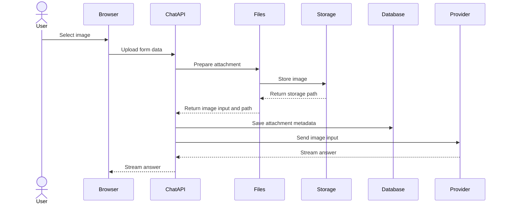
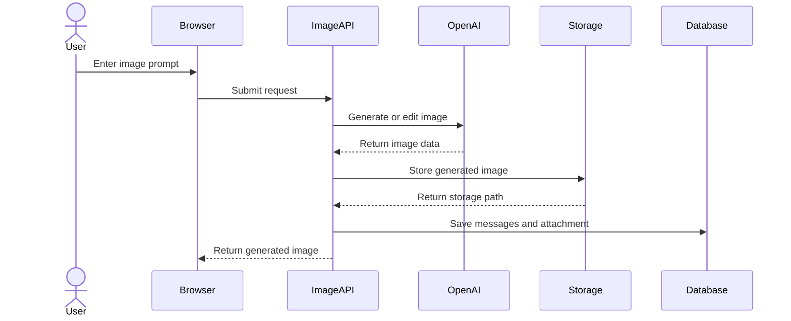
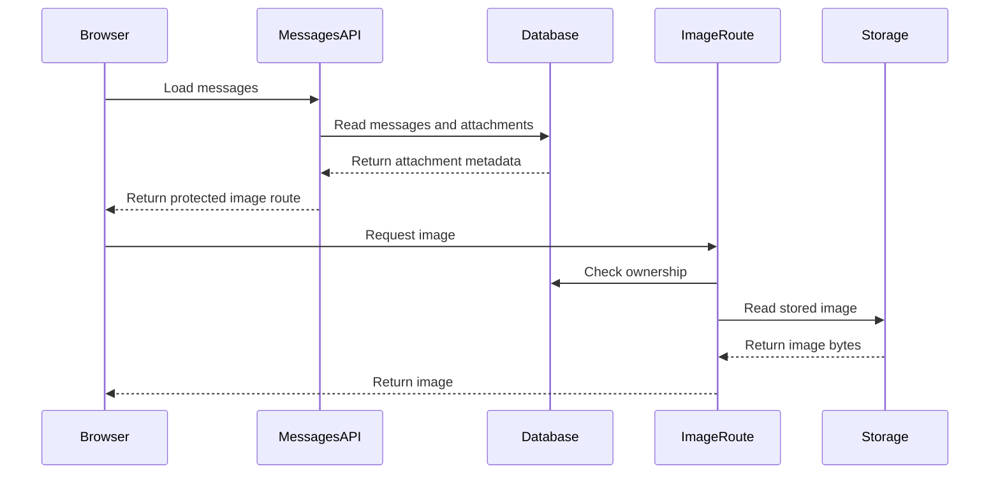
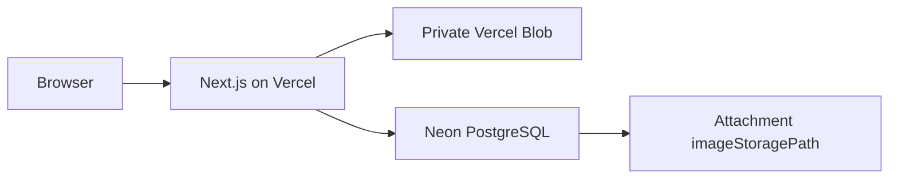

# Image Upload & Generation Flow

StudyMate 的“图片”其实有两条完全不同的流程：

1. 用户上传图片给模型看
2. 用户让模型生成/编辑图片

不要把这两条链路混在一起。

## 1. 普通聊天中的图片上传



### 为什么有两份表示

同一张图片在一次请求中有两个用途：

```text
Buffer
├── data:image/...;base64,...   -> 给 AI 看
└── imageStoragePath            -> 以后重新显示
```

Base64 data URL 不长期保存到 PostgreSQL。

## 2. 图片生成

前端开启：

```text
Create an image
```

以后，发送目标从：

```text
/api/chat
```

切换为：

```text
/api/images
```

### 无参考图



### 有参考图

区别只有 OpenAI endpoint：

```text
无参考图片 -> /images/generations
有参考图片 -> /images/edits
```

参考图也会作为用户 Message 的 Attachment 保存。

## 3. 历史图片怎么显示

数据库不会把服务器路径直接给浏览器。



这条受控 API 的设计是对的：浏览器不知道服务器真实文件路径。

## 4. 当前图片实际存在哪里

生产环境（Vercel）由 `src/lib/storage.ts` 通过 `@vercel/blob` 写入私有 Blob：

```text
src/lib/storage.ts
    ↓
@vercel/blob.put(..., { access: "private" })
    ↓
Vercel Blob（studymate-images）
```

本地开发在未配置 `BLOB_READ_WRITE_TOKEN` 时使用 `STUDYMATE_STORAGE_DIR`：

```text
data/storage/
└── images/
    └── YYYY/
        └── MM/
            └── DD/
                └── <uuid>.png
```

PostgreSQL 只存：

```text
Attachment.imageStoragePath
```

## 5. 当前 production 的实际状态

Vercel Production 已配置 `BLOB_READ_WRITE_TOKEN`，并运行通过 Blob 接线的 Storage Layer：



当前职责：

```text
Vercel Blob
-> 图片二进制

Neon PostgreSQL
-> filename
-> mimeType
-> size
-> message relationship
-> blob pathname / storage key
```

生产部署必须配置 `BLOB_READ_WRITE_TOKEN`；缺少该变量时，Vercel 环境会明确报错，不会静默写入临时磁盘。

### 当前完成度

- Vercel Blob Store：已启用（`studymate-images`）
- StudyMate production 代码：通过 `put()` / `get()` 读写私有 Blob
- `@vercel/blob`：已加入 `package.json`
- Storage Layer 接线：已完成

## 6. Storage Layer 约束

业务层只调用 Storage Layer：

```text
writeStoredImage()
readStoredImage()
```

上层 `/api/chat`、`/api/images` 和 Attachment 模型尽量不要感知具体供应商。

当前接口：

```ts
writeStoredImage(buffer, mimeType): Promise<string>
readStoredImage(storagePath): Promise<Buffer>
```

这样未来从 Vercel Blob 换 S3 / R2，也不需要重写业务流程。
