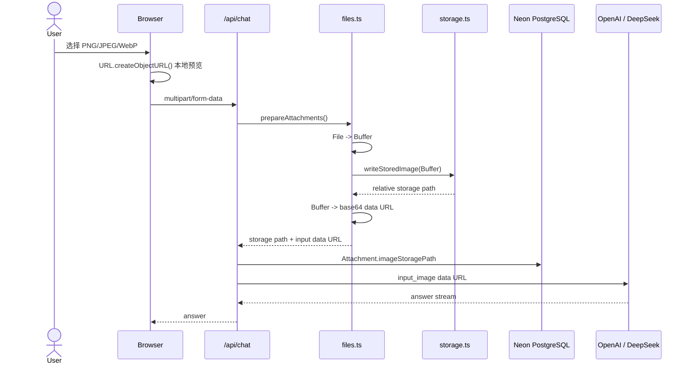
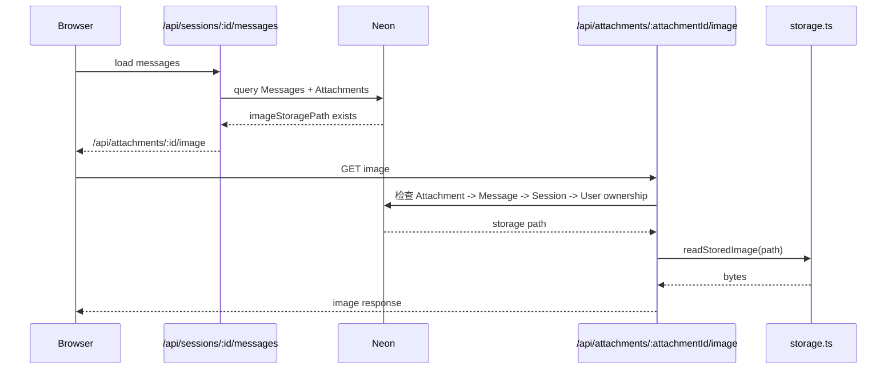
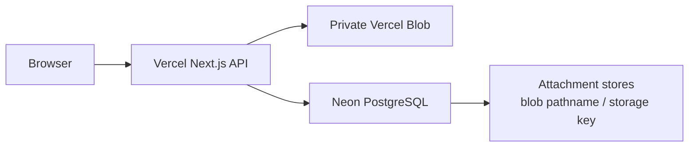

# Image Upload & Generation Flow

StudyMate 的“图片”其实有两条完全不同的流程：

1. 用户上传图片给模型看
2. 用户让模型生成/编辑图片

不要把这两条链路混在一起。

## 1. 普通聊天中的图片上传



### 为什么有两份表示

同一张图片在一次请求中有两个用途：

```text
Buffer
├── data:image/...;base64,...   -> 给 AI 看
└── imageStoragePath            -> 以后重新显示
```

Base64 data URL 不长期保存到 PostgreSQL。

## 2. 图片生成

前端开启：

```text
Create an image
```

以后，发送目标从：

```text
/api/chat
```

切换为：

```text
/api/images
```

### 无参考图

```mermaid
sequenceDiagram
    actor U as User
    participant UI as Browser
    participant API as /api/images
    participant OAI as OpenAI Images API
    participant STORE as storage.ts
    participant DB as Neon PostgreSQL

    U->>UI: 输入图片 prompt
    UI->>API: multipart/form-data
    API->>OAI: POST /images/generations
    OAI-->>API: data[0].b64_json
    API->>API: Base64 -> Buffer
    API->>STORE: writeStoredImage()
    STORE-->>API: imageStoragePath
    API->>DB: USER prompt Message
    API->>DB: ASSISTANT Message + Attachment
    API-->>UI: data:image/png;base64,...
```

### 有参考图

区别只有 OpenAI endpoint：

```text
无参考图片 -> /images/generations
有参考图片 -> /images/edits
```

参考图也会作为用户 Message 的 Attachment 保存。

## 3. 历史图片怎么显示

数据库不会把服务器路径直接给浏览器。



这条受控 API 的设计是对的：浏览器不知道服务器真实文件路径。

## 4. 当前图片实际存在哪里

当前代码：

```text
src/lib/storage.ts
    ↓
fs/promises.writeFile
    ↓
STUDYMATE_STORAGE_DIR
```

未配置环境变量时：

```text
data/storage/
└── images/
    └── YYYY/
        └── MM/
            └── DD/
                └── <uuid>.png
```

PostgreSQL 只存：

```text
Attachment.imageStoragePath
```

## 5. 当前 production 的实际状态

Vercel 项目侧已经准备了 Blob Store，但 production 部署所使用的当前代码仍然走本地文件系统。

所以现在实际是：

```text
应用运行方式：Serverless / Vercel Functions
文件方案：本地磁盘式持久化
```

Vercel 本地文件系统不应该作为长期用户文件仓库。重新部署、函数实例切换等情况下，不能把这些文件视为可靠持久数据。

所以：

> Blob 基础设施已经有了，但 Storage Layer 还需要真正接到 Blob 上。

## 6. Vercel Blob 接线目标

完成应用层接入后的结构：



目标职责：

```text
Vercel Blob
-> 图片二进制

Neon PostgreSQL
-> filename
-> mimeType
-> size
-> message relationship
-> blob pathname / storage key
```

### 当前完成度

- Vercel Blob Store：已准备
- StudyMate production 代码：仍使用 `fs.writeFile()`
- `@vercel/blob`：当前 `package.json` 尚未依赖
- Storage Layer 接线：未完成

因此“Blob 已经建立”是基础设施状态；“图片已经由 Blob 持久化”要等应用代码切换后才成立。

## 7. 应用接线时怎么改

建议只替换 Storage Layer：

```text
writeStoredImage()
readStoredImage()
```

上层 `/api/chat`、`/api/images` 和 Attachment 模型尽量不要感知具体供应商。

理想接口：

```ts
type StoredObject = {
  key: string;
  mimeType: string;
  size: number;
};

storeImage(buffer, mimeType): Promise<StoredObject>
readImage(key): Promise<Response | Buffer>
```

这样未来从 Vercel Blob 换 S3 / R2，也不需要重写业务流程。
