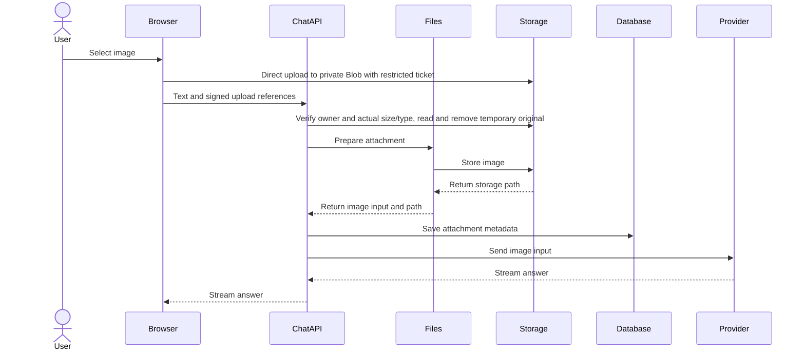
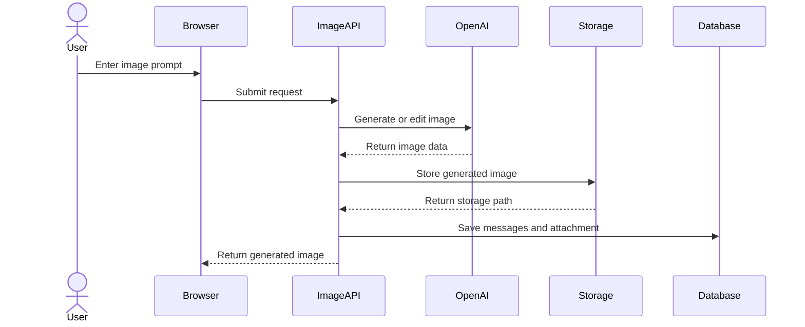
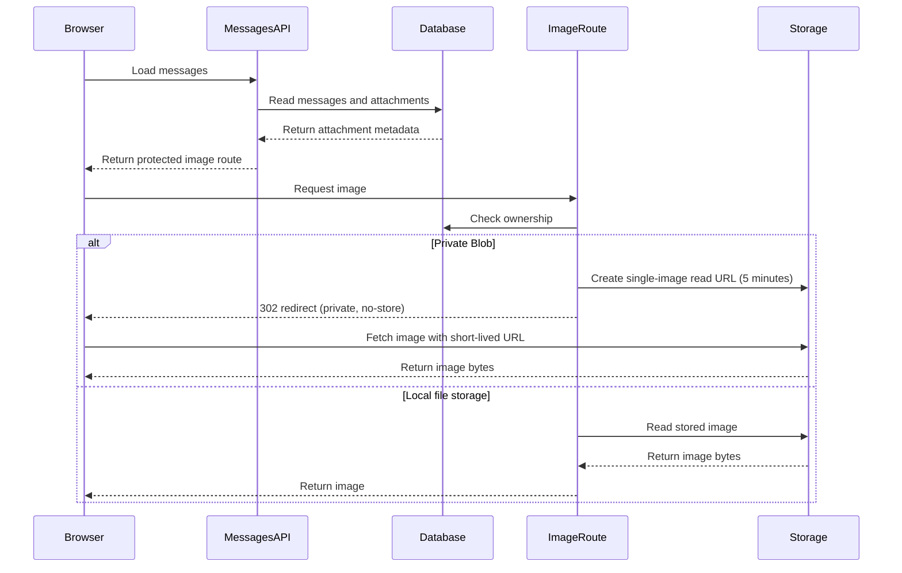
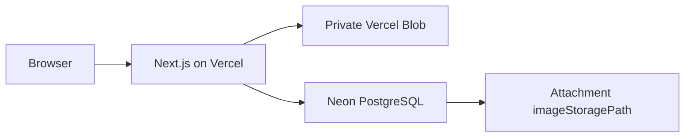

# Image Upload & Generation Flow

NoteFable 的“图片”其实有两条完全不同的流程：

1. 用户上传图片给模型看
2. 用户让模型生成/编辑图片

不要把这两条链路混在一起。

## 1. 普通聊天中的图片上传



### 为什么有两份表示

同一张图片在一次请求中有两个用途：

```text
Buffer
├── data:image/...;base64,...   -> 给 AI 看
└── imageStoragePath            -> 以后重新显示
```

Base64 data URL 不长期保存到 PostgreSQL。

Claude 使用独立的模型输入副本（`src/lib/claude-image.ts`、Sharp）：先尝试保留尺寸的 JPEG，再按需降低质量、等比缩小，不裁剪。原图字节、MIME、尺寸元数据和历史预览保持原样；超过 5 MiB 的原图不直接报错。模型副本完成处理后才保存原图；批量附件中任一处理或存储失败时，清理本批已保存且尚未写入数据库的原图，避免重试产生无引用文件。清理失败记入服务器日志，并保留原始处理错误。当前消息为图片分配最多 10 MiB、单张最多 5 MiB，当前与历史合计最多 20 MiB 未编码数据；历史读取也优化原图。上传限制仍为图片和文件合计 10 个、每个 20 MiB、合计 100 MiB。

这些是应用内部传输预算。Claude 直连 API 的官方单图限制按 Base64 后计算（10 MB），标准请求上限为 32 MB；Base64 约增加三分之一体积，因此服务端预留文字、历史和工具内容空间。见 [Claude Vision 文档](https://platform.claude.com/docs/en/build-with-claude/vision)。

历史预览从附件图片 API 开始：确认当前用户拥有该附件后，Blob 存储使用限单文件、5 分钟有效的签名 GET URL 重定向；大图不经 Vercel Function 代理回传。签名令牌只授予该图片的读取操作，私有存储访问凭据保留在服务器。

## 2. 图片生成

`/api/images` 使用独立的双层生图额度（月 / 账期总量 + 每日张数，与聊天次数分开统计）：未登录 10 张/月且 3 张/天（同网络另共享 30 张/月）、免费登录 20 张/月且 5 张/天、Pro 60 张/账期且 10 张/天。在调用 OpenAI 前在同一事务内预占两层计数，任一层满额即返回 `429`（`{ error, code: "usage_limit", tier, kind: "image" }`）；游客看到登录引导，已登录免费用户在启用订阅时看到升级引导（`UpgradePrompt`）。设置的“方案”页里 Pro 同时显示本期与今日两条进度条，免费方案平时只显示今日条、仅在月上限用满时补显示满额的本月条。生成或保存失败、没有交付图片时退还次数。档位与重置规则见[用量计数](database.md#usagecounter)与[付费方案](billing.md)。生成前还检查文件存储：用量已满或参考图放不下时返回 413 `code: "storage_limit"`（不调用 OpenAI、不计次数）；生成后的图片和参考图登记为 `StoredFile`（`CHAT_IMAGE`）并计入用量，这时不再检查上限（费用已经产生）。保存消息之前失败时，已存的图片立即删除。

工作区（笔记、白板、幻灯片）的“AI 生成图片”与白板选区“草图变图片”（`POST /api/pages/images`，共用 `src/components/workspace-image-dialog.tsx` 与 `src/lib/page-images.ts`）用同一个生图额度（同样预占、没有交付图片时退还）和同一段请求代码（`src/lib/image-generation.ts` 的 `createImageApiGeneration` 与 `createImageApiEdit`），但不建会话、不留聊天记录：纯文字请求（`application/json`）走 `/images/generations`；带参考草图的请求（`multipart/form-data`，字段 `referenceImage`，经 `sniffImage` 校验为 PNG/JPEG/WebP 且不超过 4 MiB，`prompt` 可省略、默认补草图转换提示词）走 `/images/edits`，**参考草图只在内存转交上游，绝不落盘或入库**。生成前先查存储空间，完成图片存成笔记文件（`NOTE_FILE`，计入存储用量），返回 `{ url, name, mimeType, size, prompt, reportToken }` 在对话框内展示预览（可改提示词或比例重新生成、也可在预览区直接举报），点击插入后写入当前页面并由页面保存设为使用中，没被用上的由文件清理删掉。笔记支持斜杠菜单 `/generate image` 与图片块上传/替换面板的“用 AI 生成”；白板支持工具栏图片菜单、更多工具菜单、右上选项菜单的“用 AI 生成”以及选中元素后左侧属性面板的“变成图片”（草图变图片，插在原选区右侧并保留原草图）；幻灯片支持工具栏图片菜单与右侧图片检查器的“用 AI 生成”；三种类型处于可编辑状态时也可在页面 AI 面板的“＋”菜单直接打开。见 [slides.md](slides.md#图片) 与 [whiteboard.md](whiteboard.md#保存)。AI 幻灯片向导开启逐页配图时也调这个接口（纯文字请求），不经预览对话框，生成后直接填进对应页的图片占位，见 [slides.md](slides.md#ai-生成幻灯片)。

默认使用 `gpt-image-2.6-sunburst`，可通过 `OPENAI_IMAGE_MODEL` 覆盖。图片生成和编辑与 GPT-6 Luna 聊天共用服务端 `OPENAI_API_KEY`，默认接入点为 `https://api.openai.com/v1`（可通过 `OPENAI_BASE_URL` 覆盖）。单次 prompt 最多 4,000 字符（超出返回 413），可选 `size`（`1024x1024 | 1024x1536 | 1536x1024 | auto`，默认 `auto`）与 `quality`（`low | medium | high | auto`，默认 `auto`），固定 `output_format: "png"`、`n: 1`，上游临时失败自动重试一次（最多 2 次尝试）；当前上传参考图只接受 PNG / JPEG / WebP（其他格式返回 400）。模型访问权限取决于 OpenAI 项目设置。

前端开启：

```text
Create an image
```

以后，发送目标从：

```text
/api/chat
```

切换为：

```text
/api/images
```

### 无参考图



### 有参考图

区别只有 OpenAI endpoint：

```text
无参考图片 -> /images/generations
有参考图片 -> /images/edits
```

参考图也会作为用户 Message 的 Attachment 保存。

已有会话生成图片时，服务端在确认会话归属后读取最近 24 条 USER/ASSISTANT 消息，将最近最多 8,000 字符的对话及附件提取文本作为背景加入 Images API 的 prompt；本次用户指令优先，转换后的 prompt 不写入可见聊天记录。无会话历史时直接使用本次输入。

本次上传的参考图保留，并与最近 24 条消息中的历史 PNG/JPEG/WebP（包括助手生成的图片）一起传入 `/images/edits`；历史图片不重复存储为本次上传。当前图片与历史图片合计最多 10 张、100 MiB，其中历史图片的模型副本合计最多占 15 MiB。历史候选先保留最新结果和最早的用户上传原图，再按新到旧填充剩余名额；字节预算按可用名额分配，超出单张份额的历史图片仅对模型副本进行等比缩小和保留透明度的 WebP 压缩（先尝试最长边 2048，再按需降低到 1536/1024/768），以便原图和编辑结果同时可见。存储原图及历史预览不变。无法读取、无法处理或原始文件超过 100 MiB 的旧图片跳过，以免阻断全新题材的生成。模型结合编号映射和当前指令决定使用哪些参考图，不通过原图关键词猜测用户意图。

发送前按历史时间、附件顺序排列历史图片，再附加本次上传；prompt 中的编号映射精确对应二进制顺序，标明来源、对话轮次、附件位置与文件名。对话文字达到上限后仍保留每轮的图片数量和轮次，模型可按当前指令选择实际提供的原图、生成结果或新附件，忽略无关图片。只有编号映射中的图片可见；模型不得假装能看到未提供的历史图片或用其他图片冒充，需要精确编辑未能复用的旧图时应重新上传。

## 3. 历史图片怎么显示

数据库不会把服务器路径直接给浏览器。



该 API 先检查当前用户归属，再签发单张图片的短时读取权限。Blob 模式下浏览器会看到签名后的读取 URL，但拿不到 Blob 写入密钥或其他图片的访问权限；本地模式直接返回文件字节。

## 设置里的图标

设置里的“图标”（7 个预设 AI 角色或上传的图片）和上面两条流程无关，不发给模型。上传的图片在端末上居中裁成正方形、缩到 96×96、存成 PNG 的 data URL（网页 `imageFileToIcon`，Android / iOS 同样），每个端末先存在本机（网页 `localStorage` 的 `notefable:app-icon`、Android `SharedPreferences`、iOS `UserDefaults`），所以离线和未登录也能用。

已登录时随账号同步（网页 `src/lib/app-icon-sync.ts`，Android `data/AppIconSync.kt`，iOS `Core/Support/AppIconSync.swift`，规则相同）：

- 本机除了图标还记两项（网页 `localStorage` 的 `notefable:app-icon-owner` / `notefable:app-icon-pending`，Android `SharedPreferences` `app_icon` 的 `owner` / `pending`，iOS `UserDefaults` 的 `app_icon.owner` / `app_icon.pending`）：**归属账号**是本机的图标属于哪个账号（`GET` / `PUT` 返回的 `account`，账号的不透明键，不是用户 ID；未登录时选的没有归属账号），**待发送**是登录时选了、还没送到账号。账号状态里没有用户 ID（`AccountUser` 只有名字、邮箱、头像等，邮箱也不能区分账号：同一个邮箱可能是两个账号），所以用这个键。
- 启动（或登录）后和打开设置时 `GET /api/app-icon`，按顺序判断：
  1. 本机的图标的归属账号是别的账号：不送进这个账号，先恢复成默认（同一台设备换账号时，不把前一个人的照片放进新账号），清掉待发送。
  2. 有待发送：不用账号上的旧值覆盖，把本机的值再 `PUT` 一次；送不上就继续等下一次。
  3. 账号上有值（`updatedAt` 不为 `null`）：以账号为准写进本机，归属账号记成这个账号。
  4. 账号上还没有，而本机选过非默认的（未登录时选的，或这个账号的）：把本机的值 `PUT` 上去一次。

  读不到（离线等）时保留本机的值。
- 在设置里选了就先写本机，再 `PUT /api/app-icon`（发之前立起待发送，送到后放下并记下归属账号）；按选的顺序一个个送，读的途中又选了，读到的值不用。送不上时本机的选择保留，设置里显示“无法保存你的图标，请重试。”（网页显示服务端给的原因），下次读时再送。
- 未登录（访客）不读也不送，只用本机的值，选的值没有归属账号。明确退出登录、删除账号时，本机的图标如果属于账号（有归属账号或待发送）就恢复成默认，不留给下一个人；未登录时选的保留。
- 局限：启动时连不上服务端、账号还没读到时（这时按未登录处理），选的图标不送到账号，之后账号上的值优先。

账号上的图片存在私有 Blob 的 `app-icons/<用户 ID>/`（本地开发是 `NOTEFABLE_STORAGE_DIR` 下同一路径），Postgres 只存路径（`User.appIconImage`，见 [database.md](database.md)）。图片在存储里不见了（Blob 404 / 本地文件不存在，`StoredImageNotFoundError`）时，`GET` 记日志并按默认角色回答（`icon: null`，`updatedAt` 照旧）；一时读不到才返回 503。

## 4. 当前图片实际存在哪里

生产环境（Vercel）由 `src/lib/storage.ts` 通过 `@vercel/blob` 写入私有 Blob：

```text
src/lib/storage.ts
    ↓
@vercel/blob.put(..., { access: "private" })
    ↓
Vercel Blob（notefable-images）
```

本地开发在未配置 `BLOB_READ_WRITE_TOKEN` 时使用 `NOTEFABLE_STORAGE_DIR`：

```text
data/storage/
└── images/
    └── YYYY/
        └── MM/
            └── DD/
                └── <uuid>.<ext>   # 按 MIME 决定（.png / .jpg / .webp / .gif / .bin）
```

PostgreSQL 只存：

```text
Attachment.imageStoragePath
StoredFile（路径、持有者、种类、字节数、引用状态：存储上限与未引用文件的清理，见 database.md）
```

## 5. 当前 production 的实际状态

Vercel Production 已配置 `BLOB_READ_WRITE_TOKEN`，并运行通过 Blob 接线的 Storage Layer：



当前职责：

```text
Vercel Blob
-> 图片二进制

Neon PostgreSQL
-> filename
-> mimeType
-> size
-> message relationship
-> blob pathname / storage key
```

生产部署必须配置 `BLOB_READ_WRITE_TOKEN`；缺少该变量时，Vercel 环境会明确报错，不会静默写入临时磁盘。

### 当前完成度

- Vercel Blob Store：已启用（`notefable-images`）
- NoteFable production 代码：通过 `@vercel/blob` 的 `put()` / `get()` / `del()` / `list()` 与 `issueSignedToken()` / `presignUrl()` 读写、删除并签发私有 Blob 单图短时读取链接
- `@vercel/blob`：已加入 `package.json`
- Storage Layer 接线：已完成

## 6. Storage Layer 约束

业务层只调用 Storage Layer（`src/lib/storage.ts`）：

```ts
newChatImagePath(mimeType): string
writeStoredImage(buffer, mimeType): Promise<string>
writeStoredImageAt(storagePath, buffer, mimeType): Promise<string>
readStoredImage(storagePath, maxBytes?): Promise<Buffer>
deleteStoredImage(storagePath): Promise<void>
deleteStoredPrefix(prefix): Promise<void>
listStoredFiles(prefix, cursor?, limit?): Promise<{ files, cursor? }>
getStoredImageReadUrl(storagePath): Promise<string | null>
sharesForeignStorage(): boolean
```

新文件不直接调用 `writeStoredImageAt`，而是经 `src/lib/stored-files.ts` 的 `storeFile()`：先检查存储上限并登记 `StoredFile` 行，再写文件；不用了的文件用 `discardStoredFiles()` 删除（文件和行一起）。`listStoredFiles` 只给清理任务的盘点和临时上传的清理用；`sharesForeignStorage()` 为真（本地开发用着与生产共享的 Blob token）时不运行清理。

上层 `/api/chat`、`/api/images`、封面/笔记文件/头像路由与账号删除等逻辑尽量不直接依赖具体供应商，这样未来从 Vercel Blob 换 S3 / R2 时不需要重写业务流程。
