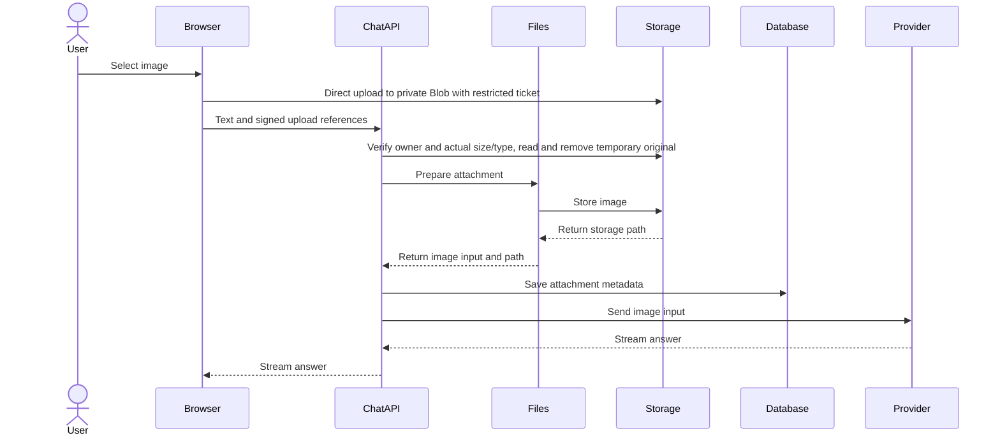
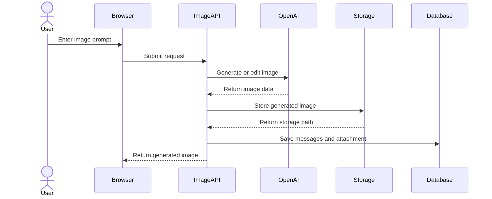
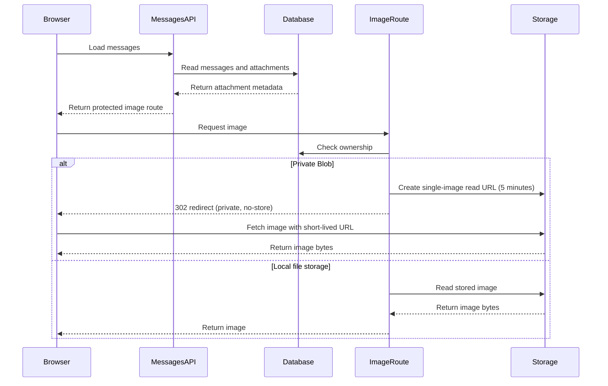
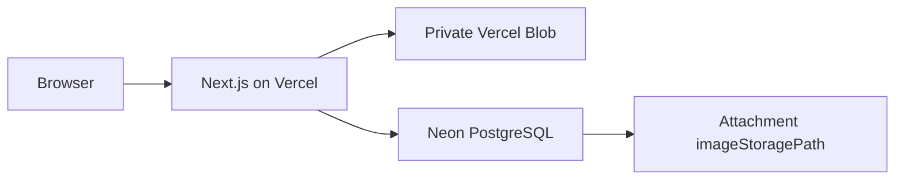

# Image Upload & Generation Flow

NoteFable 的“图片”其实有两条完全不同的流程：

1. 用户上传图片给模型看
2. 用户让模型生成/编辑图片

不要把这两条链路混在一起。

## 1. 普通聊天中的图片上传



### 为什么有两份表示

同一张图片在一次请求中有两个用途：

```text
Buffer
├── data:image/...;base64,...   -> 给 AI 看
└── imageStoragePath            -> 以后重新显示
```

Base64 data URL 不长期保存到 PostgreSQL。

Claude 使用独立的模型输入副本（`src/lib/claude-image.ts`、Sharp）：先尝试保留尺寸的 JPEG，再按需降低质量、等比缩小，不裁剪。原图字节、MIME、尺寸元数据和历史预览保持原样；超过 5 MiB 的原图不直接报错。模型副本完成处理后才保存原图；批量附件中任一处理或存储失败时，清理本批已保存且尚未写入数据库的原图，避免重试产生无引用文件。清理失败记入服务器日志，并保留原始处理错误。当前消息为图片分配最多 10 MiB、单张最多 5 MiB，当前与历史合计最多 20 MiB 未编码数据；历史读取也优化原图。上传限制仍为图片和文件合计 10 个、每个 20 MiB、合计 100 MiB。

这些是应用内部传输预算。Claude 直连 API 的官方单图限制按 Base64 后计算（10 MB），标准请求上限为 32 MB；Base64 约增加三分之一体积，因此服务端预留文字、历史和工具内容空间。见 [Claude Vision 文档](https://platform.claude.com/docs/en/build-with-claude/vision)。

历史预览从附件图片 API 开始：确认当前用户拥有该附件后，Blob 存储使用限单文件、5 分钟有效的签名 GET URL 重定向；大图不经 Vercel Function 代理回传。签名令牌只授予该图片的读取操作，私有存储访问凭据保留在服务器。

## 2. 图片生成

`/api/images` 使用独立的每日生图额度，与聊天次数分开统计。在调用 OpenAI 前预占一次，满额时返回 `429`（`code: "usage_limit"`）；游客看到登录引导。生成或保存失败、没有交付图片时退还次数。档位与重置规则见[用量计数](database.md#usagecounter)。

默认使用 `gpt-image-2.6-sunburst`，可通过 `OPENAI_IMAGE_MODEL` 覆盖。图片生成和编辑与 GPT-6 Luna 聊天共用服务端 `OPENAI_API_KEY`，接入点为 `https://api.openai.com/v1`。模型访问权限取决于 OpenAI 项目设置。

前端开启：

```text
Create an image
```

以后，发送目标从：

```text
/api/chat
```

切换为：

```text
/api/images
```

### 无参考图



### 有参考图

区别只有 OpenAI endpoint：

```text
无参考图片 -> /images/generations
有参考图片 -> /images/edits
```

参考图也会作为用户 Message 的 Attachment 保存。

已有会话生成图片时，服务端在确认会话归属后读取最近 24 条 USER/ASSISTANT 消息，将最近最多 8,000 字符的对话及附件提取文本作为背景加入 Images API 的 prompt；本次用户指令优先，转换后的 prompt 不写入可见聊天记录。无会话历史时直接使用本次输入。

本次上传的参考图保留，并与最近 24 条消息中的历史 PNG/JPEG/WebP（包括助手生成的图片）一起传入 `/images/edits`；历史图片不重复存储为本次上传。当前图片与历史图片合计最多 10 张、100 MiB，其中历史图片的模型副本合计最多占 15 MiB。历史候选先保留最新结果和最早的用户上传原图，再按新到旧填充剩余名额；字节预算按可用名额分配，超出单张份额的历史图片仅对模型副本进行等比缩小和保留透明度的 WebP 压缩（先尝试最长边 2048，再按需降低到 1536/1024/768），以便原图和编辑结果同时可见。存储原图及历史预览不变。无法读取、无法处理或原始文件超过 100 MiB 的旧图片跳过，以免阻断全新题材的生成。模型结合编号映射和当前指令决定使用哪些参考图，不通过原图关键词猜测用户意图。

发送前按历史时间、附件顺序排列历史图片，再附加本次上传；prompt 中的编号映射精确对应二进制顺序，标明来源、对话轮次、附件位置与文件名。对话文字达到上限后仍保留每轮的图片数量和轮次，模型可按当前指令选择实际提供的原图、生成结果或新附件，忽略无关图片。只有编号映射中的图片可见；模型不得假装能看到未提供的历史图片或用其他图片冒充，需要精确编辑未能复用的旧图时应重新上传。

## 3. 历史图片怎么显示

数据库不会把服务器路径直接给浏览器。



该 API 先检查当前用户归属，再签发单张图片的短时读取权限。Blob 模式下浏览器会看到签名后的读取 URL，但拿不到 Blob 写入密钥或其他图片的访问权限；本地模式直接返回文件字节。

## 4. 当前图片实际存在哪里

生产环境（Vercel）由 `src/lib/storage.ts` 通过 `@vercel/blob` 写入私有 Blob：

```text
src/lib/storage.ts
    ↓
@vercel/blob.put(..., { access: "private" })
    ↓
Vercel Blob（studymate-images）
```

本地开发在未配置 `BLOB_READ_WRITE_TOKEN` 时使用 `STUDYMATE_STORAGE_DIR`：

```text
data/storage/
└── images/
    └── YYYY/
        └── MM/
            └── DD/
                └── <uuid>.png
```

PostgreSQL 只存：

```text
Attachment.imageStoragePath
```

## 5. 当前 production 的实际状态

Vercel Production 已配置 `BLOB_READ_WRITE_TOKEN`，并运行通过 Blob 接线的 Storage Layer：



当前职责：

```text
Vercel Blob
-> 图片二进制

Neon PostgreSQL
-> filename
-> mimeType
-> size
-> message relationship
-> blob pathname / storage key
```

生产部署必须配置 `BLOB_READ_WRITE_TOKEN`；缺少该变量时，Vercel 环境会明确报错，不会静默写入临时磁盘。

### 当前完成度

- Vercel Blob Store：已启用（`studymate-images`）
- NoteFable production 代码：通过 `put()` / `get()` 读写私有 Blob
- `@vercel/blob`：已加入 `package.json`
- Storage Layer 接线：已完成

## 6. Storage Layer 约束

业务层只调用 Storage Layer：

```text
writeStoredImage()
readStoredImage()
```

上层 `/api/chat`、`/api/images` 和 Attachment 模型尽量不要感知具体供应商。

当前接口：

```ts
writeStoredImage(buffer, mimeType): Promise<string>
readStoredImage(storagePath): Promise<Buffer>
```

这样未来从 Vercel Blob 换 S3 / R2，也不需要重写业务流程。
