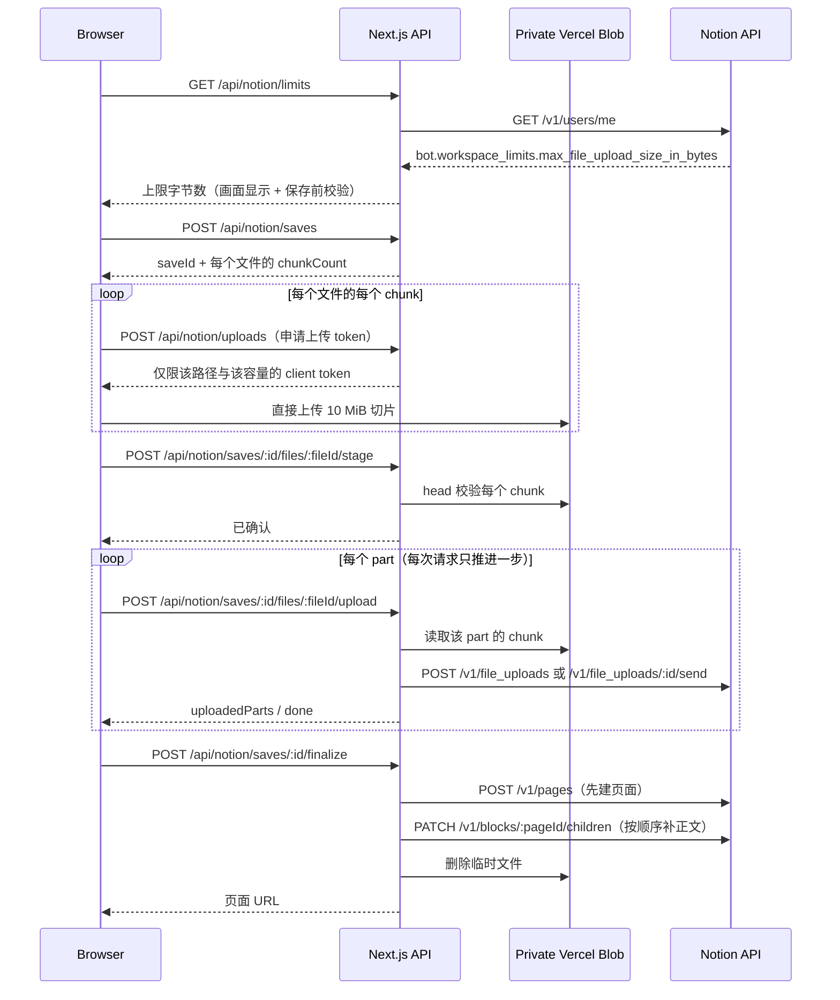

# Notion Export Flow

## 这个流程解决什么

把一段对话或临时笔记导出成 Notion 页面。正文可以自由插入本机文件，文件在 Notion 里按插入位置还原：图片存成 image 块，其他资料存成 file 块。

抽屉中的纯文字和带文件导出都走 `/api/notion/saves/*`；原来的 `/api/notion/pages` 仍保留为纯文字接口。

## 一次导出的完整路径



## 为什么这样分段

- **上传 token 逐 chunk 申请**：令牌只对「这个下稿的这个文件的这个 chunk」有效，并带容量上限（`maximumSizeInBytes`）。浏览器拿不到更大范围的写权限。
- **临时文件按 10 MiB 切**：和 Notion 推荐的分片大小一致。浏览器用 `File.slice()` 上传，服务端一次只读一个 chunk，不把整个文件读进内存。
- **Notion 转运用短请求推进**：单文件 ≤ 20 MiB 走 `single_part` 一次发完；超过 20 MiB 建 `multi_part`，每个 part 一次请求，进度写回 `NotionSaveFile.uploadedParts`。失败时下稿保留，重试从同一处继续。
- **页面先建、正文后补**：`notionPageId` 在追加正文之前就写入数据库，所以追加失败可以继续写同一个页面，而不是新建第二个页面。
- **结果不明时暂停**：页面创建或正文追加若没有收到响应，会分别记录不确定状态。正文追加可能已经生效；再次追加前需检查现有页面并明确确认，避免静默产生重复块。

## 文件与空间限制

| 项目 | 值 | 来源 |
| --- | --- | --- |
| 免费工作区单文件上限 | 5 MiB | Notion API `workspace_limits` |
| 付费工作区单文件上限 | 5 GiB | 同上，代码侧再按 5 GiB 截断 |
| 单次导出附件数上限 | 20 个 | `src/lib/notion-files.ts` |
| 单次导出附件总量上限 | 5 GiB | 同上 |
| 单文件分片阈值 | 20 MiB | Notion 规范 |
| 分片大小 | 10 MiB | Notion 推荐值 |
| `part_number` 上限 | 1000 | 5 GiB / 10 MiB = 512，仍在范围内 |
| 支持的文件类型 | Notion 官方扩展名列表 | [Working with files and media](https://developers.notion.com/guides/data-apis/working-with-files-and-media) |

## Notion API 版本分离

`src/lib/notion.ts` 里有两条版本常量：

```text
NOTION_API_VERSION       = "2022-06-28"   既有页面创建、数据库读取
NOTION_FILE_API_VERSION  = "2026-03-11"   file_uploads / users/me / 正文追加
```

2026-03-11 调整了数据库相关的行为，所以不能整体切换；只有文件相关的调用和需要 `file_upload` 块的正文追加使用新版本。

## 临时文件的回收

```text
notion-staging/<saveId>/<fileId>/<chunkIndex>
```

- 保存成功或用户取消：立即删除该 `saveId` 下的所有 chunk，并清空 `NotionSaveFile.stagingPrefix`。
- 放置超过 24 小时：由 `GET /api/cron/notion-staging-cleanup` 每日回収（Vercel Cron，`vercel.json`），未完成的记录标记为 `EXPIRED`。

Cron 需要 `CRON_SECRET`，请求必须带 `Authorization: Bearer <CRON_SECRET>`；未配置时该接口一律返回 401。

## 所有权与凭据

- 所有 `/api/notion/*` 路由都通过 `loadOwnedNotionSave()` 校验匿名设备的所有者，不匹配按 404 处理。
- `NOTION_API_KEY` / `NOTION_DATABASE_ID` 只存在于服务端。
- Blob 的上传令牌由服务端按路径和容量签发，浏览器不会拿到 `BLOB_READ_WRITE_TOKEN`。
- 本地开发也使用 Private Vercel Blob（`.env.local` 的 `BLOB_READ_WRITE_TOKEN`），没有文件系统回退。

## 已知边界

- 传输期间必须保持标签页打开；浏览器关闭后不会自动继续（刷新后可对未完成的保存继续重试）。
- 不提供删除或撤销已上传到 Notion 的文件的能力（Notion API 目前没有该接口）。
- 只有未完成的保存可以继续；已完成的保存再次点击保存会新建页面。
