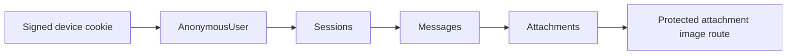

# System Overview

## 系统定位

StudyMate 是单一所有者使用的 AI Web 入口，而不是公开多用户 SaaS。

核心职责：

- 在浏览器中维护会话
- 服务端统一保管 OpenAI / DeepSeek / Notion 凭据
- 把用户消息和历史保存到 Neon PostgreSQL
- 把附件转换为模型可以处理的输入
- 提供图片输入与图片生成
- 提供原生 Web 搜索
- 把会话内容导出到 Notion

## Component Diagram

```mermaid
flowchart TB
    Browser[Browser<br/>React 19 UI]

    subgraph Vercel[Vercel - Next.js 16 App Router]
      Page[src/app/page.tsx]

      subgraph Routes[Route Handlers]
        Chat[/api/chat]
        Images[/api/images]
        Sessions[/api/sessions]
        Messages[/api/sessions/:id/messages]
        AttachmentImage[/api/attachments/:id/image]
        NotionRoute[/api/notion/pages]
      end

      subgraph Libraries[Server Libraries]
        Auth[auth.ts]
        Models[models.ts]
        Files[files.ts]
        Storage[storage.ts]
        Prisma[prisma.ts]
        DeepSeek[deepseek-responses.ts]
        NotionLib[notion.ts]
        RateLimit[rate-limit.ts]
      end
    end

    Neon[(Neon PostgreSQL<br/>project: neon_db<br/>branch: production<br/>db: neondb<br/>schema: studymate)]
    OpenAI[OpenAI APIs<br/>Responses / Images]
    DeepSeekAPI[DeepSeek Responses API]
    NotionAPI[Notion API]
    LocalStorage[(Current local filesystem<br/>STUDYMATE_STORAGE_DIR)]

    Browser --> Page
    Page --> Chat
    Page --> Images
    Page --> Sessions
    Page --> Messages
    Page --> NotionRoute

    Chat --> Auth
    Chat --> Models
    Chat --> Files
    Chat --> RateLimit
    Chat --> Prisma

    Images --> Auth
    Images --> Models
    Images --> RateLimit
    Images --> Storage
    Images --> Prisma

    Messages --> Prisma
    AttachmentImage --> Auth
    AttachmentImage --> Prisma
    AttachmentImage --> Storage

    Prisma --> Neon
    Chat --> OpenAI
    Chat --> DeepSeekAPI
    Images --> OpenAI
    NotionRoute --> NotionLib
    NotionLib --> NotionAPI
    Files --> Storage
    Storage --> LocalStorage
```

## 运行时边界

### Browser / Client

前端主要集中在 `src/app/page.tsx`：

- 输入消息
- 选择模型
- 选择 reasoning effort
- 切换图片生成模式
- 选择/粘贴附件
- 本地 object URL 图片预览
- 调用 API
- 接收 SSE 文本流
- 展示历史消息和生成图片

浏览器不会直接拿 OpenAI、DeepSeek、Notion 或数据库凭据。

### Next.js Server

Next.js Route Handlers 是应用控制层：

- 校验请求
- 校验匿名设备身份
- 做 rate limit
- 读写数据库
- 调用 AI provider
- 调用 Notion
- 处理文件

### Neon PostgreSQL

持久化：

- 匿名设备身份
- Session
- Message
- Attachment 元数据
- 文本/PDF 抽取文本
- 图片存储路径
- API 限流状态

不持久化：

- OpenAI / DeepSeek API key
- 图片二进制本体
- 浏览器临时 preview URL

### AI Providers

#### OpenAI

负责：

- 普通文本/多模态聊天
- 原生 Web Search
- 图片生成
- 带参考图的图片编辑

#### DeepSeek

负责：

- 文本/视觉聊天
- 原生 Web Search

当前不负责 StudyMate 图片生成。

### Notion

只在用户主动导出时调用。

流程是 StudyMate 服务端向 Notion API 写入页面，浏览器不直接调用 Notion。

## Authentication Reality

当前所谓“用户”是匿名设备身份，而不是完整账号系统。

```text
signed studymate_device cookie
        ↓
AnonymousUser.deviceId
        ↓
Session ownership
        ↓
Message / Attachment ownership
```

这可以隔离不同浏览器的数据，但不能替代真正的登录和访问控制。

## 数据所有权边界



图片读取 API 会从 `Attachment -> Message -> Session -> AnonymousUser` 一路检查当前设备所有权，而不是把服务器真实文件路径直接暴露给浏览器。
