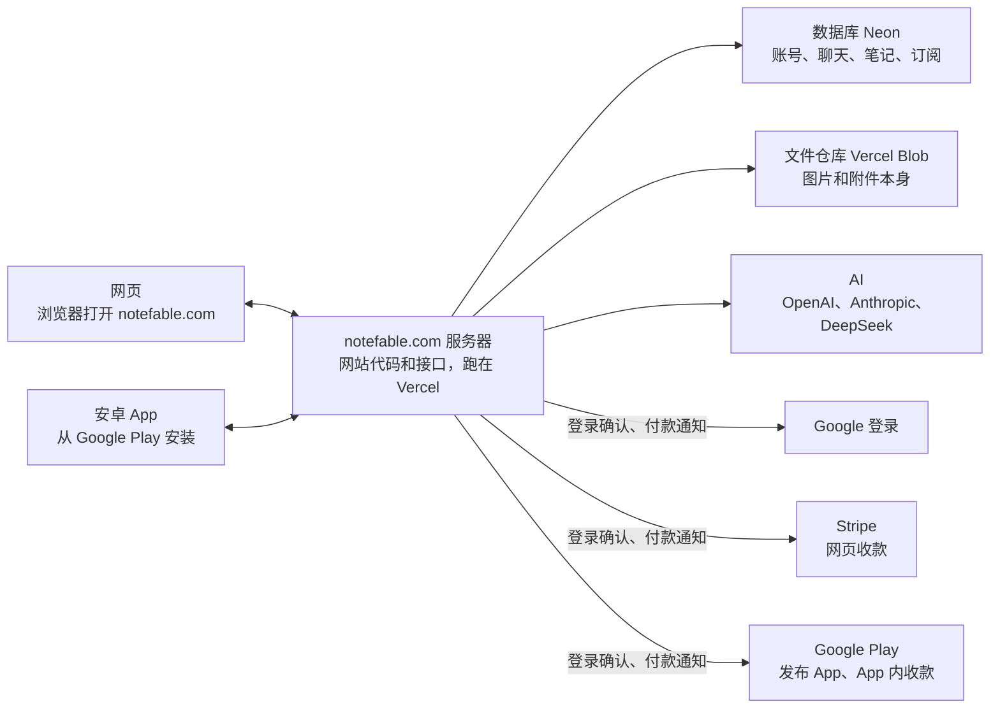

# NoteFable 项目全景图（入门版）

> 给项目所有者自己看的总览：用大白话讲清楚 NoteFable 由哪些部分组成、怎么连在一起、怎么发布和收钱。新词第一次出现时都会先解释。细节在 [docs/architecture/](architecture/README.md)。
> 线上同步版（带结构图）：Claude 文档「NoteFable 项目全景图」。两边内容保持一致，改一边时另一边也要改。
> 最后核对：2026-11-17。

## 一张图看全局

NoteFable 的中心是 notefable.com 服务器：网页和安卓 App 都只和它说话，它再去找数据库、文件仓库、AI 和外部服务。

## 网站和服务器

| 部分 | 是什么（大白话） | 放在哪 |
| --- | --- | --- |
| 网站代码 | 用 Next.js（一种写网站的框架）写的，网页和服务器接口在同一套代码里 | GitHub 仓库 kakumine2001/NoteFable |
| 服务器 | 运行网站代码的电脑，不用自己管机器 | Vercel |
| 数据库 | 存账号、聊天、笔记、订阅状态的大表格 | Neon（PostgreSQL） |
| 文件仓库 | 存图片、附件本身；数据库里只记“文件在哪” | Vercel Blob |
| AI | 真正回答问题、生成图片的服务 | OpenAI、Anthropic、DeepSeek |

改代码到上线的流程：

1. 在一个新分支（代码的副本）上改代码。
2. 跑检查：类型检查、代码风格检查、自动测试。
3. 开 PR（合并请求），经过自审和另一个 AI 的交叉审查。
4. 合并进 main（正式代码）。Vercel 看到 main 变了就自动部署，几分钟后网站上线新版本。

所以“合并 = 上线”，不能直接往 main 推代码（规则见 [AGENTS.md](../AGENTS.md)）。

## 账号和登录

不登录也能用；登录是为了在多台设备之间同步，以及购买 Pro。

- **不登录（匿名）**：第一次打开时，服务器发一个随机编号存在浏览器或 App 里（Cookie，小纸条）。聊天和笔记都挂在这个编号下，清掉 Cookie 就找不回来了。
- **Google 登录**：用 Google 账号证明“我是我”。
- **邮箱验证码登录**：服务器用 Resend（发信服务）把 6 位数字发到邮箱，填对就登录。

Google 登录要在 Google Cloud 登记“谁可以用我的登录”，这叫 **OAuth 客户端**。现在只有两个：

| 客户端 | 管什么 | 登记的内容 |
| --- | --- | --- |
| NoteFable-Web | 网站的 Google 登录；也是 App 登录时 Google 发出的“通行证”的收件人 | 网站地址、登录后跳回的地址 |
| NoteFable-Android | 告诉 Google：盖了这个章的 App 是我们的 | 包名 `com.kakumine.notefable` + Play 签名的 SHA-1 |

客户端的名字只是标签，可以随便改；起作用的是包名和 SHA-1。

## 安卓 App

安卓 App 是“原生 App”：用安卓自己的语言 Kotlin 写，不是把网页套个壳。代码在 `mobile/android/`。

- **数据从哪来**：App 本身不存聊天和笔记，和网页一样向 notefable.com 的接口（API，服务器开的“窗口”）要数据，所以两边看到的是同一份。
- **界面**：照着网页的样子重新画了一遍。网页改了界面，App 也要在同一次修改里改。
- **笔记编辑器例外**：编辑笔记的那一页是在 App 里嵌了一个小浏览器（WebView），打开网站的 `/note-embed`。编辑器太复杂，重写一个安卓版工作量太大，两边也一定会不一致。
- **模型列表**：能选哪些 AI 模型由服务器决定，App 每次打开时去要，不写死在 App 里。

## 签名（用印章来理解）

给用户装的 App 只用一枚印章：Google 保管的 Play 应用签名密钥。签名对上了，Google 登录才能用。

| 术语 | 比喻 | 说明 |
| --- | --- | --- |
| 私钥 | 印章本身 | 只有拿着它的人才能签名，别人仿造不了 |
| 签名 | 盖章这个动作 | 每次打包 App 都做一次 |
| 证书 | 印鉴登记证 | 做印章时一起做一次；写着“这枚章是谁的”，可以公开 |
| SHA-1 指纹 | 印鉴登记证上的编号 | 从证书算出来的 20 组短编号，只用来核对“是不是同一枚章”；公开了也做不出印章 |

两枚印章：

- **上传密钥**（你自己的，存在你电脑上）：只给要上传到 Play 的包盖章，证明“是我本人传的”。丢了可以向 Google 申请重置。
- **Play 应用签名密钥**（Google 保管，你拿不到）：Play 收到包以后换盖这枚章再发给用户。Play Console「アプリの署名」页面上的 SHA-1 就是它的编号。

Google 登录时：Google 从 App 上的章算出编号，和 Google Cloud 里 NoteFable-Android 登记的编号比，一样才放行。所以**本地打的包不能用 Google 登录**（你电脑上没有 Google 那枚章），开发时用邮箱验证码登录；要测 Google 登录就装从 Play 拿的包。

签名不是加密：加密是把内容锁起来让别人看不懂；签名是内容谁都能看，只证明“谁做的、没被改过”。

## 打包和发布

给人装的 App 一律从 Play 拿：你打包上传，Play 盖章再发出去。

- **APK**：手机能直接安装的文件，像电脑上的 `.exe` 安装包。
- **AAB**：专门交给 Play 的打包文件，手机不能直接装。Play 按每台手机的型号把它做成 APK，顺便盖上 Google 的章。

每次发新版：

1. 打开 `mobile/android/app/build.gradle.kts`，`versionCode`（版本流水号，Play 不接受重复的）加 1，`versionName`（给人看的版本号，比如 1.0.7）改成新的。
2. 电脑上运行 `./gradlew bundleRelease`，得到 AAB（用你的上传密钥盖章）。
3. 在 Play Console 把 AAB 传到「内部测试」并发布。内部测试 = 只有你和少数人能从 Play 装的测试版。
4. 自己的手机从 Play 测试链接安装，试一下。
5. 要发 APK 文件给别人时：Play Console → App bundle explorer（アプリバンドル エクスプローラ）→ 下载「署名済みのユニバーサル APK」，传到 Google Drive 的发布文件夹（只留最新一个）。

从 Drive 装的 APK 能用 Google 登录（章是对的），但不能买 Pro：Play 只让从 Play 商店装的 App 付款。详细规则见 [android.md](architecture/android.md)。

## 收费

Pro 每月 ¥300（含税），只提高使用上限。网页用 Stripe 收钱，App 里用 Google Play 收钱，买的是同一个 Pro。

| 身份 | 聊天 | 生成图片 |
| --- | --- | --- |
| 不登录 | 每天 10 条 | 不能 |
| 登录、免费 | 每天 20 条 | 每月 5 张 |
| Pro | 每个计费月 1,000 条 | 每个计费月 40 张 |

（数字以 `src/lib/usage-plans.ts` 为准。）

- **为什么两套收钱方式**：Google 规定 App 里卖数字内容必须用 Google Play 结算（Google 抽 15%），不能引导去网页付款。网页上用 Stripe（手续费低）。
- **网页（Stripe）付款后**：Stripe 自动通知网站（Webhook，Stripe 主动发来的消息）→ 网站把这个人改成 Pro。续费、解约、扣款失败也走这条路。
- **App（Google Play）付款后**：App 把“购买凭证”发给网站 → 网站拿凭证去问 Google 是不是真的 → 是就改成 Pro。续费和解约由 Google 通过 Pub/Sub（Google 的消息传递服务）通知网站。
- **解约**：都是用到已付的月底再停。网页的由网站代码自动守住 Stripe 的这个设置；Play 的本来就是这样。
- **删除账号**：网页买的订阅立即结束，并删掉 Stripe 上的客户记录；Play 买的停止续费。已付的部分不退。

详细规则见 [billing.md](architecture/billing.md)。

## 法律页面和各个后台

| 页面 | 地址 | 写什么 |
| --- | --- | --- |
| 隐私政策 | notefable.com/privacy | 收集什么数据、发给谁、怎么删 |
| 服务条款 | notefable.com/terms | 使用规则；第 3 节是 Pro 的价格、续费、解约、退款 |
| 特商法标示 | notefable.com/legal-notice | 日本法律要求的卖家信息；姓名、地址、电话写“有人要求时马上告知” |
| 删除账号 | notefable.com/delete-account | 怎么删、删掉哪些东西 |

| 后台 | 管什么 | 状态（2026-11-17） |
| --- | --- | --- |
| Vercel | 网站运行、密钥等环境变量 | Stripe 3 项、Google Play 3 项都已设置 |
| Stripe | 网页收款 | 本人确认（KYC）完成，收款和打款有效；解约用到月底；4 个网址已填 |
| Google Cloud | Google 登录、Play 通知的传递 | OAuth 客户端 2 个；Pub/Sub 已接到网站 |
| Play Console | 上架、App 内收款 | 应用签名已启用；订阅商品已建但未启用；表单和商店介绍未填 |

Stripe 还有 4 项没亲眼确认（商品价格、Webhook、扣款失败后的处理、网站连的是不是正式账户）。最省事的确认办法：用自己的卡真买一次 Pro，确认变成 Pro 后解约，再在 Stripe 退款。

## 上架进度

网站、Stripe、签名和登录都准备好了；剩下的都在 Play 那边，最慢的是 14 天封闭测试。

- [ ] 电脑上打包 1.0.7
- [ ] Play Console 启用订阅 `notefable_pro`
- [ ] 上传到内部测试，用手机试 Google 登录和购买 Pro
- [ ] 填 Play Console 的应用内容声明和商店介绍（答案在 [docs/play-store/](play-store/console-answers.md)）
- [ ] 找 12 个人做 14 天封闭测试（封闭测试 = 指定的人能从 Play 装的测试版；新的个人开发者账号必须先过这一关）
- [ ] 申请正式上架

## 术语表

| 中文 | 日本語 | English | 一句话 |
| --- | --- | --- | --- |
| 私钥 | 秘密鍵 | private key | 印章本身，用来签名 |
| 签名 | 署名 | signing | 用私钥给 App 盖章 |
| 证书 | 証明書 | certificate | 写着“这枚章是谁的”，可公开 |
| 指纹 | フィンガープリント | fingerprint (SHA-1) | 从证书算出的编号，用来核对 |
| 上传密钥 | アップロード鍵 | upload key | 你的章，只用来传包给 Play |
| 应用签名密钥 | アプリ署名鍵 | app signing key | Google 的章，发给用户的包用它 |
| 安装包 | APK | APK | 手机能直接装的文件 |
| 应用包 | アプリバンドル | AAB (Android App Bundle) | 交给 Play 的文件 |
| 内部测试 | 内部テスト | internal testing | 少数人马上能装的测试版 |
| 封闭测试 | クローズドテスト | closed testing | 上架前必须的 12 人 × 14 天 |
| 身份验证 | 本人確認 | KYC | Stripe 确认收钱的是真人 |
| 网络钩子 | Webhook | webhook | Stripe 主动发给网站的通知 |
| 登录客户端 | OAuth クライアント | OAuth client | 在 Google 登记“谁能用登录” |

## 详细文档

- [architecture/android.md](architecture/android.md)：打包、签名、Play、App 里的 Google 登录
- [architecture/billing.md](architecture/billing.md)：收费、Stripe、Google Play 结算
- [play-store/](play-store/console-answers.md)：Play Console 要填的答案和商店介绍
- [architecture/deployment.md](architecture/deployment.md)：服务器和环境变量
- [architecture/README.md](architecture/README.md)：所有架构文档的入口
