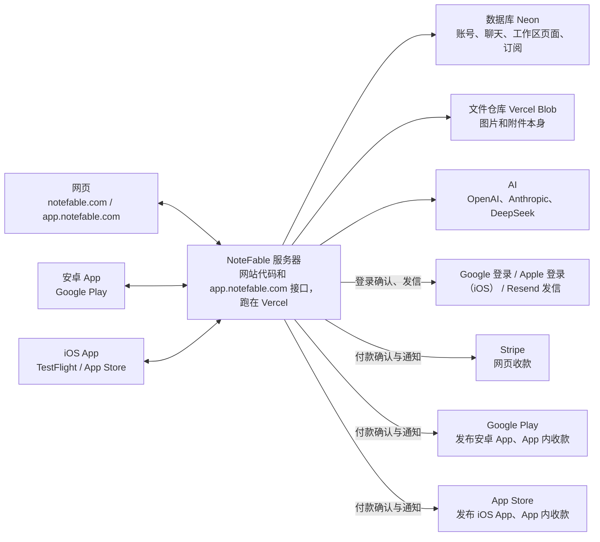

# NoteFable 项目全景图（入门版）

> 给项目所有者自己看的总览：用大白话讲清楚 NoteFable 由哪些部分组成、怎么连在一起、怎么发布和收钱。新词第一次出现时都会先解释。细节在 [docs/architecture/](architecture/README.md)。
> 线上同步版（带结构图）：Claude 文档「NoteFable 项目全景图」。两边内容保持一致，改一边时另一边也要改。
> 最后核对：2026-11-27。

## 一张图看全局

NoteFable 的中心是运行在 Vercel 上的服务器：介绍页在 `notefable.com`，聊天、工作区（Workspace：笔记、白板、幻灯片）与全部 API 接口在 `app.notefable.com`。网页、安卓 App 和 iOS App 都只和它说话，它再去找数据库、文件仓库、AI 和外部服务。

## 网站和服务器

| 部分 | 是什么（大白话） | 放在哪 |
| --- | --- | --- |
| 网站代码 | 用 Next.js（一种写网站的框架）写的，网页和服务器接口在同一套代码里 | GitHub 仓库 kakumine2001/NoteFable |
| 服务器 | 运行网站代码的电脑，不用自己管机器 | Vercel |
| 数据库 | 存账号、聊天、工作区页面（笔记、白板、幻灯片）、订阅状态的大表格 | Neon（PostgreSQL） |
| 文件仓库 | 存图片、附件本身；数据库里只记“文件在哪” | Vercel Blob |
| AI | 真正回答问题、生成图片的服务 | OpenAI、Anthropic、DeepSeek |

改代码到上线的流程：

1. 在一个新分支（代码的副本）上改代码。
2. 跑检查：类型检查、代码风格检查、自动测试。
3. 开 PR（合并请求），经过自审和另一个 AI 的交叉审查。
4. 合并进 main（正式代码）。Vercel 看到 main 变了就自动部署，几分钟后网站上线新版本。

所以“合并 = 上线”，不能直接往 main 推代码（规则见 [AGENTS.md](../AGENTS.md)）。

## 账号和登录

不登录也能用；登录是为了在多台设备之间同步，以及购买 Pro。

- **不登录（匿名）**：第一次打开时，服务器发一个随机编号存在浏览器或 App 里（Cookie，小纸条）。聊天和工作区页面都挂在这个编号下，清掉 Cookie 就找不回来了。
- **Google 登录**：用 Google 账号证明“我是我”。
- **邮箱验证码登录**：服务器用 Resend（发信服务）把 6 位数字发到邮箱，填对就登录。
- **Apple 登录**（只在 iOS App 里，正式服务器已配置好）：用 Apple 账户证明“我是我”。它单独算一个账户，不和 Google / 邮箱账户合并；网页和安卓没有这个入口。

Google 登录要在 Google Cloud 登记“谁可以用我的登录”，这叫 **OAuth 客户端**。现在有三个：

| 客户端 | 管什么 | 登记的内容 |
| --- | --- | --- |
| NoteFable-Web | 网站的 Google 登录；也是 App 登录时 Google 发出的“通行证”的收件人 | 网站地址、登录后跳回的地址 |
| NoteFable-Android | 告诉 Google：盖了这个章的 App 是我们的 | 包名 `com.kakumine.notefable` + Play 签名的 SHA-1 |
| NoteFable-iOS | iPhone App 的 Google 登录 | Bundle ID `com.kakumine.notefable`（客户端 ID 写在 iOS 构建配置里） |

客户端的名字只是标签，可以随便改；起作用的是包名、SHA-1 和 Bundle ID。

## 手机 App（安卓与 iOS）

安卓 App（`mobile/android/`，Kotlin / Compose）和 iOS App（`mobile/ios/`，Swift / SwiftUI）都是“原生 App”，不是把网页套个壳。

- **数据从哪来**：App 本身不存聊天和工作区页面，和网页一样向 `app.notefable.com` 的接口（API，服务器开的“窗口”）要数据（`notefable.com/api/*` 返回 421），所以多端看到的是同一份。
- **界面**：照着网页的样子重新画了一遍。网页改了界面，安卓和 iOS 也要在同一次修改里一起改。
- **编辑器例外**：笔记、白板和幻灯片的编辑页是在 App 里嵌了一个小浏览器（Android `WebView` / iOS `WKWebView`），打开工作区的 `/note-embed`。这些编辑器太复杂，原生重写工作量太大，各端也一定会不一致。
- **模型列表**：能选哪些 AI 模型由服务器决定，App 每次打开时去要，不写死在 App 里。
- **外观和 Markdown**：网页、安卓和 iOS 都能选“跟随系统 / 浅色 / 深色”（只记在当前这台设备上，不跟着账号走），也都能把一篇笔记导出成 Markdown 文件、把 Markdown 文件导入成笔记。
- **只有网页才有的**：电脑宽度下在聊天旁边并排打开一个工作区页面（笔记、白板或幻灯片）的“分屏”。手机屏幕放不下，所以两个 App 没有。
- **iOS 现状**：代码在 CI 上跑通 Core 单元测试、模拟器构建和截图；合入调高构建号的 PR 后由 GitHub Actions 自动上传 TestFlight，构建已装到真机，界面还没逐项验收。Sign in with Apple 和 App Store 内购已经接好（Apple 登录的正式服务器已配置好；内购配置齐全后开放），还要真机和沙盒验收；通用链接网站端已配好，同样待真机验证（见 [ios.md](architecture/ios.md) 和 [ios-native.md](architecture/ios-native.md)）。

## 签名（用印章来理解）

给用户装的 App 只用一枚印章：Google 保管的 Play 应用签名密钥。签名对上了，Google 登录才能用。

| 术语 | 比喻 | 说明 |
| --- | --- | --- |
| 私钥 | 印章本身 | 只有拿着它的人才能签名，别人仿造不了 |
| 签名 | 盖章这个动作 | 每次打包 App 都做一次 |
| 证书 | 印鉴登记证 | 做印章时一起做一次；写着“这枚章是谁的”，可以公开 |
| SHA-1 指纹 | 印鉴登记证上的编号 | 从证书算出来的 20 组短编号，只用来核对“是不是同一枚章”；公开了也做不出印章 |

两枚印章：

- **上传密钥**（你自己的，存在你电脑上）：只给要上传到 Play 的包盖章，证明“是我本人传的”。丢了可以向 Google 申请重置。
- **Play 应用签名密钥**（Google 保管，你拿不到）：Play 收到包以后换盖这枚章再发给用户。Play Console「アプリの署名」页面上的 SHA-1 就是它的编号。

Google 登录时：Google 从 App 上的章算出编号，和 Google Cloud 里 NoteFable-Android 登记的编号比，一样才放行。所以**本地打的包不能用 Google 登录**（你电脑上没有 Google 那枚章），开发时用邮箱验证码登录；要测 Google 登录就装从 Play 拿的包。

签名不是加密：加密是把内容锁起来让别人看不懂；签名是内容谁都能看，只证明“谁做的、没被改过”。

## 打包和发布

给人装的 App 一律从 Play 拿：你打包上传，Play 盖章再发出去。

- **APK**：手机能直接安装的文件，像电脑上的 `.exe` 安装包。
- **AAB**：专门交给 Play 的打包文件，手机不能直接装。Play 按每台手机的型号把它做成 APK，顺便盖上 Google 的章。

普通改动可以直接通过 PR 合入 main。需要发封闭测试时，在 PR 中提高 versionCode（Play 使用的版本流水号）并更新 versionName（给用户看的版本号）。合并后，GitHub Actions 构建签名 AAB 并同时发布到 Play 的内部测试和 alpha 封闭测试轨道。测试人员收到邀请后从 Play 安装。

Drive 安装包交付当前暂停。Android 发布条件和 Play 签名规则见 [Android 应用](architecture/android.md)；iOS 端在 PR 中调高 `mobile/ios/project.yml` 的 `CURRENT_PROJECT_VERSION`，合入 `main` 后由 GitHub Actions 通过 Apple 云端签名自动打包上传到 App Store Connect（TestFlight），详见 [iOS 发布与 CI](architecture/ios.md)。

## 收费

Pro 每月 ¥300（含税），只提高使用上限和文件存储容量（单个文件的上限不变：工作区页面里的文件 4 MB，聊天附件 20 MB）。第一次订阅先免费试用 30 天（要先绑定付款方式，到期自动扣费，试用期内取消不扣钱）。网页用 Stripe 收钱，安卓 App 用 Google Play、iOS App 用 App Store 收钱，买的是同一个 Pro。

| 身份 | 聊天 | 生成图片 | 文件存储 |
| --- | --- | --- | --- |
| 不登录 | 每天 20 条 | 每月 10 张，每天最多 3 张 | 100 MB |
| 登录、免费 | 每天 40 条 | 每月 20 张，每天最多 5 张 | 500 MB |
| Pro | 每个计费月 2,000 条 | 每个计费月 60 张，每天最多 10 张 | 10 GB |

（数字以 `src/lib/usage-plans.ts` 为准。）

- **为什么三套收钱方式**：Google 和 Apple 规定 App 里卖数字内容要走各自商店的结算（Google Play 结算、App Store 内购，商店会抽成，Google 抽 15%），不能引导去网页付款。网页上用 Stripe（手续费低）。
- **网页（Stripe）付款后**：Stripe 自动通知网站（Webhook，Stripe 主动发来的消息）→ 网站把这个人改成 Pro。续费、解约、扣款失败也走这条路。
- **App（Google Play）付款后**：App 把“购买凭证”发给网站 → 网站拿凭证去问 Google 是不是真的 → 是就改成 Pro。续费和解约由 Google 通过 Pub/Sub（Google 的消息传递服务）通知网站。
- **App（App Store）付款后**：iOS App 把 Apple 签名的交易发给网站 → 网站验证签名并向 Apple 查订阅状态 → 有效就改成 Pro。续费、退款和撤销由 Apple 的服务器通知告诉网站。
- **解约**：都是用到已付的月底再停。网页的由网站代码自动守住 Stripe 的这个设置；Play 和 App Store 的本来就是这样。
- **删除账号**：网页买的订阅立即结束，并删掉 Stripe 上的客户记录；Play 买的停止续费；App Store 买的服务器取消不了，要自己在 App Store 的订阅里取消。已付的部分不退。

详细规则见 [billing.md](architecture/billing.md)。

## 法律页面和各个后台

| 页面 | 地址 | 写什么 |
| --- | --- | --- |
| 隐私政策 | notefable.com/privacy | 收集什么数据、发给谁、怎么删 |
| 服务条款 | notefable.com/terms | 使用规则；第 3 节是 Pro 的价格、续费、解约、退款 |
| 特商法标示 | notefable.com/legal-notice | 日本法律要求的卖家信息；姓名、地址、电话写“有人要求时马上告知” |
| 删除账号 | notefable.com/delete-account | 怎么删、删掉哪些东西 |

| 后台 | 管什么 | 状态（2026-11-22） |
| --- | --- | --- |
| Vercel | 网站运行、密钥等环境变量 | 分域（`notefable.com` / `app.notefable.com`）、Stripe 3 项、Google Play 3 项均已设置 |
| Stripe | 网页收款 | 本人确认（KYC）完成，收款和打款有效；解约用到月底；4 个网址已填 |
| Google Cloud | Google 登录、Play 通知的传递 | OAuth 客户端 3 个（Web + Android + iOS）；Pub/Sub 已接到 `app.notefable.com` |
| Play Console | 上架、App 内收款 | 应用签名已启用；订阅商品 `notefable_pro`（`monthly` + 30 天免费试用）已启用；调高 versionCode 的 PR 合入后自动发布到内部测试和 Alpha 封闭测试（仓库当前版本 1.0.20，versionCode 30；Play 上的状态以 Console 为准）；通过 Testers Community 开展 16 天封闭测试（2026-11-22 启动） |

Stripe 还有 4 项没亲眼确认（商品价格、Webhook、扣款失败后的处理、网站连的是不是正式账户）。最省事的确认办法：用自己的卡真买一次 Pro，确认变成 Pro 后解约，再在 Stripe 退款。

## 上架进度

网站、Stripe、签名、登录和 Play 封闭测试都已推进中；安卓侧等 14 天封闭测试满期后即可申请正式版；iOS 侧 TestFlight 已能自动上传并装到真机，内购、Sign in with Apple 和通用链接都已接好，上架前要做真机验收。

- [x] Play Console 启用订阅 `notefable_pro`（`monthly` 与 30 天免费试用）
- [x] 填 Play Console 的应用内容声明和商店介绍（答案在 [docs/play-store/](play-store/console-answers.md)）
- [x] 启动 14 天封闭测试（2026-11-22 起通过 Testers Community 在 Alpha 轨道进行；仓库当前版本 1.0.20（versionCode 30）；期间再发 2–3 次更新）
- [ ] 从 Play 测试轨道在真机走完 Google 登录与购买/取消/删号全流程验证
- [ ] 封闭测试满 14 天后在 Play Console 申请正式上架
- [x] （iOS）注册 Apple Developer 账号并配置 `appstore-publish` 密钥，发 TestFlight 真机验证（2026-11-24 build 2 已装到真机）

## 术语表

| 中文 | 日本語 | English | 一句话 |
| --- | --- | --- | --- |
| 私钥 | 秘密鍵 | private key | 印章本身，用来签名 |
| 签名 | 署名 | signing | 用私钥给 App 盖章 |
| 证书 | 証明書 | certificate | 写着“这枚章是谁的”，可公开 |
| 指纹 | フィンガープリント | fingerprint (SHA-1) | 从证书算出的编号，用来核对 |
| 上传密钥 | アップロード鍵 | upload key | 你的章，只用来传包给 Play |
| 应用签名密钥 | アプリ署名鍵 | app signing key | Google 的章，发给用户的包用它 |
| 安装包 | APK | APK | 手机能直接装的文件 |
| 应用包 | アプリバンドル | AAB (Android App Bundle) | 交给 Play 的文件 |
| 内部测试 | 内部テスト | internal testing | 少数人马上能装的测试版 |
| 封闭测试 | クローズドテスト | closed testing | 上架前必须的 12 人 × 14 天 |
| 身份验证 | 本人確認 | KYC | Stripe 确认收钱的是真人 |
| 网络钩子 | Webhook | webhook | Stripe 主动发给网站的通知 |
| 登录客户端 | OAuth クライアント | OAuth client | 在 Google 登记“谁能用登录” |

## 详细文档

- [architecture/android.md](architecture/android.md) / [android-native.md](architecture/android-native.md)：Android 打包、签名、Play、App 内 Google 登录与原生实现
- [architecture/ios.md](architecture/ios.md) / [ios-native.md](architecture/ios-native.md)：iOS 云端签名、TestFlight 自动上传与 SwiftUI 客户端实现
- [architecture/billing.md](architecture/billing.md)：收费、Stripe、Google Play 结算
- [architecture/i18n.md](architecture/i18n.md)：17 种界面语言与 RTL
- [play-store/](play-store/console-answers.md)：Play Console 要填的答案和商店介绍
- [app-store/listing.md](app-store/listing.md)：App Store 产品页要填的文字
- [app-store/review-info.md](app-store/review-info.md)：App Store 提交审核用的年龄分级答案、审核备注、版权、订阅文字和 TestFlight 说明
- [architecture/deployment.md](architecture/deployment.md)：服务器、分域和环境变量
- [architecture/README.md](architecture/README.md)：所有架构文档的入口
